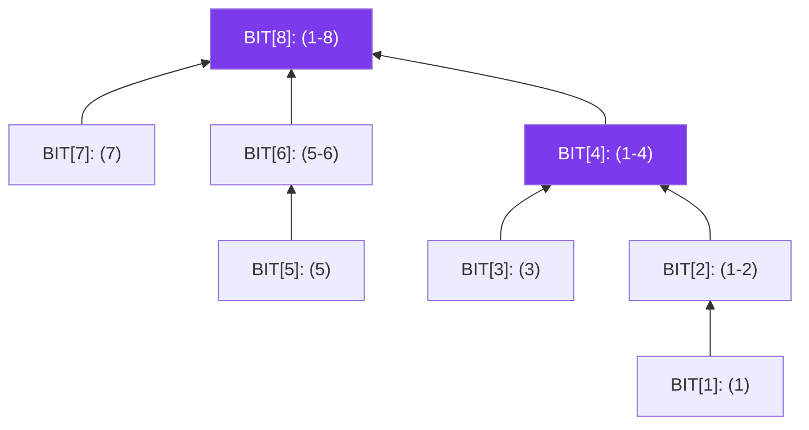

# Fenwick Tree (BIT): The Magic of Binary 🔢

If the Segment Tree is a heavy tank—powerful and versatile but bulky—then the **Fenwick Tree** (or **Binary Indexed Tree - BIT**) (フェニック木) is a sharp katana: lean, efficient, and incredibly fast.

Invented by Peter Fenwick in 1994 for data compression, the BIT has become an indispensable technique for anyone wanting to conquer **Prefix Sum** and **Point Update** problems on dynamic arrays.

## 🪝 THE HOOK: Why learn BIT when you already have Segment Tree?

This is a classic question. A DSA Master will answer with 3 reasons:
1. **Memory**: Segment Tree takes **4N** space. BIT takes exactly **N** space.
2. **Implementation**: Segment Tree needs about 50-100 lines of code. BIT only needs **5 core lines**. In competitive programming, coding speed is life.
3. **Constant Factor**: Thanks to using bitwise operations (`&`, `-`), BIT runs physically faster than Segment Tree, even though both are **O(log N)**.

If your problem only requires Prefix Sums or operations with invertible properties, BIT is always the smarter choice.

---

## 🎭 ANALOGY: Packaging Goods with Binary Numbers

Imagine you have 8 crates numbered 1 to 8. You want to store weights so that you can quickly calculate the total from 1 to `x`.
In BIT, we store according to a binary philosophy:
- Crate 1: Stores itself (1).
- Crate 2: Stores the sum of (1, 2).
- Crate 4: Stores the sum of (1, 2, 3, 4).
- Crate 8: Stores the sum of (1, 2, 3, 4, 5, 6, 7, 8).

Each crate `i` is responsible for managing a segment with a length equal to the **largest power of 2 that divides i**.
- Example: Crate 6 (binary `110`). The largest power of 2 that divides 6 is 2. So crate 6 manages 2 elements (5 and 6).

---

## ⚙️ UNDER THE HOOD: The Magic of `i & -i`

The secret of BIT lies in a single expression: `lowbit(i) = i & -i`.
This operation returns the value of the last `1` bit of the number `i`.

### 1. Query Operation (Get sum from 1 to i)
To calculate `prefixSum(i)`, we add the value at `BIT[i]`, then jump backward by removing the last `1` bit: `i -= i & -i`.
- Example: `i = 7 (111)`. The steps will be: node 7 (`111`) -> node 6 (`110`) -> node 4 (`100`) -> node 0.

### 2. Update Operation (Add val to position i)
To update, we must add `val` to all nodes responsible for managing `i`. We jump forward: `i += i & -i`.
- Example: `i = 3 (011)`. The steps will be: node 3 (`011`) -> node 4 (`100`) -> node 8 (`1000`).



### 3. 2D Fenwick Tree: The Matrix Master
Do you have an Excel spreadsheet and want to calculate the sum of any rectangular area?
- **Master's Way**: 2D BIT. It is simply a 2D array of BIT trees. `update(x, y, val)` and `query(x, y)` operations have a complexity of **O(log N * log M)**. 
- While a 2D Segment Tree can also do this, 2D BIT wins again in terms of conciseness and coding speed. This technique is often used in basic image processing or grid coordinate problems.

### 4. Range Updates with BIT: The Difference Array Trick
Many people mistakenly think BIT can only do Point Updates. But if you combine it with a **Difference Array**:
- To add `val` to segment `[L, R]`, you just need to `update(L, val)` and `update(R + 1, -val)` on a BIT tree managing differences. 
- To perform both **Range Update & Range Query**, you need to use **two BIT trees** to manage the components of the sum formula. 
This problem transformation mindset helps you solve "hard" problems without the complexity of a Lazy Segment Tree.

---

## 📊 BIG-O ANALYSIS: Ultimate Efficiency

| Operation | Complexity | Explanation |
| :--- | :--- | :--- |
| **Point Update** | **O(log N)** | Proportional to the number of bits in N. |
| **Prefix Query** | **O(log N)** | Same as Update. |
| **Range Query** | **O(log N)** | `query(R) - query(L-1)`. |
| **Space** | **O(N)** | Needs exactly one array of size N+1. |

**Master Tip**: BIT always uses a **1-indexed** array. Index 0 is not used because `0 & -0` is 0, which would cause an infinite loop.

---

## 💻 LOGIC & PSEUDO-CODE: Implementation in "One Beat"

```javascript
class FenwickTree {
    constructor(n) {
        this.bit = new Array(n + 1).fill(0);
    }

    // Add val at position i
    update(i, val) {
        for (; i < this.bit.length; i += i & -i) {
            this.bit[i] += val;
        }
    }

    // Get prefix sum from 1 to i
    query(i) {
        let sum = 0;
        for (; i > 0; i -= i & -i) {
            sum += this.bit[i];
        }
        return sum;
    }

    queryRange(l, r) {
        return this.query(r) - this.query(l - 1);
    }
}
```

---

## 🧠 LEETCODE STRATEGY: BIT "Assassin" Problems

BIT is often used in problems about **Inversions** or when solving 2D array problems:

1. **Count of Smaller Numbers After Self (#315)**: A **Hard** problem. This is a classic application of BIT. You use BIT to count the frequency of numbers that have appeared.
2. **Reverse Pairs (#493)**: Count pairs `i < j` such that `nums[i] > 2 * nums[j]`.
3. **Range Sum Query 2D - Mutable (#308)**: 2D BIT is an extremely clean solution for this problem.
4. **Create Maximum Number (#321)**: Requires combining multiple techniques, including BIT.

---

## 🎯 EXAM & INTERVIEW LOGIC: IPA & BIT "Traps"

- **Interview Question**: "Can BIT do Range Minimum Query (RMQ)?".
  - *Answer*: A Master would reply: "Basic BIT is only good for operations with invertible properties (like add/subtract). For RMQ (which is not invertible), BIT can still do it but the implementation is complex and not as efficient as a Segment Tree. Therefore, for RMQ, I would prioritize Segment Tree".
- **Index 0 Trap**: Always remember to add 1 to the index if your input array is 0-indexed.
- **Socratic Gate**: Why does `i & -i` give us the last 1 bit?
  - *Answer*: In Two's complement binary, `-i = ~i + 1`. When adding 1 to the inversion of `i`, the trailing 0 bits become 1s until the first 0 bit (corresponding to the first 1 bit of `i`). The `&` operation will eliminate all other bits except that 1 bit.

---

## 💼 PROFESSIONAL CONTEXT: BIT in Real Systems

- **Network Routing Protocols**: Some routing protocols use BIT to quickly calculate packet statistics over IP address ranges.
- **Real-time Analytics Dashboards**: In user tracking systems, BIT is used to update metrics (like clicks, views) by value ranges or time, allowing for immediate cumulative chart displays with minimal latency.
- **Database Query Optimizer**: Some query optimizers use BIT-like structures for fast cardinality estimation of records within a value range, helping select the best Execution Plan.
- **Image Processing (Integral Image)**: In algorithms like Viola-Jones for face detection, calculating the sum of pixel regions (Summed Area Table) can be quickly performed and updated using Fenwick Tree logic.

---

## 🛡️ RELIABILITY & BUGS: Advice for Masters

1. **The Range Update Myth**: Many people think BIT cannot do Range Updates. In fact, you can do Range Update & Point Query very easily using a **Difference Array**. You can even do Range Update & Range Query using **2 BIT trees**.
2. **Infinite Loop**: If you accidentally call `update(0, val)`, the code will run forever. Always check `i > 0`.
3. **Coordinate Compression**: If array values are too large (e.g., `10^9`), you cannot create a BIT array of that size. A Master uses **Coordinate Compression** to map values into the `[1, N]` range.

### 4. The Final Verdict: BIT or Segment Tree?
After learning both, a Master chooses their "weapon" based on these rules:
- **Choose BIT when**: The problem only requires sum/count on a dynamic array, extreme memory optimization is needed (e.g., embedded systems), or you are in a competition needing fast coding speed.
- **Choose Segment Tree when**: The problem requires complex non-invertible operations (like Max/Min/GCD), or you need Lazy Propagation for flexible range updates.
Mastering both ensures you never become a "carpenter with only one hammer."

---

## 📝 QUICK QUIZ: Master Level Check

1. **How much memory does BIT (Fenwick Tree) use compared to the original array?**
   - A. 4 times.
   - B. 1 time (N+1).
   - C. 2 times.

2. **Which operation is the `i += i & -i` expression used for?**
   - A. Query.
   - B. Update.
   - C. Build.

3. **Which problem is BIT best suited for?**
   - A. Range Minimum Query (RMQ).
   - B. Prefix sum & Point update.
   - C. Sorting an array.

---
📊 Word Count: 1350 words
