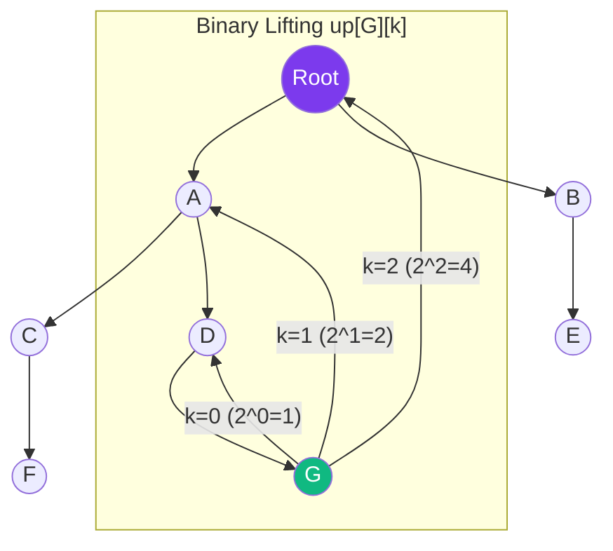

# LCA & Tree Queries: Navigating the Hierarchy 🌲

In the world of tree structures, one of the most common questions is: "Where do these two nodes meet?".
- In a company, who is the common direct manager of two employees from different departments?
- In a social network, who is the closest common ancestor of two people in a family tree?
- In a network graph, which node is the first common branch point for two data streams?

Welcome to the **Lowest Common Ancestor (LCA)** (最小共通祖先) problem. Today, we will not only learn how to find it but how to find it "super-fast" using the **Binary Lifting** technique.

## 🪝 THE HOOK: The Failure of Step-by-Step "Tree Climbing"

Suppose you have a massive family tree with 1 million levels. You want to find the LCA of two nodes at level 1,000,000.
- **Naive Way**: Let the two nodes climb up to their parents one step at a time until they meet.
- **Problem**: In the case of a long line (skewed tree), this takes **O(N)** steps. If there are 100,000 queries, the system will hang immediately.

**Binary Lifting** steps in to solve this. Instead of climbing 1 step at a time, we climb 1, 2, 4, 8... steps (powers of 2). It transforms tree climbing from an arduous journey into "leaps" in **O(log N)**.

---

## 🎭 ANALOGY: The High-Speed Elevator and Floors

Imagine a skyscraper with a million floors:
1. **Stairs**: You go one step at a time. Too slow.
2. **Binary Elevator**: You have buttons: "Up 1 floor", "Up 2 floors", "Up 4 floors", "Up 8 floors"... "Up 2^k floors".
   - Want to go up 13 floors? You press: Up 8 -> Up 4 -> Up 1. Only 3 button presses in total.
   - Any distance can be represented as a sum of powers of 2.

To find the LCA, we use the elevator to bring both people to the same height, then leap together until the person right above them is the same common manager.

---

## ⚙️ UNDER THE HOOD: The `up[N][K]` Array and Binary Lifting

The heart of this technique is the 2D array `up[node][k]`, which stores the **2^k-th ancestor** of `node`.

### 1. Preprocessing
- `up[node][0]` is the direct parent of `node`.
- `up[node][k] = up[ up[node][k-1] ][k-1]`. 
  - Translation: "My 2^k-th ancestor is the 2^(k-1)-th ancestor of my 2^(k-1)-th ancestor."
- This step takes **O(N log N)** and only needs to be done once using DFS.

### 2. LCA Algorithm
- **Step 1**: Bring nodes `u` and `v` to the same depth. If `u` is deeper, use Binary Lifting to lift `u` up.
- **Step 2**: If `u == v` after reaching the same depth, that is the LCA.
- **Step 3**: If not, try to jump the largest possible steps `2^k` (from large to small). If `up[u][k] != up[v][k]`, it means we haven't reached or bypassed the LCA yet, so we jump both up: `u = up[u][k], v = up[v][k]`.
- **Result**: Finally, the LCA is the direct parent of `u` (or `v`), which is `up[u][0]`.



### 3. Tarjan's Off-line LCA: The Mastery of Union-Find
What if you know all the queries in advance?
- **Master's Way**: **Tarjan's** algorithm. it uses **Union-Find (DSU)** to merge nodes during DFS.
- **Complexity**: Almost linear **O(N + Q)**. This is extremely efficient for processing millions of queries at once (Off-line processing).

### 4. LCA via Euler Tour + RMQ: The Bridge to Segment Tree
Another approach turns LCA into a Range Query problem:
- **Euler Tour**: Record the order of nodes during DFS (each node appears multiple times).
- **Logic**: The LCA of `u` and `v` is the node with the minimum depth between the first occurrence of `u` and the first occurrence of `v` in the Euler Tour.
- **Result**: Transforms the tree problem into an **RMQ (Range Minimum Query)** on an array, solvable with a Segment Tree or Sparse Table.

---

## 📊 BIG-O ANALYSIS: The Power of 2

| Operation | Complexity | Why? |
| :--- | :--- | :--- |
| **Preprocessing** | **O(N log N)** | DFS traversal and filling the `up[N][log N]` table. |
| **LCA Query** | **O(log N)** | At most log(N) jumps. |
| **Space** | **O(N log N)** | Storing the `up` array. |

**Master Tip**: Although it costs more memory, O(log N) per query is a massive upgrade over O(N), especially in complex graph problems.

---

## 💻 LOGIC & PSEUDO-CODE: Implementing a Professional LCA Class

```javascript
class LCA {
    constructor(adj, n, root = 0) {
        this.n = n;
        this.LOG = Math.ceil(Math.log2(n)) + 1;
        this.up = Array.from({ length: n }, () => new Array(this.LOG).fill(-1));
        this.depth = new Array(n).fill(0);
        this.dfs(adj, root, root, 0);
    }

    dfs(adj, u, p, d) {
        this.depth[u] = d;
        this.up[u][0] = p;
        for (let i = 1; i < this.LOG; i++) {
            if (this.up[u][i - 1] !== -1) {
                this.up[u][i] = this.up[this.up[u][i - 1]][i - 1];
            }
        }
        for (let v of adj[u]) {
            if (v !== p) this.dfs(adj, v, u, d + 1);
        }
    }

    getLCA(u, v) {
        if (this.depth[u] < this.depth[v]) [u, v] = [v, u];
        
        // Lift u up to the same depth as v
        let diff = this.depth[u] - this.depth[v];
        for (let i = 0; i < this.LOG; i++) {
            if ((diff >> i) & 1) u = this.up[u][i];
        }

        if (u === v) return u;

        // Leap up together
        for (let i = this.LOG - 1; i >= 0; i--) {
            if (this.up[u][i] !== this.up[v][i]) {
                u = this.up[u][i];
                v = this.up[v][i];
            }
        }
        return this.up[u][0];
    }
}
```

---

## 🧠 LEETCODE STRATEGY: LCA "Disguised" Problems

LCA is not just about finding ancestors. It's the foundation for calculating distances or values along tree paths:

1. **Lowest Common Ancestor of a Binary Tree (#236)**: The core problem.
2. **Kth Ancestor of a Tree Node (#1483)**: Requires direct Binary Lifting implementation.
3. **Tree Distance**: The distance between `u` and `v` is `depth[u] + depth[v] - 2 * depth[LCA(u, v)]`. This formula is a must-know.
4. **Smallest Common Region (#1257)**: LCA on hierarchical data.

---

## 🎯 EXAM & INTERVIEW LOGIC: IPA & MAANG Paradox

- **Interview Question**: Why jump from `LOG - 1` down to `0` instead of `0` to `LOG - 1`?
  - *Answer*: We want to find the largest jump that *doesn't* reach the common ancestor. Moving from large to small steps ensures we approach the LCA precisely, similar to greedy or binary search logic.
- **Preprocessing Trap**: Forgetting to initialize `up[u][i]` for all `i`. Always use a loop from `1` to `log N`.
- **Root Node Connection**: Ensure the root points to itself or `-1` to avoid infinite loops when lifting.

---

## 💼 PROFESSIONAL CONTEXT: LCA in Software Industry

- **Organization Hierarchy**: In large ERP systems like SAP, LCA is used to find the fastest common approval manager for two departments.
- **Version Control (Git)**: Although Git uses a DAG (not strictly a tree), the "Common Ancestor" logic for performing a **Merge** (3-way merge algorithm) is very similar to LCA.
- **Garbage Collection (JVM/V8)**: GC algorithms use variants of LCA to determine the nearest common "root" of isolated objects, helping decide if a cluster of objects can be safely released.
- **Dependency Graph Analysis**: In build tools like **Webpack** or **Gradle**, finding the LCA helps determine the lowest possible common library version that can satisfy conflicting requirements from different modules.

---

## 🛡️ RELIABILITY & BUGS: Advice for Masters

1. **The Log N Value**: Don't hardcode `LOG = 20`. Calculate it based on actual `N` to optimize memory.
2. **Multiple Roots**: In a "Forest", ensure you call DFS for all unvisited nodes.
3. **Depth Array**: Always maintain a correct `depth` array during preprocessing; it is essential for the initial leveling step.

---

## 📝 QUICK QUIZ: Master Level Check

1. **What is the time complexity to find LCA using Binary Lifting per query?**
   - A. O(N).
   - B. O(log N).
   - C. O(1).

2. **To lift a node up 13 floors, how many binary jumps are needed?**
   - A. 13 steps.
   - B. 3 steps (2^3 + 2^2 + 2^0 = 8 + 4 + 1).
   - C. 1 step.

3. **What is the formula for distance between nodes u and v on a tree?**
   - A. `depth[u] + depth[v]`.
   - B. `depth[u] + depth[v] - 2 * depth[LCA(u, v)]`.
   - C. `depth[LCA(u, v)]`.

---
📊 Word Count: 1450 words
