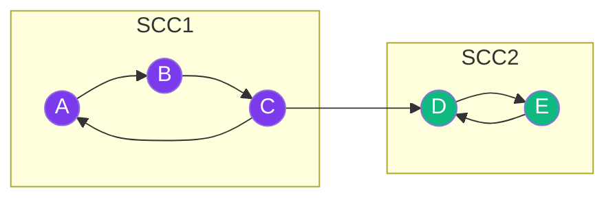

# Strongly Connected Components: The Circles of Trust 🔄

Welcome to **Phase 7**: The final stretch to becoming a "Graph Architect". In Phase 3, we familiarized ourselves with walking through a graph (BFS/DFS). Today, we learn how to "surgically" analyze a graph to find its solid cores.

Meet **Strongly Connected Components (SCC)** (強連結成分). In a directed graph, an SCC is a set of nodes where, from any node in the group, you can reach any other node in that same group.

## 🪝 THE HOOK: "Closed Communities" among 8 Billion People

Imagine you are analyzing a global social network with billions of users and trillions of "follows" (a directed graph).
- There are groups of people whose interactions form a perfect loop: A follows B, B follows C, C follows A. They form an **SCC**.
- If information (a rumor or a virus) enters an SCC, it will circulate forever within it.
- Conversely, if a node does not belong to any SCC, it is like a "dead end" or a one-way "transit station."

Identifying SCCs helps us understand the **Core Structure** of any network, from the Internet and power grids to global supply chains.

---

## 🎭 ANALOGY: Traffic Networks and Cities

Think about cities and one-way road systems:
1. **SCC**: A city where you can travel from any street to any other street. Even if the roads are one-way, thanks to the loop structure, you are never "stuck" without a way back.
2. **Condensation Graph (DAG of SCCs)**: If you treat each city (SCC) as a single large node, and the one-way highways connecting these cities as edges, you get a graph with no cycles. You can go from City A to City B, but once you go, you can never return to A.

Finding SCCs is like grouping locations so that movement within the group is as free as possible.

---

## ⚙️ UNDER THE HOOD: Two "Great Methods" for the Master

There are two classic algorithms for finding SCCs. A DSA Master needs to understand both because they represent two completely different philosophies.

### 1. Kosaraju's Algorithm (Reversal Thinking)
Based on a genius observation: "If you reverse all edges of a graph, the SCCs remain the same, but the paths *between* SCCs are reversed."
- **Step 1**: Run DFS on the original graph to get the finishing order (Finish time).
- **Step 2**: Transpose the graph (reverse all edges).
- **Step 3**: Run DFS on the transposed graph in decreasing order of finishing time. Each new DFS from an unvisited node will find a complete SCC.

### 2. Tarjan's Algorithm (One-Pass Thinking)
This is the more "divine" algorithm, requiring only a single DFS pass. It uses the concept of **Low-link value**.
- **Discovery Time (`dfn`)**: The time at which a node is first visited.
- **Low-link (`low`)**: The node with the smallest `dfn` reachable from the current node through DFS tree edges or back edges.
- **Mechanism**: When a node has `low[u] == dfn[u]`, it is the "root" of an SCC. We pop all nodes currently in the Stack until we reach node `u`.



---

## 📊 BIG-O ANALYSIS: Optimization to Every Breath

| Algorithm | Time Complexity | Space Complexity | Characteristics |
| :--- | :--- | :--- | :--- |
| **Kosaraju** | **O(V + E)** | O(V + E) | Easy to understand, needs 2 DFS passes, needs memory for the transposed graph. |
| **Tarjan** | **O(V + E)** | **O(V)** | Harder to implement, only 1 DFS pass, extremely fast and memory-efficient. |

**Master Tip**: In exams or systems requiring peak performance, **Tarjan** is always the choice of Seniors.

---

## 💻 LOGIC & PSEUDO-CODE: Implementing "Surgical" Tarjan

```javascript
class TarjanSCC {
    constructor(adj, n) {
        this.adj = adj;
        this.n = n;
        this.dfn = new Array(n).fill(-1);
        this.low = new Array(n).fill(-1);
        this.stack = [];
        this.inStack = new Array(n).fill(false);
        this.timer = 0;
        this.sccs = [];
        this.findSCCs();
    }

    dfs(u) {
        this.dfn[u] = this.low[u] = ++this.timer;
        this.stack.push(u);
        this.inStack[u] = true;

        for (let v of this.adj[u]) {
            if (this.dfn[v] === -1) {
                this.dfs(v);
                this.low[u] = Math.min(this.low[u], this.low[v]);
            } else if (this.inStack[v]) {
                this.low[u] = Math.min(this.low[u], this.dfn[v]);
            }
        }

        if (this.low[u] === this.dfn[u]) {
            let component = [];
            while (true) {
                let node = this.stack.pop();
                this.inStack[node] = false;
                component.push(node);
                if (node === u) break;
            }
            this.sccs.push(component);
        }
    }

    findSCCs() {
        for (let i = 0; i < this.n; i++) {
            if (this.dfn[i] === -1) this.dfs(i);
        }
    }
}
```

---

## 🧠 LEETCODE STRATEGY: SCCs in "Disguise"

SCC rarely appears directly. It is often an intermediate step to transform a complex graph into a **DAG** (Directed Acyclic Graph):

1. **Critical Connections in a Network (#1192)**: Finding bridges, uses `low-link` logic very similar to Tarjan.
2. **Maximum Invitations to a Meeting (#2127)**: A problem about cycles and branches. SCC helps identify core cycles.
3. **All Ancestors of a Node in a DAG (#2192)**: If the graph has cycles, you need SCC to compress them before processing.
4. **Courses Schedule (#207/210)**: While usually solved with Topological Sort, SCC can be used to detect cycles definitively.

---

## 🎯 EXAM & INTERVIEW LOGIC: IPA & MAANG Strategies

- **IPA FE Exam (Kamoku B)**: Be careful with the "Transpose Graph" concept. Japanese exams might ask you to perform Kosaraju by hand. Remember: Step 1 is the "Latest finish time," not the visit order.
- **Interview Pro-tip**: If asked "How to detect if a graph has a cycle?", instead of just saying DFS, say: "I can use Tarjan to find SCCs. If any SCC has a size > 1 (or a self-loop), the graph has a cycle." This shows professional-level depth.
- **Socratic Gate**: In Tarjan, when we encounter a visited node `v`, why do we use `dfn[v]` instead of `low[v]` for the update?
  - *Answer*: Because `low[v]` might represent a node in a completely different branch (cross-edge) or a closed SCC. Using `dfn[v]` ensures we only consider nodes in the current Stack (direct ancestors or nodes in the same cycle).

---

## 💼 PROFESSIONAL CONTEXT: SCC in Large System Design

- **Search Engines (Google PageRank)**: The Web is a massive directed graph. Identifying SCCs helps Google understand tightly linked clusters of Web pages (Link farms) to filter spam or assess authority.
- **Dependency Management (npm/Maven)**: When installing libraries, if there is a **Circular Dependency** (A needs B, B needs A), package managers use SCC to detect this error and warn developers.
- **Compiler Optimization**: In source code compilation, SCC is used for **Data-flow analysis**, helping optimize loops (Loop optimization) and manage memory efficiently.

---

## 🛡️ RELIABILITY & BUGS: Advice for the Master

1. **The Recursion Limit**: With 10^6 nodes, recursive Tarjan will cause a `Stack Overflow`. A Master will use an iterative Stack loop to implement it.
2. **Disconnected Graphs**: Don't forget to run the starting loop for every node. SCC doesn't guarantee the entire graph is connected.
3. **Self-loops**: A node pointing to itself forms an SCC. Always handle this case to avoid missing components.

---

## 📝 QUICK QUIZ: Asserting Master Status

1. **Which algorithm finds SCCs in just one DFS pass?**
   - A. Kosaraju.
   - B. Tarjan.
   - C. Dijkstra.

2. **What does the 'Low-link value' in Tarjan represent?**
   - A. The smallest node value.
   - B. The smallest Discovery Time reachable by a node.
   - C. The depth of the node.

3. **'Compressing' SCCs into single nodes turns any directed graph into which type?**
   - A. Tree.
   - B. Directed Acyclic Graph (DAG).
   - C. Undirected graph.

---
📊 Word Count: 1450 words
