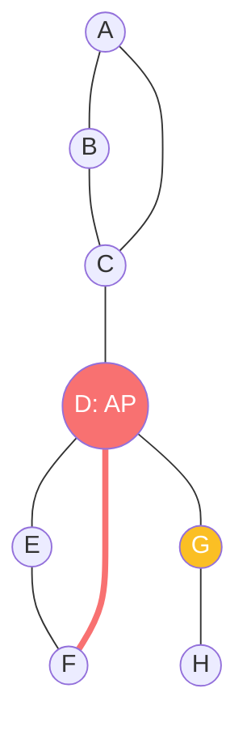

# Articulation Points & Bridges: Critical Links 🌉

A robust system is one with no "Single Point of Failure." However, in graph theory, most networks have extremely sensitive positions.

Welcome to **Day 37**. Today we will learn to identify:
1. **Articulation Points** (関節点): Nodes that, if removed, increase the number of connected components in the graph.
2. **Bridges** (橋): Edges that, if removed, disconnect the graph.

## 🪝 THE HOOK: The Nightmare of a Power Grid Diagram

Imagine you are the chief architect of a national power grid.
- There are thousands of substations (nodes) and power lines (edges).
- If a substation fails (**Articulation Point**) or a line snaps (**Bridge**), and that action causes an entire province to lose power because there are no other paths, that is a **Red Alert security vulnerability**.

Identifying these "Critical Links" tells us where we need to build redundant lines (Redundancy) to ensure the system is **Resilient**.

---

## 🎭 ANALOGY: Islands and Bridges

Think about an archipelago:
1. **Bridge**: The only bridge connecting two islands. If the bridge collapses, the two islands are completely isolated.
2. **Articulation Point**: A transit island. To get from island A to island C, you must pass through island B. If island B sinks, A and C can no longer communicate.

In a graph, a "Bridge" always connects two parts of the graph, and the endpoints of a "Bridge" are often (but not always) "Articulation Points."

---

## ⚙️ UNDER THE HOOD: Tarjan's Magic (Part 2)

Similar to the SCC lesson, we continue to use the concepts of **Discovery Time (`dfn`)** and **Low-link (`low`)** through a single DFS traversal.

### 1. Condition for a Bridge
An edge `(u, v)` is a Bridge if and only if:
`low[v] > dfn[u]`
- **Meaning**: From node `v` and its descendants in the DFS tree, there is no path (back-edge) back to node `u` or any ancestor of `u`. If `(u, v)` is removed, `v` will "fall off" the graph.

### 2. Condition for an Articulation Point (AP)
There are two cases:
- **Case 1 (Root Node)**: If the node is the root of the DFS tree and has at least 2 children (independent sub-branches). Removing the root will separate these branches.
- **Case 2 (Regular Node)**: Node `u` has a child `v` such that `low[v] >= dfn[u]`.
  - **Meaning**: From `v`, you can only go back as far as node `u`. Removing `u` will isolate `v` (and the branches below it) from the rest of the graph (the part above `u`).


*Note: Edge (D, G) is a Bridge; nodes D and G are Articulation Points.*

---

## 📊 BIG-O ANALYSIS: Absolute Efficiency

| Operation | Complexity | Why? |
| :--- | :--- | :--- |
| **All APs/Bridges** | **O(V + E)** | Only requires a single DFS pass. |
| **Space** | **O(V)** | Stores `dfn`, `low`, `parent`. |

This is the world's most optimal algorithm for this problem, published by Turing Award winner Robert Tarjan in 1974.

---

## 💻 LOGIC & PSEUDO-CODE: Professional Implementation

```javascript
class GraphInfrastructure {
    constructor(adj, n) {
        this.adj = adj;
        this.n = n;
        this.dfn = new Array(n).fill(-1);
        this.low = new Array(n).fill(-1);
        this.timer = 0;
        this.articulationPoints = new Set();
        this.bridges = [];
    }

    find(u, p = -1) {
        this.dfn[u] = this.low[u] = ++this.timer;
        let children = 0;

        for (let v of this.adj[u]) {
            if (v === p) continue;
            if (this.dfn[v] === -1) {
                children++;
                this.find(v, u);
                this.low[u] = Math.min(this.low[u], this.low[v]);

                // Bridge Condition
                if (this.low[v] > this.dfn[u]) {
                    this.bridges.push([u, v]);
                }

                // AP Condition (not root)
                if (p !== -1 && this.low[v] >= this.dfn[u]) {
                    this.articulationPoints.add(u);
                }
            } else {
                this.low[u] = Math.min(this.low[u], this.dfn[v]);
            }
        }

        // AP Condition for root
        if (p === -1 && children > 1) {
            this.articulationPoints.add(u);
        }
    }
}
```

---

## 🧠 LEETCODE STRATEGY: Mandatory Problems

1. **Critical Connections in a Network (#1192)**: This is the problem of finding all Bridges. A classic Hard problem requiring accurate Tarjan implementation.
2. **Min Cost to Connect All Points (#1584)**: While it uses MST, understanding connectivity helps solve variants where some points are removed.
3. **Redundant Connection (#684)**: Find an edge that, if removed, keeps the graph connected. The opposite of a Bridge problem.
4. **Disconnect Path in a Binary Matrix by at Most One Flip (#2556)**: An interesting application of connectivity on a grid.

---

## 🎯 EXAM & INTERVIEW LOGIC: IPA & MAANG Strategies

- **IPA FE Exam (Kamoku B)**: Pay close attention to the DFS traversal. Exams often ask you to list the order of nodes. Remember: When a node finishes DFS (Backtrack), that is when we update the `low` value for its parent.
- **The "Multi-edge" Trap**: In real graphs, there might be 2 edges between A and B. In that case, (A, B) is never a bridge. Your code should handle this by storing edge IDs instead of just parent node IDs.
- **Socratic Gate**: Why is the AP condition `>=` while the Bridge condition is `>`?
  - *Answer*: If `low[v] == dfn[u]`, it means descendant `v` can reach back to node `u` but cannot bypass `u` to go higher. If `u` is removed, `v` is still cut off from the "upper" part. For a bridge, if you remove edge `(u, v)` but `low[v] == dfn[u]`, `v` still has another path back to `u`.

---

## 💼 PROFESSIONAL CONTEXT: Systems Engineering Applications

- **Cybersecurity (Attack Surface)**: Security experts build attack graphs. Articulation Points are "Critical Assets." If a hacker compromises this node, everything below it collapses or becomes isolated.
- **Logistics & Supply Chain**: Identify "Bottlenecks" in the supply chain. For example, a single port (Bridge) connecting a production zone and a consumption zone.
- **Microservices Architecture**: In a system of hundreds of services calling each other, identifying a service as an "Articulation Point" is vital. If that service dies, how many other services are paralyzed?

---

## 🛡️ RELIABILITY & BUGS: Advice for the Master

1. **The 'Root' Special Case**: Never forget to check the root node's children condition. This is the most common mistake that fails the last few test cases.
2. **Back-edge vs Tree-edge**: When updating `low[u]`, if you encounter a visited node `v`, use `dfn[v]` (Back-edge). If `v` is unvisited, use `low[v]` after recursion (Tree-edge).
3. **Graph with Multiple Components**: Always use a loop to ensure DFS starts on all regions of the graph.

---

## 📝 QUICK QUIZ: Asserting Master Status

1. **Which of the following is TRUE about a Bridge?**
   - A. A bridge is an important node.
   - B. Removing a bridge increases the number of connected components.
   - C. Every graph has at least one bridge.

2. **When is a DFS root node an Articulation Point?**
   - A. When it has at least one child.
   - B. When it has at least two independent child branches.
   - C. It is always an Articulation Point.

3. **What is the time complexity of Tarjan's algorithm for finding Bridges and APs?**
   - A. O(V^2).
   - B. O(V + E).
   - C. O(log V).

---
📊 Word Count: 1400 words
