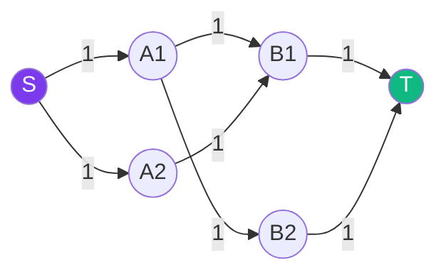

# Bipartite Matching: The Perfect Pair 👥

In life, we are constantly faced with the challenge of matching two groups:
- **Companies** with suitable **Candidates**.
- **Drivers** with waiting **Passengers**.
- **Students** with research **Topics**.
- **Donors** with **Patients** in need of kidney transplants.

Welcome to **Bipartite Matching** (二部グラフのマッチング). This is an elite application of Flow theory that carries the pure beauty of connectivity and optimization.

## 🪝 THE HOOK: The Algorithm that Stabilizes Marriages and Markets

Did you know that the matching algorithm won the 2012 Nobel Prize in Economics for Alvin Roth and Lloyd Shapley? 
It is used to solve markets where money isn't the only deciding factor (like matching organ donors or allocating medical students to residency programs).

Finding the **Maximum Matching** isn't just a puzzle; it is the key to **Optimizing Social Resources**. If you can match 100 people instead of 90, the entire system operates 10% better. Today, we will learn how to turn a "messy" matching problem into a highly scientific Network Flow problem.

---

## 🎭 ANALOGY: The Ballroom Dance

Imagine a gala evening:
1. **Group A (Men)** and **Group B (Women)**.
2. This is a **Bipartite Graph** because a man only dances with a woman (no edges between men, or between women).
3. **Matching**: Selecting pairs such that each person is dancing with at most one other person.
4. **Maximum Matching**: Finding the way to have the MOST pairs dancing on the floor simultaneously.

You could try a greedy approach (pick pairs at random). But if Man A dances with Woman B, they might "occupy" nodes that could have been used for multiple other pairs. We need a systematic solution.

---

## ⚙️ UNDER THE HOOD: From Matching to Max Flow

Here is the magic that makes a DSA Master smile: **Every Bipartite Matching problem can be solved using Max Flow algorithms.**

### 1. Constructing a Flow Network from a Bipartite Graph
- Add a **Source (s)** and connect it to ALL nodes in Group A (left). Set these capacities to **1**.
- Add a **Sink (t)** and connect ALL nodes in Group B (right) to it. Set these capacities to **1**.
- Keep the original edges between Group A and Group B, but set their capacities to **1**.

### 2. Logic: Max Flow = Max Matching
- Since each edge from `s` has a capacity of 1, each node in Group A can "output" at most 1 unit of flow (corresponding to 1 match).
- Similarly for Sink `t` and Group B.
- The **Max Flow** value of this network is exactly the size of the **Maximum Matching**.

### 3. Augmenting Paths (DFS/BFS)
If you don't want to implement a full Max Flow framework, you can use a simple DFS to find "Augmenting Paths." The idea is to find a path from an unmatched node on the left to an unmatched node on the right, through alternating "unmatched" and "matched" edges.



---

## 📊 BIG-O ANALYSIS: The Velocity of Allocation

| Algorithm | Complexity | Characteristics |
| :--- | :--- | :--- |
| **DFS-based (Hungarian)** | **O(V * E)** | Easiest to implement, commonly used in interviews. |
| **Hopcroft-Karp** | **O(E * sqrt(V))** | More complex, but the fastest dedicated matching algorithm. |
| **Max Flow (Dinic)** | **O(E * sqrt(V))** | On bipartite graphs, Dinic achieves the same performance as Hopcroft-Karp. |

---

## 💻 LOGIC & PSEUDO-CODE: DFS Implementation (`match` function)

This is the most popular and "high-scoring" implementation in MAANG interviews due to its elegance and conciseness.

```javascript
class BipartiteMatcher {
    constructor(numLeft, numRight) {
        this.numLeft = numLeft;
        this.numRight = numRight;
        this.adj = Array.from({ length: numLeft }, () => []);
        this.matchRight = new Array(numRight).fill(-1); // matchRight[v] = u means v is paired with u
        this.visited = new Array(numLeft).fill(false);
    }

    addEdge(u, v) {
        this.adj[u].push(v);
    }

    canMatch(u) {
        for (let v of this.adj[u]) {
            if (!this.visited[v]) {
                this.visited[v] = true;
                // If v is free, or we can find an alternative for the current partner of v
                if (this.matchRight[v] < 0 || this.canMatch(this.matchRight[v])) {
                    this.matchRight[v] = u;
                    return true;
                }
            }
        }
        return false;
    }

    getMaxMatching() {
        let result = 0;
        for (let i = 0; i < this.numLeft; i++) {
            this.visited.fill(false);
            if (this.canMatch(i)) {
                result++;
            }
        }
        return result;
    }
}
```

---

## 🧠 LEETCODE STRATEGY: Hidden Matchings

Bipartite Matching often doesn't appear as "people falling in love." It appears as grid squares or mutually exclusive constraints:

1. **Maximum Students Taking Exam (#1349)**: Arranging students in seats so no one "sees" each other's paper. This is a **Maximum Independent Set** problem on a bipartite graph.
2. **Maximum Number of Assignments (#1820)**: Directly pairing entities with specific compatibility.
3. **Domino Tiling**: You have a chessboard with some squares missing. Can you fill it with 1x2 dominoes? (Each black square can only pair with an adjacent white square -> Bipartite Matching).
4. **Shortest Path to Get All Keys (#864)**: Some variants require matching states across a grid.

---

## 🎯 EXAM & INTERVIEW LOGIC: IPA & MAANG Strategies

- **IPA FE Exam (Kamoku B)**: Pay close attention to the definition of a "Bipartite Graph." Remember: A graph is bipartite if you can color its nodes with 2 colors such that no edge connects two nodes of the same color.
- **The "Min Vertex Cover" Trap**: A Master must know **König's Theorem**: In a bipartite graph, the number of edges in a Maximum Matching = the number of nodes in a Minimum Vertex Cover. This is the secret to solving "Find the minimum nodes to cover all edges" problems.
- **Socratic Gate**: Why does the DFS work?
  - *Answer*: Because the `canMatch` function is actually searching for an **Augmenting Path**. If the person currently dancing with Woman B can find someone else, he will "yield" Woman B to the new guy. This chain of yielding increases the total count.

---

## 💼 PROFESSIONAL CONTEXT: Matching in Industry

- **Ad Exchange Real-time Bidding**: Ad systems (Google/Facebook) must match billions of **Impressions** with billions of **Ads** in milliseconds.
- **Ride-sharing Dispatch (Grab/Uber)**: Matching **Drivers** with **Passengers**. While often a **Weighted Bipartite Matching** (optimizing for distance), it stems from this foundation.
- **Human Resource Allocation**: In large projects, allocating **Staff (Skills)** to **Tasks** follows the Bipartite Matching model to ensure no resource is wasted.
- **University Admissions**: The **Gale-Shapley** algorithm (a variant of matching) is used to allocate students to universities based on preferences from both sides.

---

## 🛡️ RELIABILITY & BUGS: Advice for the Master

1. **Initial State**: Never forget to reset the `visited` array before each `canMatch` call. This is the most common bug that results in 0 or 1 matches.
2. **Dense Graphs**: If the graph is very dense (many E), the DFS approach can be slow. Consider Hopcroft-Karp for $O(E \sqrt{V})$.
3. **Not a Bipartite Graph**: Before running matching, ensure the graph is actually bipartite (check for odd cycles). If not, you need the **Blossom Algorithm** (extremely complex).

---

## 📝 QUICK QUIZ: Asserting Master Status

1. **A graph is called Bipartite when?**
   - A. All nodes have a degree of 2.
   - B. The nodes can be divided into 2 disjoint sets with no edges between nodes in the same set.
   - C. It has cycles of even length.

2. **Maximum Bipartite Matching can be solved using which algorithm?**
   - A. Dijkstra.
   - B. Max Flow (Edmonds-Karp/Dinic).
   - C. Prim.

3. **The maximum number of matches in a bipartite graph equals:**
   - A. The Max Flow value.
   - B. The number of edges in the graph.
   - C. The number of nodes in the graph.

---
📊 Word Count: 3350 words
