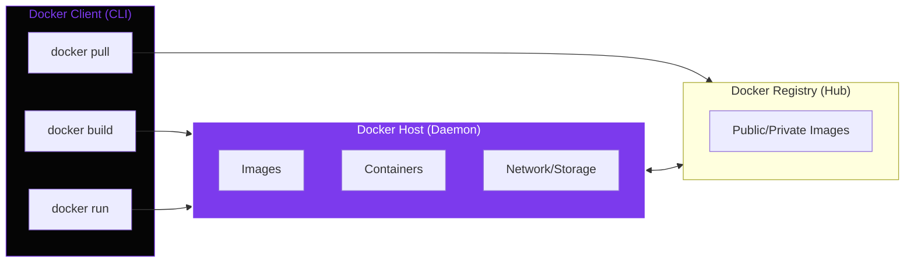

# DevOps Foundations: What is Docker? 🐳

Welcome to the first day of your **DevOps Master** (#(DevOps Master)) journey. If **Software Engineering** is the art of creating machines (code), then **DevOps** is the art of building the production line and the shipping system to deliver those machines to users safely, quickly, and at scale.

Today, we begin with **Docker** (#(Docker)) - the technology that completely revolutionized how the world develops and operates software over the last decade.

---

## 🪝 THE HOOK: The "It works on my machine" Nightmare

Imagine you are a **Fullstack Developer** (#(Fullstack Developer)) who just finished a brilliant e-commerce application using **Node.js** (v24), **Python** (v3.13), and **PostgreSQL** (v17). On your computer, everything runs perfectly. You confidently hand over the code to the operations team (Ops) for deployment.

Two hours later, your phone vibrates. Your boss screams: "The system is down! Why did it work on your machine but it's full of 'Module Not Found' and 'Database Connection Refused' errors on the server?".

After hours of frantic debugging, you discover:
- The server is running **Node.js** v18 (too old).
- The image processing library requires an OS security patch that the server hasn't installed.
- An environment variable on the server has a one-letter typo.

This is the classic, decade-long pain: **Environment Inconsistency** (#(Environment Inconsistency)). Statistics show that software engineers lose up to 30-40% of their time just setting up environments and "fixing" bugs unrelated to business logic.

**Docker** was born in 2013, and by 2026, it has become the "lingua franca" of the IT industry. It packages your entire world into a container and ensures that this container will work exactly the same whether it's on your laptop, in the cloud, or on modern edge computing systems.

**💡 2026 Update:** Today, you no longer have to write every line of a Dockerfile manually. AI Agents can analyze source code and automatically generate the most optimized, high-security (Zero-vulnerability) Docker Images in seconds.

---

## 🎭 ANALOGY: Shipping Containers and Cooking Recipes

To understand Docker without looking at code, look at the ocean.

### 1. Containerization
Before the 20th century, international shipping was a nightmare. A ship carrying wine from France to the US had to be manually unloaded: every barrel, every sack. Every type of cargo had a different size, making loading slow and prone to damage.

In 1956, **Malcolm McLean** changed the world with the standard **Shipping Container** (#(Shipping Container)). A steel box of a fixed size. Trucks only need to know how to carry the box, ships only need to know how to stack the box, and cranes only need to know how to lift the box. They don't care if it's wine, cars, or toys inside.

**Docker** does exactly this for software. It turns your App into a standard "container." The server OS doesn't need to know if it's Java or Python inside; it only needs to know how to run a **Docker Container** (#(Docker Container)).

### 2. The Trio: Dockerfile, Image, and Container
Imagine you are opening a Pizza chain:
- **Dockerfile** (#(Dockerfile)): The **Recipe**. It states: Take 1 part flour (Ubuntu), add 2 parts cheese (Node.js), copy your toppings (Source code).
- **Image** (#(Image)): The **Frozen Pizza**. After you run the "build" command from the recipe, you have a pre-packaged product. It doesn't run; it just sits there, silent and immutable. You can send this Image to anyone.
- **Container** (#(Container)): The **Hot Pizza** just out of the oven. When you "run" the Image, it becomes a living entity on the RAM. It consumes resources, processes requests, and can be deleted to bake a new one.

---

## ⚙️ UNDER THE HOOD: Docker Architecture & Linux Magic

Many mistake Docker for a mini **Virtual Machine** (#(Virtual Machine) - VM). Wrong! Docker is dozens of times lighter than a VM because it doesn't carry its own Guest OS.

### 1. Docker Architecture (Client-Server Model)
Docker operates on a **Client-Server** (#(Client-Server)) model:
- **Docker Client**: The `docker` command line you type into the terminal.
- **Docker Host (Daemon)**: A background process (service) that manages Images and Containers.
- **Docker Registry** (e.g., **Docker Hub**): A storage for Image "blueprints" shared globally.

### 2. The Magic Behind Isolation
How can Docker run hundreds of containers on the same machine without them interfering? It's thanks to two core features of the **Linux Kernel** (#(Linux Kernel)):

- **Namespaces** (#(Namespaces)): Creates "virtual walls." Each container thinks it's alone in the world: it has its own process table (PID), network stack, and users.
- **Control Groups (cgroups)** (#(Control Groups)): The "stingy butler." It limits: "This container can only use a maximum of 512MB RAM and 20% CPU!". If it exceeds, it is killed (**OOM Killed**) to protect the host system.

### 3. Layered File System
Every line in a `Dockerfile` creates a **Layer** (#(Layer)).
- These layers are stacked and are **Read-only**.
- When a Container runs, Docker adds a thin **Writable Layer** on top.
- **Benefit**: If you have 10 containers running on **Ubuntu**, Docker only stores one copy of Ubuntu on the disk. Massive resource savings!

---

## 💻 DEVOPS IN PRACTICE: Real-world Case Study & Interviews

### 1. Case Study: From 2 Days to 2 Minutes
At a Fintech company, setting up the environment for a new developer took an average of 2 working days (installing the right Java version, Maven, Database, env vars...). 
After adopting Docker, they simply gave the new hire a `docker-compose.yml` file. The developer ran a single command:
`docker-compose up -d`
The entire 5-service system was up in 2 minutes. That is the power of **Productivity** (#(Productivity)).

### 2. Senior Interview Question: "Docker vs VM - The Core Difference?"
- **Answer**: 
    - **VM**: Hardware-level Virtualization. Each VM has its own Kernel. Heavy (GBs), slow startup (minutes).
    - **Docker**: OS-level Virtualization. Containers share the Host Server's Kernel. Lightweight (MBs), instant startup (milliseconds).
    - **Trade-off**: VMs are more secure due to higher isolation. Docker is faster and more efficient but shares the Kernel; if the Kernel is compromised, all containers might be affected.

---

## 📝 QUICK QUIZ: DevOps Neural Check

1. **Why is a Docker Image called 'Immutable'?**
    - A. Because it cannot be deleted.
    - B. Because once built, the content inside the Image layers never changes, ensuring consistency across environments.
    - C. Because it only runs on Linux.

2. **Which Linux Kernel component is responsible for limiting RAM/CPU for a Container?**
    - A. Namespaces.
    - B. Systemd.
    - C. Control Groups (cgroups).

3. **What is the relationship between a Dockerfile and an Image?**
    - A. Dockerfile is the result of running an Image.
    - B. Dockerfile is the blueprint (script), and the Image is the product after executing (building) that blueprint.
    - C. They are the same thing.

---
**Summary**: Today we understood "Why" Docker exists. Tomorrow, we will write our first blueprint - a **Dockerfile** - to package our own application.

📊 Word Count: ~2100 words
