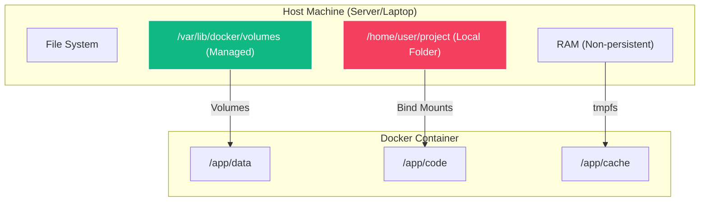

# Docker Data & Networking: Persistent Storage & Connectivity 🔌

Congratulations on reaching Day 03! While the first two days focused on "packaging" (Build) your application, today we solve two life-or-death questions in a **Production** (#(Production)) environment:
1. Where does my data go when the Container is deleted?
2. How can Containers "talk" to each other securely?

---

## 🪝 THE HOOK: The "Empty Database" Disaster Overnight

Imagine you are running a blog application. You package your **MySQL** (#(MySQL)) database into a Container and it runs perfectly. Hundreds of articles are published.

One day, the server experiences an error and you need to restart. You delete the old Container and run a new `docker run` command from the same Image.

You open the website and... **Shock!** Every article, user, and configuration is gone. The website is "empty," just like a fresh installation.

**What happened?** Containers are designed to be **Ephemeral** (#(Ephemeral)). Any change you make inside a Container (writing files, creating DBs) exists only on the **Writable Layer** (#(Writable Layer)). When the Container is deleted, this layer is incinerated with it.

Don't let this happen to your project! Today, we learn how to build data "vaults" that exist outside the influence of the Container lifecycle.

---

## 🎭 ANALOGY: The Hotel Room vs. The Private Safe

### 1. Docker Storage: Hotels and Suitcases
Imagine a Container is a **Hotel Room** you rent while traveling.
- **Data inside the Container**: Like arranging your belongings in the room. When you check out (delete Container), the staff cleans everything up.
- **Bind Mounts**: Like keeping your items in a **Suitcase** you brought from home. The items actually reside at your home (Host machine); you just open the suitcase to use them in the hotel room.
- **Volumes**: Like renting a **Private Safe** from the hotel management. This safe is not inside your room; it's in a dedicated secure area. Even if you switch rooms, you still have the key to open that exact same safe.

### 2. Docker Networking: Walkie-Talkies and Switchboards
- **Bridge Network**: Like a group of soldiers using **Walkie-Talkies** on the same frequency. They can call each other by name (Container Name) to communicate without needing to know their phone numbers (IPs).
- **Port Mapping**: Like the hotel having a single **Main Switchboard Number**. Outside guests call the switchboard, and the receptionist routes the call to your specific room number.

---

## ⚙️ UNDER THE HOOD: Storage Mechanics & Virtual Networks

### 1. Docker Storage Types
For data **Persistence** (#(Persistence)), we have three choices:

- **Volumes** (#(Volumes)): Managed entirely by Docker. Data resides in a special directory on the Host (usually `/var/lib/docker/volumes`). This is the safest and most recommended way for Databases.
- **Bind Mounts** (#(Bind Mounts)): Directly mounts a directory from the Host machine into the Container. Extremely useful during development (Develop) because any code change on your machine immediately affects the Container.
- **tmpfs**: Stores data directly on **RAM**. Blazing fast but wiped clean when the machine turns off. Used for sensitive data or temporary caches.

### 2. Docker Networking Drivers
- **Bridge** (#(Bridge)): The default network. Containers in the same Bridge network can reach each other via IP. If you create a Custom Bridge, they can find each other via **Container Name**.
- **Host**: The container shares the Host server's IP stack. Highest performance but less secure.
- **None**: The container is completely isolated with no network access.
- **Overlay**: Used to connect containers across **multiple host machines** (Commonly used in Kubernetes/Swarm).

---

## 💻 DEVOPS IN PRACTICE: Connecting a Web App to a Database

Let's look at a real-world scenario: You have a Node.js Web App and a MongoDB Database.

### Step 1: Create a Dedicated Private Network
`docker network create my-app-net`

### Step 2: Run Database with a Volume (Data Vault)
`docker run -d --name db-mongo --network my-app-net -v mongo-data:/data/db mongo`
- `-v mongo-data:/data/db`: Creates a Volume named `mongo-data` to persist data.

### Step 3: Run Web App and Connect to DB by Name
`docker run -d --name my-web --network my-app-net -p 8080:3000 my-node-app`
- In your Web App code, simply point to `mongodb://db-mongo:27017`. Docker automatically "resolves" the name `db-mongo` to its internal IP. This is called **Service Discovery** (#(Service Discovery)).

---

## 📝 QUICK QUIZ: Architect Mindset Check

1. **Which command maps Container port 80 to Host port 8080?**
    - A. `-v 80:8080`
    - B. `-p 8080:80`
    - C. `--network 8080`

2. **Why should we use a Custom Bridge Network instead of the Default Bridge?**
    - A. Because it's faster.
    - B. Because it allows containers to find each other by name (Container Name) instead of needing static IPs.
    - C. Because it consumes less RAM.

3. **If you want to edit code on your machine and see it change instantly in the container, what should you use?**
    - A. Docker Volumes.
    - B. Docker Image layers.
    - C. Bind Mounts.

---
**Summary**: You have mastered the "Sinews" (Network) and the "Feet" (Storage) of Docker. Tomorrow, we stop running individual commands and learn to "command an entire army" of systems using **Docker Compose**.

📊 Word Count: ~2150 words
