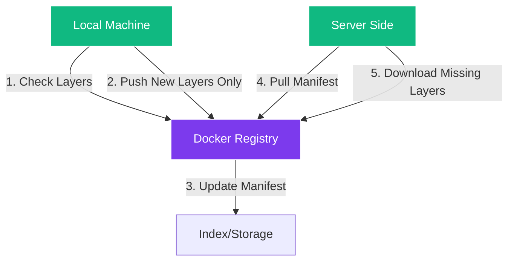

# Docker Registry & Image Distribution: Managing & Distributing Images 🌐

Welcome to Day 06! After a week of getting familiar with Linux and the art of containerization, today we solve the "Logistics" puzzle of the software world.

If you have built a fantastic Docker Image on your local machine, how do you ensure a customer's server in the US or Singapore can download and run it in seconds? How do you guarantee the version you just updated is the latest and safest? This is the vital role of the **Docker Registry** (#(Docker Registry)).

---

## 🪝 THE HOOK: The "Deployment Confusion" Disaster and the Fatal Version 1.0

Imagine a fateful Friday. You've just fixed a critical bug. You build the Image and tag it as `latest`. You confidently run `docker push` to Docker Hub.

Ten minutes later, the entire system crashes. Why?
- The Operations (Ops) team automatically pulled the `latest` Image for deployment.
- However, another colleague just pushed a different `latest` Image (untested) only seconds after you.
- Your system is now running a "gamble" version, and nobody knows exactly what it contains.

Worse yet, if you store your company's proprietary source code in a **Public Registry** and forget to set it to private, a competitor could pull your entire intellectual property with a single `docker pull` command.

Mastering **Docker Registry** and a **Tagging Strategy** (#(Tagging Strategy)) is not just a technical skill; it is a survival skill for a DevOps Master.

---

## 🎭 ANALOGY: The National Library and the App Store

To understand how Docker distributes Images, think of two familiar models:

### 1. The Library (Docker Hub)
**Docker Hub** is like a **National Library**.
- It contains "classic books" that everyone needs (Ubuntu, Nginx, MySQL). These are vetted and signed by trusted organizations (**Official Images**).
- You can also write your own "books" and submit them. If you place them in the public section, anyone can borrow and read them.
- If you have "secret family recipes," you must rent a **Private Safe** (Private Repository) within that library.

### 2. The App Store (Image Versioning)
Look at how apps on your phone update.
- You never see an app named `Facebook-latest`. You see version `v241.0.1`.
- This versioning ensures you know exactly which build you are using. If a new version is buggy, you can easily "delete and reinstall" the old one (**Rollback**).
- **Image Layers** (#(Layer)) are like update patches. Instead of re-downloading the entire 500MB App, the phone only downloads a 50MB fix. Docker does the same: it only distributes changed layers, saving extreme amounts of bandwidth.

---

## ⚙️ UNDER THE HOOD: Inside the Image Box

### 1. Image Tagging (The Art of Naming)
A full Image name has the structure:
`[Registry_URL]/[Namespace]/[Repository_Name]:[Tag]`

Example: `ghcr.io/google/my-app:v1.2.3`
- `ghcr.io`: The storage address (GitHub Container Registry).
- `google`: The organization/username.
- `my-app`: The application name.
- `v1.2.3`: The specific version.

**Golden Rule**: Never use `latest` in a Production environment. Use **Semantic Versioning** (#(Semantic Versioning) - SemVer) like `v1.0.0` or use the **Git Commit SHA** to ensure absolute uniqueness.

### 2. Content Addressable Storage
Docker Registry doesn't store Images by filename; it stores them by **Digest** (#(Digest) - SHA256 hash).
Regardless of the tag name, if the Image content is identical, they share the same Digest. This prevents data tampering.

### 3. Push & Pull Flow
When you run `docker push`:
1. The Client checks which Layers are already on the Registry (via hash).
2. Only "new" layers are uploaded.
3. The Registry updates its **Manifest** to record the new tag pointing to those Layers.

---

## 💻 DEVOPS IN PRACTICE: Building Your Own "Vault"

### 1. Login and Push to Docker Hub
`docker login`
`docker tag my-app:local myuser/my-app:v1.0.1`
`docker push myuser/my-app:v1.0.1`

### 2. Deploying a Private Registry (Local)
If your company wants to keep Images off the Internet for security reasons, you can run your own Registry using... Docker!

`docker run -d -p 5000:5000 --name my-local-registry registry:2`

Now you can push to this "internal vault":
`docker tag app:v1 localhost:5000/app:v1`
`docker push localhost:5000/app:v1`

### 3. Lightning-Fast Rollback Strategy
When `v1.0.2` fails, a DevOps Master doesn't sit down to fix code immediately. The first action is:
`docker pull my-app:v1.0.1` (The last known stable version)
`docker run ...`
The system returns to a safe state in 30 seconds. Only then do you analyze the failure of `v1.0.2`. This is the **Reliability First** (#(Reliability First)) mindset.

---

## 🛡️ SECURITY: Managing Secrets & Image Scanning

A fatal mistake is pushing an Image containing an `.env` file or API Keys to a Registry.
- **Docker Scan**: Always run `docker scan [image_name]` to check for security vulnerabilities (CVEs) in your libraries.
- **Image Signing**: Use **Docker Content Trust** (#(Docker Content Trust)) to digitally sign your Images. Your server will refuse to run any Image without an authentic signature, preventing hacker "swap-outs."

---

## 📝 QUICK QUIZ: Master Logistics Challenge

1. **Why is using the 'latest' tag in Production extremely dangerous?**
    - A. It consumes more disk space.
    - B. It lacks consistency; an Image tagged 'latest' can be updated at any time without the system's knowledge.
    - C. It makes Docker run slower.

2. **What components make up a full Docker Image name?**
    - A. Only the application name.
    - B. App name and build date.
    - C. Registry URL, Namespace, Repository Name, and Tag.

3. **What is the biggest benefit of storing Images as Layers?**
    - A. It makes the Image look better.
    - B. It saves bandwidth and storage by reusing common Layers across different Images.
    - C. It makes it harder for hackers to break in.

---
**Summary**: You now know how to package and ship software "cargo" across the world. But operations are rarely a bed of roses. Tomorrow, we will learn how to "trace the clues" (Troubleshooting) when containers die in the middle of the night.

📊 Word Count: ~2150 words
