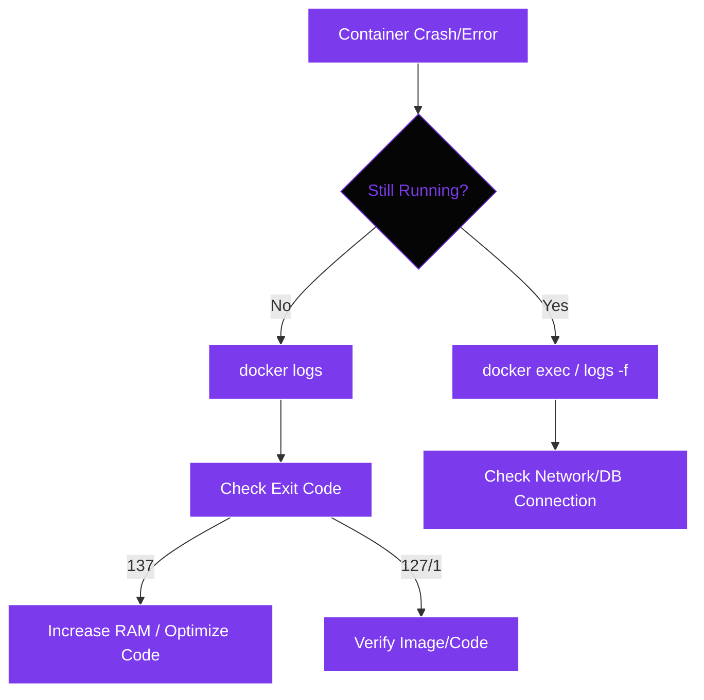

# Container Troubleshooting & Lifecycle: Real-World Debugging 🔍

Welcome to the halfway mark of Phase 1! Today is a "real combat" day in every sense of the word. In the world of DevOps, your job isn't just to build; it's to fix.

Thousands of containers are running in Production, and at any moment, one can "suddenly expire." Your mission is to play the role of a technical detective, following the trail (Logs) to find the root cause of the incident in the shortest time possible.

---

## 🪝 THE HOOK: The "CrashLoopBackOff" at Midnight

Imagine you are sleeping soundly when you receive a notification from the monitoring system: "The payment application just crashed!". You turn on your computer, check the status, and see the container in the **Exited** state. You try to restart it; it runs for 5 seconds and then... crashes again.

Restart, crash. Restart, crash. This phenomenon is called **CrashLoopBackOff** (#(CrashLoopBackOff)).
- No errors appear on your console.
- You can't SSH into the container because it won't "live" for more than 5 seconds.
- Your boss is asking: "When will the system be back up?".

If you don't know how to use Docker's diagnostic tools, you will fall into a desperate loop: Try - Fail - Retry - Fail Again. Today, we will learn how to "read the soul" of a container.

---

## 🎭 ANALOGY: The Family Doctor and the Flight Black Box

### 1. Container Lifecycle: From Birth to Dissolution
Think of a Container as a **Track Athlete**:
- **Created**: Standing at the starting line, ready but waiting for the command to run.
- **Running**: Sprinting at full speed on the track (RAM).
- **Paused**: Taking a quick break to drink water; all states are frozen in place.
- **Exited**: Completed the race (or injured halfway) and left the stadium.

### 2. Troubleshooting: The Flight Black Box (Logs)
When a plane crash occurs, the first thing investigators look for is the **Black Box**.
- **Docker Logs** is that black box. It records every breath and every cry for help from the application before it "dies."
- **Docker Inspect** is like an X-ray, showing you the internal structure, blood vessels (Network), and skeleton (Volumes) of the container.

---

## ⚙️ UNDER THE HOOD: Exit Codes & Diagnostic Tools

### 1. Decoding the Last Words (Exit Codes)
When a container crashes, it always leaves a mysterious number behind. This is its final "testament":
- **Exit Code 0**: Died of... old age (Task completed successfully).
- **Exit Code 1**: General error (App crashed due to code error).
- **Exit Code 137**: "Assassinated" by the Operating System (**SIGKILL**). Usually due to excessive RAM consumption (**OOM - Out of Memory**).
- **Exit Code 127**: "Command not found" error. You told it to run `python`, but Python is missing from the Image.

### 2. The Docker "Detective" Toolkit
To investigate, you must master these four commands:

- **docker logs -f [id]**: Follow logs in real-time. 99% of causes are found here (DB connection failure, syntax error, missing environment variables).
- **docker inspect [id]**: View the detailed JSON configuration. Helps check if the IP is correct and if Volumes are mounted in the right place.
- **docker stats**: View real-time resource consumption (CPU, RAM). Helps identify "greedy" containers.
- **docker exec -it [id] /bin/sh**: "Jump" inside a running container to check the file system. Note: Only works if the container is in the **Running** state.

### 3. Master Diagnostic Workflow

---

## 💻 DEVOPS IN PRACTICE: The Case of the "Disappearing Container"

Scenario: You run an Nginx container, but immediately after starting, it reports success and `Exits with 0`.
Command: `docker run -d nginx`
Result: The container is not running in the background.

**Master Analysis**: 
A Docker Container only lives as long as the primary process it manages (PID 1) is still running. By default, Nginx runs in "daemon" mode (background). When Nginx detaches to run in the background, Docker's main process ends, and the Container shuts down.
**Solution**: You must tell Nginx to run in the foreground:
`docker run -d nginx nginx -g 'daemon off;'`

This is the most common mistake for beginners: Not understanding **Foreground vs Background Processes** (#(Foreground vs Background Processes)).

---

## 🛡️ BEST PRACTICES: Surviving an Incident

1. **Health Checks**: Always define a health check command in the Dockerfile or Compose file. "Only consider it alive if it returns 200 OK."
2. **Restart Policies**: Use `--restart unless-stopped`. If the container crashes due to a transient error, Docker will automatically resurrect it.
3. **Log Rotation**: Don't let log files grow until they fill the disk. Configure the `json-file` driver with a size limit (e.g., 10MB).

---

## 📝 QUICK QUIZ: Diagnostic Engineer Challenge

1. **What does Exit Code 137 usually imply?**
    - A. The application has completed its task.
    - B. The container was forced to stop by the OS, usually due to RAM overload (OutOfMemory).
    - C. Incorrect Database password.

2. **Which command allows you to enter a running container to type commands?**
    - A. `docker inspect`
    - B. `docker exec -it`
    - C. `docker logs`

3. **What is the condition for a Container to remain in the 'Running' state?**
    - A. The server must have an Internet connection.
    - B. The main process (PID 1) inside the container must be active.
    - C. You must frequently click on the website.

---
**Summary**: You have mastered the skill of "diagnosing" containers. But fixing them one by one is exhausting. Tomorrow, we return to **Docker Compose**, but at a higher level: managing health, environment variables, and the automation of an entire large-scale system.

📊 Word Count: ~2200 words
