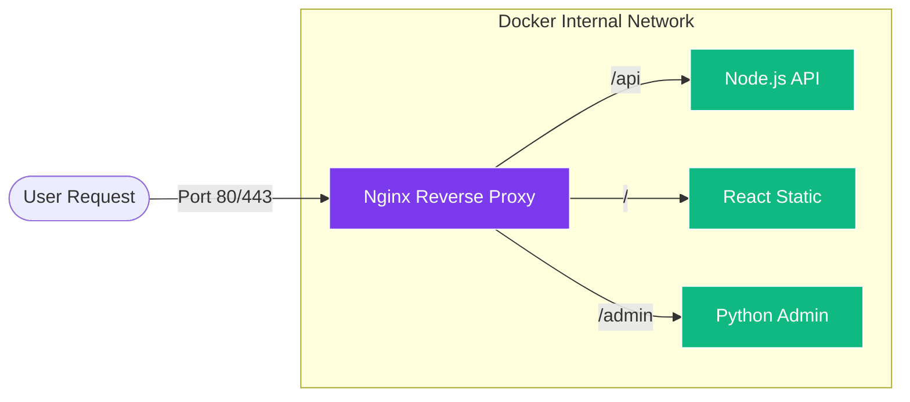

# Networking Deep Dive & Reverse Proxy: Traffic Orchestration 🌐

Welcome to Day 09! We already know how to connect containers within the same network. But the harsh reality of production is: your server usually has only one public IP address and typically only exposes 1-2 ports (like 80 for HTTP and 443 for HTTPS).

How do you simultaneously run App A, App B, and App C so that users only need to type `a.com`, `b.com`, or `c.com` to reach the correct destination? This is where we need a **Reverse Proxy** (#(Reverse Proxy)).

---

## 🪝 THE HOOK: The "Port Conflict" Disaster

Imagine you are deploying three different projects for clients on a single VPS.
- Project 1: Nginx running on port 80.
- Project 2: You also want to use Nginx on port 80.
- Project 3: Yet another web app needing port 80.

You run `docker run -p 80:80 ...` for the second project and immediately receive a "slap" from the Docker daemon:
`Error response from daemon: driver failed programming external connectivity on endpoint ... Bind for 0.0.0.0:80 failed: port is already allocated.`

You are faced with two choices:
1. Buy 3 more VPS instances (Expensive).
2. Run on non-standard ports like `8081`, `8082` (Extremely unprofessional; no user wants to type `domain.com:8081`).

A **DevOps Master** chooses neither. They deploy a single "Gatekeeper" at port 80 to orchestrate and route all incoming traffic.

---

## 🎭 ANALOGY: The Hotel Receptionist and the Delivery Company

### 1. Reverse Proxy: The Hotel Receptionist
Imagine your server is a **Hotel**.
- Customers (Users) only know the hotel's main address. They arrive at the **Reception Desk** (Reverse Proxy - Nginx).
- A customer says: "I want to meet the accounting department." The receptionist directs them to Room 201 (Backend Container).
- Another customer says: "I want to see the restaurant menu." The receptionist directs them to Room 105 (Frontend Container).
Customers never need to know the specific room numbers; they only interact with the Receptionist.

### 2. Docker DNS: Internal Names
In a large company, employees call each other by name ("John," "Sarah") rather than by their social security numbers (IPs).
**Docker DNS** allows Container A to call Container B using the service name you defined in your Compose file. Even if Container B crashes and restarts with a completely new IP, the name remains unchanged.

---

## ⚙️ UNDER THE HOOD: Drivers and Forwarding Mechanisms

### 1. Docker Network Drivers (Deep Dive)
- **Bridge**: Creates a virtual switch. Containers have their own IP range (usually `172.x.x.x`). This is the default home for most applications.
- **Host**: Removes all barriers. The container shares the IP and ports directly with the host server. Extremely fast but dangerously insecure (your app could potentially hijack the host server).
- **Overlay**: The "magic" that connects containers across different physical servers (e.g., connecting Google Cloud to AWS).

### 2. Reverse Proxy vs. Forward Proxy
- **Forward Proxy**: Helps you "climb over the firewall" to access the Internet (hides the user's identity).
- **Reverse Proxy**: Stands in front of the Server to welcome Clients (hides the server's internal structure).

### 3. Nginx - The King of Reverse Proxies
Nginx is incredibly powerful due to its **Event-driven architecture** (#(Event-driven)). It can handle tens of thousands of simultaneous connections while consuming minimal RAM.



---

## 💻 DEVOPS IN PRACTICE: Orchestrating Traffic with Nginx

Scenario: You have a Frontend app and a Backend app. You want to use Nginx to distribute traffic.

### 1. The `nginx.conf` Configuration File
```nginx
server {
    listen 80;
    server_name myapp.com;

    location / {
        proxy_pass http://frontend:3000; # Call the service name in Docker
    }

    location /api {
        proxy_pass http://backend:5000; # Route requests starting with /api
    }
}
```

### 2. The `docker-compose.yml` File Connecting Everything
```yaml
services:
  nginx:
    image: nginx:alpine
    volumes:
      - ./nginx.conf:/etc/nginx/conf.d/default.conf:ro
    ports:
      - "80:80"
    depends_on:
      - frontend
      - backend

  frontend:
    build: ./client
    # No need to expose ports to the outside

  backend:
    build: ./server
    # No need to expose ports (absolute security)
```

**Benefits**: Your Backend is now entirely within the internal network. A hacker cannot attack port 5000 of your Backend directly because it isn't open to the Internet. All traffic must pass through the Nginx filter.

---

## 🛡️ ADVANCED: Load Balancing and SSL

- **Load Balancing**: If your app is overloaded, you can run 3 Backend instances. Nginx will automatically distribute requests among them using **Round Robin**.
- **SSL Termination**: Nginx handles HTTPS decryption (port 443). The internal services can run simple HTTP to save resources. This is called **SSL Offloading** (#(Offloading)).

---

## 📝 QUICK QUIZ: Network Engineer Challenge

1. **Why should we place a Backend behind a Reverse Proxy instead of exposing its port directly?**
    - A. To make the app run faster.
    - B. To enhance security (internal systems are hidden) and easily manage SSL certificates and Load Balancing at a single entry point.
    - C. Because Docker forces you to.

2. **If Container A wants to send a request to Container B in the same Docker Network, which address should it use?**
    - A. The server's public IP address.
    - B. The Service Name defined in the configuration file.
    - C. `localhost`.

3. **Which Nginx feature allows it to handle many simultaneous requests with minimal resources?**
    - A. Multi-threading.
    - B. Event-driven architecture.
    - C. Machine Learning.

---
**Summary**: You now know how to build a complex and professional networking system. Tomorrow, the final day of Phase 1, we will study **Docker Security** - how to protect your hard work from attacks and the most common "silly" mistakes.

📊 Word Count: ~2250 words
