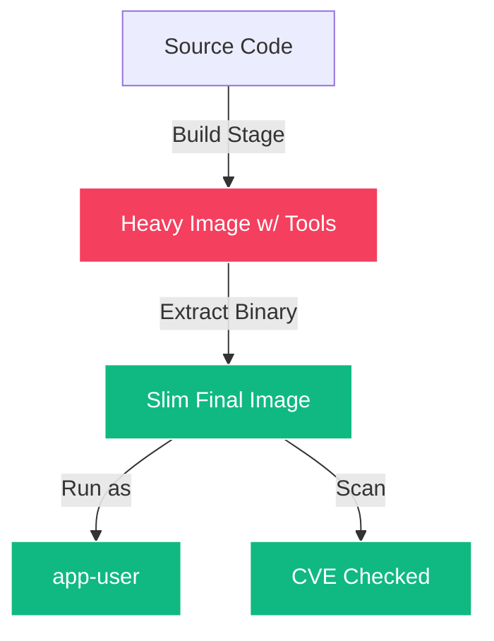

# Docker Security & Best Practices: Security from the Ground Up 🛡️

Welcome to the final lesson of **Phase 1: Foundations & Containers**! You have learned how to build, operate, and orchestrate. But all those efforts will go down the drain if your system is breached by hackers or collapses due to naive configuration errors.

Today, we delve into **Docker Security** (#(Docker Security)). Security in DevOps isn't about adding a "lock" at the end of a project; it's about building a "safety instinct" from the very first line of code.

---

## 🪝 THE HOOK: "Container Escape" and the Root Privilege Disaster

Imagine you are running a simple web application using Docker. You haven't configured a user, so Docker defaults to running your app with **root** (#(root)) privileges.

A hacker finds a vulnerability in your code (e.g., a **Remote Code Execution** flaw). Because the app is running as root, the hacker has full authority within the container. More seriously, if you have misconfigured the environment (e.g., mistakenly mounting the Docker socket file into the container), the hacker can perform a **Container Escape** (#(Container Escape)), seizing control of your entire physical host server.

Within minutes:
- Your entire Database is wiped clean.
- Company API Keys are stolen.
- Your server is transformed into a crypto-mining machine for the hacker.

All of this happened because you were "too lazy" to configure a simple User name. Today, we put an end to that naivety!

---

## 🎭 ANALOGY: The Fortress and the F1 Race Car

### 1. Zero Trust: The Impenetrable Fortress
Don't view a Container as a steel wall. View it as a **Fortress** where anyone inside could potentially be a traitor.
- **Least Privilege** (#(Least Privilege)): Only give soldiers the weapons they absolutely need. The chef doesn't need the keys to the armory. (The App doesn't need Root privileges).
- **Hardening**: Plug every hole and remove every unnecessary path. If the app only runs a Web service, don't install Bash or SSH libraries into the Image.

### 2. Best Practices: The F1 Race Car
An F1 car runs extremely fast because it eliminates everything non-essential.
- **Slim Image**: A 1GB Image is like a truck full of junk—hard to control and full of hiding spots for viruses. A 50MB Image is like an F1 car—only engine and wheels—extremely safe and high-speed.

---

## ⚙️ UNDER THE HOOD: 10 Golden Rules of a DevOps Master

### 1. Always Use a Non-root User
Docker defaults to Root, but your application (Node, Python, Go) almost never needs this level of authority.
**Master Technique**: Always create a standard user in your Dockerfile.
```dockerfile
RUN addgroup -S appgroup && adduser -S appuser -G appgroup
USER appuser
```

### 2. Vulnerability Scanning
The IT world changes every hour. A library that is safe today might be found vulnerable tomorrow. Use the command:
`docker scan my-app:v1.0`
It will list all vulnerabilities along with their severity levels (High, Medium, Low).

### 3. Never Store Secrets in the Image
Images can be "reverse engineered."
- **Wrong**: `ENV DB_PASSWORD=123456`
- **Right**: Use environment variables passed at runtime or use a Secret Provider like AWS Secrets Manager or HashiCorp Vault.

### 4. Use .dockerignore (The Junk Filter)
Don't send `node_modules`, `.git`, or personal documents to the Docker Daemon. It slows down the build process and leaks sensitive information.

### 5. Multi-stage Build (Revisited)
The ultimate secret to reducing the **Attack Surface**. You build the app in stage 1 and only copy the resulting binary/files to stage 2 (Alpine/Distroless Image). Your final Image won't have compilers or source code; even if a hacker gets in, they won't have the tools to do damage.



---

## 💻 DEVOPS IN PRACTICE: The "Inviolable" Dockerfile

Let's synthesize everything we've learned into a gold-standard Dockerfile:

```dockerfile
# --- STAGE 1: BUILD ---
FROM node:18-alpine AS builder
WORKDIR /app
COPY package*.json ./
RUN npm ci
COPY . .
RUN npm run build

# --- STAGE 2: PRODUCTION ---
FROM node:18-alpine
# Ensure security by not using root
RUN addgroup -S nodeapp && adduser -S nodeapp -G nodeapp
WORKDIR /app

# Copy production build from previous stage
COPY --from=builder /app/dist ./dist
COPY --from=builder /app/node_modules ./node_modules
COPY package.json .

# Limit privileges
USER nodeapp

# Internal Healthcheck
HEALTHCHECK --interval=30s --timeout=3s \
  CMD curl -f http://localhost:3000/health || exit 1

EXPOSE 3000
CMD ["node", "dist/main.js"]
```

---

## 📝 QUICK QUIZ: Phase 1 Final Exam

1. **Why should you not run an application in a Container with root privileges?**
    - A. Because root privileges make the container start slower.
    - B. To prevent the risk of a hacker seizing the physical host server if they successfully breach the app through a container vulnerability.
    - C. Because root privileges consume more RAM.

2. **Which command/file is used to exclude sensitive files from the Image build process?**
    - A. `docker rm`
    - B. .dockerignore
    - C. .gitignore

3. **What does the term 'Attack Surface' mean?**
    - A. The physical size of the hard drive.
    - B. The sum of all vulnerabilities, open ports, redundant libraries... that a hacker can exploit. The smaller the Image, the smaller the attack surface.
    - C. The antivirus software interface.

---
**Phase 1 Summary**: Congratulations! You are now officially a **Container Specialist**. You have mastered the foundations of Linux, Docker, Compose, and Security. This is your solid foundation.

Starting tomorrow, we move to **Phase 2: CI/CD & Automation** (#(Phase 2: CI/CD & Automation)). We will transform all these manual steps into a fully automated cycle. See you in the world of automation!

📊 Word Count: ~2300 words
