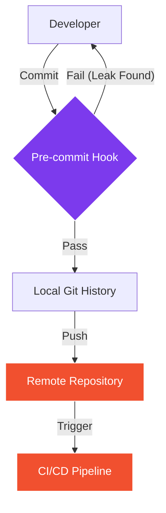

# Git for DevOps: More Than Just Code Storage 🔗

Welcome to **Phase 2: CI/CD & Automation**! In the first 10 days, you learned how to package and secure your "cargo" using Docker. Starting today, we begin building the **Automated Assembly Line** (#(Automated Assembly Line)). And the heart of that line is **Git** (#(Git)).

If you think Git is just a place to `commit` and `push` code, today will change your perspective. For a DevOps engineer, Git is the **Source of Truth** (#(Source of Truth)) and the sole trigger for the entire operational system.

---

## 🪝 THE HOOK: The "Merge Conflict" Disaster and Deployment Crash

Imagine a large project with 50 Developers working together.
- Dev A fixes a minor bug in the payment gateway.
- Dev B updates a security library.
- Both `push` to the `main` branch chaotically.

The CI/CD system automatically detects new code and starts building an Image, then deploys it to the Server.
BOOM! The entire website crashes.
- Why? Because Dev A and Dev B's code stepped on each other's toes, and no one controlled the merge process.
- More seriously, no one knows exactly whose version is running on the Server or which commit it belongs to, because the commit messages are just "Update," "Fix bug," "Final final final."

Without a standardized **Git Strategy** (#(Git Strategy)), Git becomes a massive junkyard, and your automation tools will merely be a way to "push trash to the server faster."

---

## 🎭 ANALOGY: Air Traffic Control and the Captain's Log

### 1. Git Strategy: Air Traffic Control (ATC)
Imagine the `main` branch is the only runway at an airport.
- If every plane (feature code) lands whenever it wants, disaster is guaranteed.
- DevOps creates **Landing Rules** (Branching Strategy). Planes must fly into a holding pattern (Feature Branch), undergo technical inspection (Pull Request & Code Review), and only when the control tower grants permission (Merge Approval) is it allowed to land on `main`.

### 2. Conventional Commits: The Captain's Voyage Log
- A bad captain records in the log: "Weather is nice today," "Something happened." When the ship sinks, no one understands what went wrong.
- A Master captain records: `feat(engine): upgrade to v2 engine`, `fix(radar): repair signal loss`.
Looking at this log, the automation system can automatically understand: "Ah, there's a new feature (feat), let's bump the application version!".

---

## ⚙️ UNDER THE HOOD: "Progressive" Git Thinking

### 1. Branching Strategies
There are two main schools of thought you must master:
- **Gitflow** (#(Gitflow)): Divided into several long-term branches (`develop`, `master`, `release`). Suitable for projects with slow, steady release cycles.
- **Trunk-based Development** (#(Trunk-based Development)): Everyone works on a single main branch. Small, fast, continuous. This is the "signature" of high-performing DevOps companies like Google and Netflix.

### 2. Conventional Commits (Standardized Commitments)
For machines to read and understand your commits, use this structure:
`<type>[optional scope]: <description>`
- `feat`: New feature.
- `fix`: Bug fix.
- `docs`: Documentation update.
- `chore`: Minor changes (updating libraries, config).

### 3. Git Hooks: The Security "Trap"
Git Hooks are scripts that run automatically when you perform a Git action.
- **pre-commit**: Before you commit, it automatically scans for syntax errors (Lint) or checks if you accidentally committed an API Key. If an error is found, it blocks the commit. Isn't that fantastic?



---

## 💻 DEVOPS IN PRACTICE: Automation with Git Hooks

Scenario: You want to ensure no one on the team can push code without running the Linting tool first.

### Step 1: Install Husky (Hook Management Tool)
In a Node.js project:
`npx husky-init && npm install`

### Step 2: Create a Pre-commit Script
Open the `.husky/pre-commit` file and write:
```bash
#!/bin/bash
npm run lint
npm test
```

Now, if your code has a lingering error, you will never be able to `git commit`. This is how DevOps protects code "purity" from the source.

### Interview Question: "Git Rebase vs. Git Merge - When to use which?"
- **Answer**:
    - **Merge**: Preserves history by creating a new merge commit. Good for maintaining a complex historical trail.
    - **Rebase**: "Refines" history, turning it into a single straight line. Good for cleaning up feature branches before merging into main to keep the history clean and readable.

---

## 🛡️ SECURITY: .gitignore and Git-crypt

- **.gitignore**: Always ignore `node_modules`, `.env`, `dist`, and temporary IDE files.
- **Secret**: If you must store secret files in Git (like server configurations), use **git-crypt** to encrypt them. Only those with the secret key can read them; on GitHub, they appear as a pile of junk characters.

---

## 📝 QUICK QUIZ: Testing the Git Master Mindset

1. **Why does a DevOps Master prefer Trunk-based Development?**
    - A. Because it's easier to implement than Gitflow.
    - B. Because it minimizes long-term merge conflicts and best supports Continuous Integration (CI).
    - C. Because it doesn't require the rebase command.

2. **Which of the following commits follows the Conventional Commits standard?**
    - A. `fix: repair crash when clicking payment button`
    - B. `Urgent fix`
    - C. `Update code for Boss`

3. **What is a 'pre-push' Git Hook typically used for?**
    - A. Automatically deleting old code.
    - B. Performing heavy tests (taking several minutes) before the code is actually pushed to the central Server.
    - C. To notify the Boss via Telegram.

---
**Summary**: You now know how to use Git professionally to protect your code. Tomorrow, we will study **CI/CD Philosophy**—the brain that controls the entire automated assembly line for which you just fired the first shot named "Git Commit."

📊 Word Count: ~2100 words
