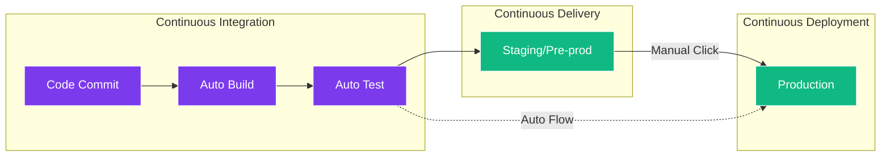

# CI/CD Philosophy: The Philosophy of Automation ⚙️

Welcome to Day 12! In the previous lesson, we used Git to safely "lock down" our source code. But code sitting in Git has no value for the customer yet. It needs to be tested, packaged, and delivered to a real production environment.

Today, we enter the world of **CI/CD** (#(CI/CD)). This is not merely about installing tools; it is about fundamentally changing how we think about software delivery.

---

## 🪝 THE HOOK: The "Integration Hell" Nightmare

Let's go back to the year 2000, before DevOps existed.
Imagine a team of 20 people coding for 3 months. Everyone keeps their code on their individual machines. At the end of the quarter, everyone begins submitting their code to be merged (**Integration**).

Thousands of conflicts arise.
- "Hey, why did you change the name of this function?"
- "I already installed the newer version of this library, why is it failing?"

Developers spend 2 additional weeks just sitting and fixing merge errors. After that, they spend another week waiting for the Testing team to perform manual checks. The result: The project is delayed, and team morale is exhausted. The technology world calls this phenomenon **Integration Hell**.

**CI/CD** was born to destroy this "hell." Instead of waiting 3 months, we integrate code... every hour.

---

## 🎭 ANALOGY: The Modern Automotive Assembly Line

To understand CI/CD, imagine a Tesla car production line:

### 1. CI (Continuous Integration): Automated Part Inspection
Every time a robotic arm finishes tightening a screw, a laser sensor immediately checks if the screw is tight (Unit Test). If an error is detected, the line stops right there, and a red alert is triggered. You never let a defective car proceed to the end of the line.

### 2. CD (Continuous Delivery): The Car is Ready in the Lot
At the end of the line, the car is driven to a parking lot, filled with gas, and polished to a shine. It is **Ready for Sale**. The manager only needs to press a "Ship" button, and the car is delivered. However, that button press still requires a human decision.

### 3. CD (Continuous Deployment): Direct Delivery to the Customer's Home
Immediately after leaving the assembly line, the car autonomously drives straight to the customer's front door. No human intervention or manual approval is required. This is the highest level of automation.

---

## ⚙️ UNDER THE HOOD: Decoding the 3 Powerful Letters

### 1. Continuous Integration (CI)
The process of automatically **Building** and **Testing** code every time someone pushes to Git.
- **Goal**: Detect errors as early as possible (**Fail Fast**).
- **Tasks**: Running Unit Tests, Security Linting, Image Vulnerability Scanning.

### 2. Continuous Delivery (CD)
Ensuring that code, after passing the CI stage, is always in a **Ready to Deploy** state for the Production environment at any time.
- **Goal**: Minimize release risk.
- **Difference**: Deployment to Production still requires a manual "button press" for approval.

### 3. Continuous Deployment (CD)
Every commit that passes all automated checks is pushed directly to the live environment for end-users.
- **Requirement**: Automated testing systems must be extremely reliable. If tests are poor, you will automatically push faulty code to millions of customers in just 5 minutes.

---

## 💻 DEVOPS IN PRACTICE: The Master's Workflow

A standard Pipeline consists of the following steps:

1. **Commit**: Developer pushes code to a Feature branch.
2. **Build**: The system (like GitHub Actions) pulls the code and installs dependencies.
3. **Test**: Runs the test suite. If a test fails -> Stop immediately and notify the Developer (just enough for them to fix it).
4. **Analysis**: Code quality checks (SonarQube) to ensure no "junk" code enters the system.
5. **Artifact**: Packages the code into a Docker Image and pushes it to a Registry (learned on Day 06).
6. **Deploy**: Updates the Server to run the new Image.

### The "Fail Fast" Mindset (#(Fail Fast)):
Don't fear errors. Be happy when the Pipeline reports an error at step 3. Because if it doesn't report it there, that error will reach the customer's wallet at step 6, and by then, the price you pay will be 100 times higher.

---

## 🛡️ BEST PRACTICES: Golden Rules of the Pipeline

- **Speed is Key**: A CI Pipeline should complete in under 5-10 minutes. If it takes longer, Developers will lose motivation.
- **Identical Environments**: Code running on a Dev machine, on CI, and on Production must reside within the same type of Docker Container.
- **Immutability** (#(Immutable)): Once an Image is packaged at step 5, it must never be modified again. If you want to change the code, create a new Image.

---

## 📝 QUICK QUIZ: DevOps Philosophy Challenge

1. **What is the main difference between Continuous Delivery and Continuous Deployment?**
    - A. Delivery is for mobile apps; Deployment is for web.
    - B. Delivery requires manual human approval before pushing to Production; Deployment is fully automated from start to finish.
    - C. Deployment is faster than Delivery.

2. **Why should we use Docker in a CI/CD Pipeline?**
    - A. Because Docker makes code lighter.
    - B. To ensure consistency: Code that runs correctly on CI is guaranteed to run correctly in other environments because the container environment remains unchanged.
    - C. Because the boss requested it.

3. **What does the term 'Artifact' refer to in CI/CD?**
    - A. The trash left behind after a build.
    - B. The final product (such as a .bin file, .jar, or Docker Image) that is ready to be deployed.
    - C. A piece of fine art.

---
**Summary**: You have grasped the soul of DevOps—the CI/CD philosophy. But "easier said than done." Tomorrow, we will start "breaking a sweat" with **GitHub Actions** to turn these philosophies into real automation code.

📊 Word Count: ~2150 words
