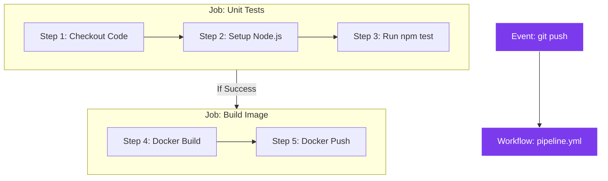

# GitHub Actions: Building Your First Assembly Line 🚀

Welcome to Day 13! Yesterday, we discussed the philosophy and mindset of CI/CD. Today, we begin to "make it real."

In the history of DevOps, we used to have to set up massive, complex Jenkins servers to achieve CI/CD. But since the birth of **GitHub Actions** (#(GitHub Actions)), automation has become as easy as writing a simple text file.

---

## 🪝 THE HOOK: The 24/7 "Robot" Sentry for Your Code

Imagine you have a virtual assistant. Every time you type `git push`, this assistant immediately:
1. Boots up a fresh, clean computer.
2. Downloads your code.
3. Installs everything required.
4. Runs the entire suite of Tests.
5. If it finds an error, it notifies you immediately.
6. If everything is "green" (Success), it packages the app and informs the stakeholders.

Most importantly: This assistant works for free (for personal projects), never sleeps, and is incredibly precise. This is **GitHub Actions**. If you aren't using it, you are manually performing boring, repetitive tasks that a robot should be doing for you.

---

## 🎭 ANALOGY: The Recipe and the Helper

To understand how GitHub Actions operates, think of a kitchen:

### 1. Workflow: The Recipe for a Dish
A YAML file is essentially a **Cooking Recipe** (#(Workflow)). It clearly states: "To cook Pho, you need to do Step 1, Step 2, Step 3...".

### 2. Events: The Alarm Bell
When does the Robot start cooking? These are the **Events** (#(Events)).
- "When a guest rings the bell" (When you `push` code).
- "At 8:00 AM every day" (A `schedule` trigger).

### 3. Runners: The Empty Kitchen
A **Runner** is the computer (usually Linux) that GitHub provides for you. It's like a brand-new, clean kitchen. You must provide the "pots and pans" (Node.js, Docker) so the robot can start working.

### 4. Actions: Pre-packaged Spice Packets
Instead of writing code from scratch to "Send an email," you can use a pre-existing **Action** from the Marketplace. It's like a ready-to-use spice packet: tear it open, pour it in, and you're done.

---

## ⚙️ UNDER THE HOOD: The Anatomy of an Automation File

A GitHub Actions Workflow is stored at a specific "secret" path: `.github/workflows/main.yml`.

### Core Components:
1. **name**: The robot's name (e.g., "CI Pipeline").
2. **on**: When should it run? (e.g., `push`, `pull_request`).
3. **jobs**: Large units of work. For example: Job 1 is Test, Job 2 is Build. Jobs can run in parallel to save time.
4. **steps**: Smaller tasks within a Job.
5. **uses**: Utilizing an Action built by others (saves effort).



---

## 💻 DEVOPS IN PRACTICE: Your First CI File

Scenario: You want to automatically run Unit Tests every time someone creates a Pull Request.

### File: `.github/workflows/test.yml`
```yaml
name: Node.js CI

on:
  pull_request:
    branches: [ main ] # Only run when targeting the main branch

jobs:
  test-and-lint:
    runs-on: ubuntu-latest # Use GitHub's latest Linux machine

    steps:
      - name: Checkout code
        uses: actions/checkout@v3 # Mandatory step for the robot to see your code

      - name: Setup Node.js
        uses: actions/setup-node@v3
        with:
          node-version: 18

      - name: Install dependencies
        run: npm ci # Clean installation of libraries

      - name: Run lint
        run: npm run lint

      - name: Run unit tests
        run: npm test
```

### Why use `npm ci` instead of `npm install`?
- **Answer**: `npm ci` (Clean Install) is faster and ensures that library versions match the `package-lock.json` file 100% exactly. In a CI environment, consistency is paramount.

---

## 🛡️ SECURITY: GitHub Secrets

The first law of DevOps: **NEVER** write passwords in your YAML files.
- Go to the **Settings > Secrets and variables** section of your GitHub repository.
- Save your password there (e.g., `DOCKER_PASSWORD`).
- In your YAML file, call it using the syntax: `${{ secrets.DOCKER_PASSWORD }}`.
GitHub will automatically mask this password in log outputs so no one can see it.

---

## 📝 QUICK QUIZ: Automation Engineer Challenge

1. **Which component decides when a Workflow begins running?**
    - A. jobs
    - B. on (Events)
    - C. steps

2. **Why should you split a Workflow into multiple small Jobs instead of putting everything in one?**
    - A. To make the YAML file look longer and more professional.
    - B. So that tasks can run in parallel, reducing the total wait time.
    - C. Because GitHub requires at least 2 jobs.

3. **What is the biggest benefit of using 'Actions' from the GitHub Marketplace?**
    - A. It makes code run faster.
    - B. Reusing common tasks (like checking out code or setting up environments) without writing complex scripts yourself.
    - C. To support the community.

---
**Summary**: You now know how to create a robot to guard your code repository. But the robot only knows how to "check"—it doesn't know how to "package" yet. Tomorrow, we will teach the robot how to automatically build high-quality Docker Images every time you commit.

📊 Word Count: ~2200 words
