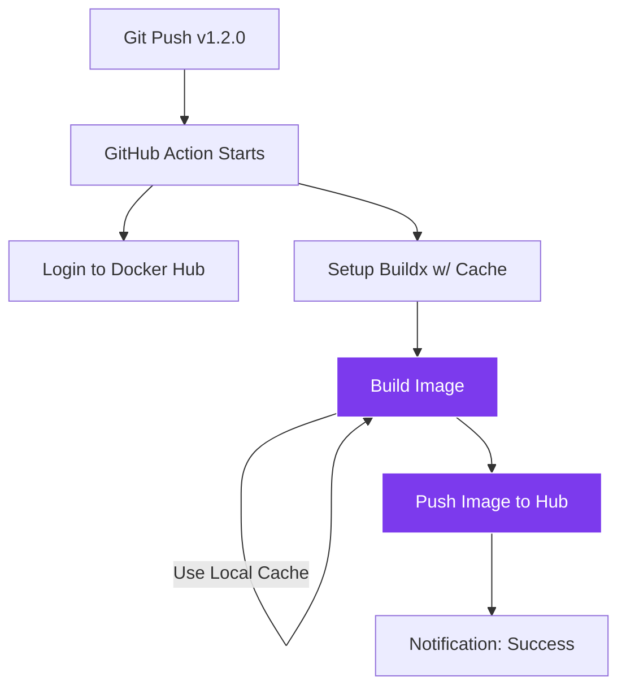

# Automated Building: Automating Image Packaging 🐳

Welcome to Day 14! We have learned how to use Docker (Phase 1) and GitHub Actions (Day 13). Today is the day we marry these two technologies together to create the **Heart of the CI system**.

In reality, you never want to manually type `docker build` or `docker push` on your local machine after every code change. It is time-consuming, bandwidth-heavy, and prone to error. We will entrust this entire process to "the cloud."

---

## 🪝 THE HOOK: "Snail-paced" Deployment and the Speed Solution

Most teams encounter a problem when starting with CI/CD: The Pipeline runs too slowly.
Every time a single line of CSS is modified, the robot takes 10 minutes to download all libraries again and rebuild the Image from scratch.
- Developers grow frustrated waiting for test results.
- The system bottlenecks as dozens of pipelines queue up.

Why is it so slow? Because you haven't used **Docker Cache** (#(Docker Cache)) in the CI environment yet. Today, we don't just learn "automation"; we learn how to make it run like the wind.

---

## 🎭 ANALOGY: The Automated Canning Factory

Imagine you have an automated canning factory:

### 1. Build-Push Flow: The Packaging Conveyor
As soon as a product (code) leaves the testing line, a conveyor automatically moves it into the canning machine (Docker Build), labels it (Tagging), and pushes it into the central warehouse (Docker Hub). The entire process requires zero human intervention.

### 2. Docker Cache on CI: The Smart Kitchen
Suppose you need to cook Pho.
- **The Old Way**: Every time a customer orders, you start soaking rice and simmering bones from scratch.
- **The Master Way (Cache)**: You keep a pot of pre-simmered broth (the old build). When a customer orders, you only need to blanch fresh noodles (the new code) and pour the broth over them. The completion time drops from 10 hours to 10 seconds.

---

## ⚙️ UNDER THE HOOD: Professional "Push-to-Build" Workflow

To automate Image building, we use a "secret" set of tools provided by Docker specifically for GitHub: **Buildx**.

### Technical Process:
1. **Setup Docker Buildx**: Creates a modern build engine that supports advanced caching.
2. **Login to Registry**: Uses Secrets to log in to Docker Hub or GitHub Registry securely.
3. **Build and Push**: Executes the build and pushes the Image to the registry in a single step.
4. **Caching**: Uses `cache-from` and `cache-to` features to store Image layers within GitHub's servers, making subsequent builds significantly faster.



---

## 💻 DEVOPS IN PRACTICE: Real-world Workflow File

Scenario: Every time you attach a Tag (e.g., `v1.0.0`) to your code, GitHub automatically builds the Image and pushes it to Docker Hub.

### File: `.github/workflows/docker-build.yml`
```yaml
name: Build and Push Docker Image

on:
  push:
    tags:
      - 'v*' # Runs when you push tags like v1.0, v2.1...

jobs:
  docker:
    runs-on: ubuntu-latest
    steps:
      - name: Checkout
        uses: actions/checkout@v3

      - name: Login to Docker Hub
        uses: docker/login-action@v2
        with:
          username: ${{ secrets.DOCKERHUB_USERNAME }}
          password: ${{ secrets.DOCKERHUB_TOKEN }}

      - name: Set up Docker Buildx
        uses: docker/setup-buildx-action@v2

      - name: Build and push
        uses: docker/build-push-action@v4
        with:
          context: .
          push: true
          tags: myuser/my-app:${{ github.ref_name }} # Automatically uses the git tag as the docker tag
          cache-from: type=gha # Retrieve cache from the GitHub Actions environment
          cache-to: type=gha,mode=max # Store maximum cache back to GitHub Actions
```

### Why use `DOCKERHUB_TOKEN` instead of a password?
- **Answer**: Passwords can change and are tied to individual accounts. **Access Tokens** are more secure, can be revoked at any time, and you can limit their permissions (e.g., allow Pushing but not Deleting). This is the security standard for a DevOps Master.

---

## 🛡️ OPTIMIZATION: Intelligent Tagging Strategy

Don't just tag everything as `latest`. Use GitHub's environment variables for smart tagging:
- **`sha-${{ github.sha }}`**: Tags the image with the code's commit hash. This is extremely safe because if the code changes, the tag changes.
- **`branch-name`**: Allows you to have separate Images for different branches (e.g., dev, staging).

---

## 📝 QUICK QUIZ: CI Engineer Challenge

1. **What is the biggest benefit of using Docker Buildx and GitHub Cache (type=gha)?**
    - A. It makes the Image smaller.
    - B. It minimizes build time by reusing as many Image layers as possible from previous builds.
    - C. It prevents code errors.

2. **Why should you configure Image building to trigger on 'Tag' push rather than every regular 'Push'?**
    - A. To save costs for GitHub.
    - B. Because tagging usually marks a finished version ready for release, avoiding "junk" images for every small change.
    - C. Because Docker doesn't support building by branch.

3. **What problem does the `${{ secrets.NAME }}` syntax solve?**
    - A. Increases pipeline speed.
    - B. Securely protects sensitive information (passwords, tokens) from being exposed in public source code.
    - C. So GitHub pays you.

---
**Summary**: You have built an automated "Packaging Factory." Your "goods" (Images) are now stored in the warehouse (Registry). Now, how do we deliver these goods to consumers in the most professional and secure way? Tomorrow, we will learn about **GitOps** and modern Deployment Strategies.

📊 Word Count: ~2200 words
