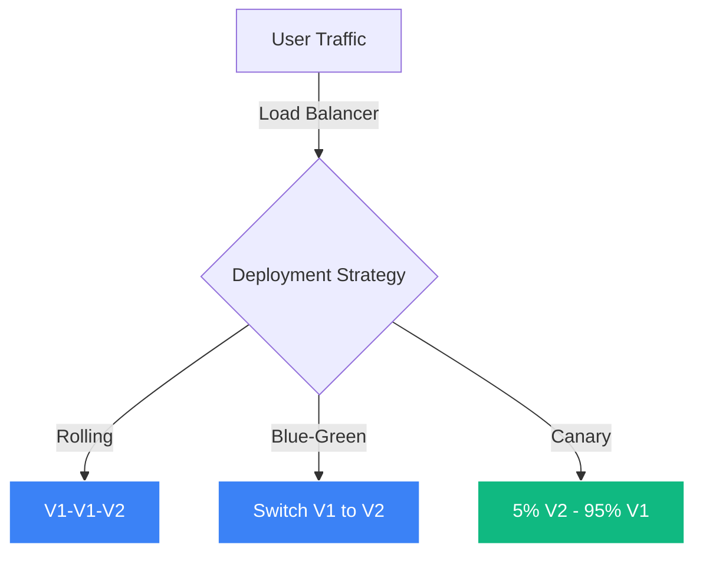

# GitOps & Deployment Strategies: Modern Deployment Strategies 🏗️

Welcome to Day 15! You have reached the 25% milestone on your journey to becoming a DevOps Master. We have our polished Docker Images and automated CI Pipelines. Now comes the final and arguably most "cool" step: **Deployment** (#(Deployment)).

How do we deliver new code to users without even a single second of interruption (**Zero Downtime**)? How do we ensure that if a new version has a bug, the system automatically reverts to the previous version as if nothing happened? The answer lies in **GitOps**.

---

## 🪝 THE HOOK: The "Accidental Touch" Error and GitOps Philosophy

Imagine you have 100 servers. One fine day, you decide to change the RAM configuration for the entire system.
- **Amateur**: You SSH into every single machine one by one to make the change. At the 87th machine, you accidentally type a command that wipes the hard drive.
- **Consequence**: You don't know exactly what you changed elsewhere, there is no history of modifications, and you cannot recover quickly.

**GitOps** (#(GitOps)) was born with a powerful manifesto: **"If it is not in Git, it does not exist on the Server."**
Every infrastructure change and every deployment must go through a `git commit`. Git is the single "Source of Truth." Want to change the RAM? Modify the config file in Git and push it. The robot handles the rest.

---

## 🎭 ANALOGY: The Conductor and the Digital Score

### 1. GitOps: The Score and the Orchestra
- **Git** is like a **Musical Score**. If you want the orchestra to play faster, you don't run down and slap each musician. You simply modify the score.
- **GitOps Controller** is like the **Conductor**. He constantly looks at the score (Git) and the orchestra (Servers). If he hears the orchestra playing the wrong note, he instructs them to adjust until they match the score exactly.

### 2. Blue-Green Deployment: Two Parallel Stages
Imagine you have two stages: **Blue** (Currently performing) and **Green** (Preparing).
- When a new show (new code) arrives, you set it up on the Green stage. The audience is still watching the Blue stage.
- Once the Green stage is ready and perfect, you simply order the security to open the doors to the Green stage and close the Blue one. The audience switches to the new version in the blink of an eye.

---

## ⚙️ UNDER THE HOOD: Classic Deployment Strategies

When you want to replace an old version (V1) with a new one (V2), there are three main methods:

### 1. Rolling Update
Replacing instances one by one.
- **Method**: Turn off one V1 instance, turn on one V2 instance. Repeat until all 10 instances are updated.
- **Pros**: Saves resources.
- **Cons**: During the update, both versions exist simultaneously, which can cause data logic issues.

### 2. Blue-Green Deployment
Running two complete systems in parallel.
- **Pros**: Instant rollback (just redirect traffic). Extremely safe.
- **Cons**: Costs double the resources (since two systems run simultaneously).

### 3. Canary Release
Named after the practice of miners taking canaries into mines to test for toxic gas.
- **Method**: Only 5% of users get the new version (V2), while the remaining 95% stay on the old version (V1).
- **Goal**: If that 5% of users don't encounter issues, you gradually increase to 10, 20... 100%. If there is a bug, only 5% are affected.

---

## 💻 DEVOPS IN PRACTICE: The "Infrastructure as Code" (IaC) Mindset

Instead of typing commands to create a server, we use code. Here is a simple example of GitOps with Docker Compose on a server:

1. **Server** installs a tool (like Portainer or a simple Cron Task).
2. **Task** runs every minute: `git pull origin main`.
3. If the `docker-compose.yml` file changes, it runs: `docker-compose up -d --remove-orphans`.

**Result**: You sit at home and type `git push` on your laptop. Five minutes later, the server in the US automatically updates to the latest version without you breaking a sweat. This is the beginning of **Deployment Automation**.

---

## 🛡️ SECURITY: Controlling Merge Permissions

In GitOps, the `main` branch is the "Ultimate Weapon." Therefore:
- **Branch Protection**: No one is allowed to push directly to `main`.
- **Pull Request Required**: Every change must be reviewed by at least one other person.
- **Status Checks**: The CI Pipeline (Day 13-14) must pass before the Merge button becomes available.

---

## 📝 QUICK QUIZ: Master Phase 1 & 2 Final Test

1. **What is the core concept of GitOps?**
    - A. Using Git to store team photos.
    - B. Using Git as the single 'Source of Truth' to manage and automate all infrastructure and applications.
    - C. Forcing everyone to learn Git.

2. **Which Deployment strategy is safest for testing a new feature on a small group of users?**
    - A. Rolling Update.
    - B. Blue-Green Deployment.
    - C. Canary Release.

3. **Why does Blue-Green Deployment allow for almost instant rollback?**
    - A. Because the old version is still running in parallel; you just need to point the Load Balancer traffic back to the old system.
    - B. Because it uses AI algorithms.
    - C. Because it uses less RAM.

---
**Summary**: Congratulations on completing your first 15 days! You have gone from zero to mastering the most modern deployment processes used in Silicon Valley.
Take a little break! Starting from **Day 16**, we will enter the world of **Orchestration**, where we will meet the giant **Kubernetes** to control tens of thousands of containers at once.

📊 Word Count: ~2250 words
