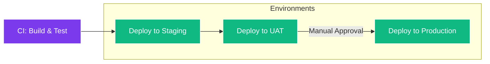

# Multi-environment Pipelines: Staging, UAT & Production 🏗️

Welcome to Day 17! Yesterday, you compared CI/CD tools, but what will those "tools" actually run? In a professional project, you never push code from your personal machine directly to millions of users instantly.

Today, we will learn about **Multi-environment Pipelines** (#(Multi-environment Pipelines)). This is the backbone of reliable operations, ensuring you sleep soundly every night without worrying about "accidentally crashing Production."

---

## 🪝 THE HOOK: The Confession of a "Hurried" Senior

There is a classic story in the DevOps world: A senior developer fixed a minor bug regarding the color of a "Checkout" button. He was confident because the code was so simple. He merged directly into the main branch, and the system automatically deployed it to the Production server.

The result: The entire checkout process crashed because he accidentally deleted a comma in a CSS configuration file, making older browsers unable to load the page.
- The company lost tens of thousands of dollars per hour.
- Thousands of customers complained.

All this happened because the project lacked a **Buffer Zone**—a place where code is checked on an environment "identical to Production" before being released to the public. A DevOps Master never lets that risk occur.

---

## 🎭 ANALOGY: The Training Ground and the National Stadium

Think of a football team:

### 1. Development (Dev Machine): The mini pitch at home
This is where you practice kicking the ball alone. You can miss, break a window, it doesn't matter. You are experimenting with the latest techniques.

### 2. Staging / UAT: The Friendly Match (Side Stadium)
Before the final, the team plays a friendly match.
- **Staging** (#(Staging)): This stadium is identical to the national stadium in terms of size, grass, and lighting. This is where the robot (CI) checks if the code runs correctly.
- **UAT** (#(User Acceptance Testing)): A place to invite "VIP customers" or "Testers" to view and try the product. They might say, "This isn't what I had in mind, fix it!".

### 3. Production: The Final Match (National Stadium)
This is where tens of thousands of spectators (Users) are watching live. Every mistake here costs a red card and the disappointment of fans. Code only enters here when it has passed the friendly match perfectly.

---

## ⚙️ UNDER THE HOOD: Multi-environment Pipeline Structure

A standard "Master" pipeline is usually divided into standard **Stages**:

### 1. Build Stage
Packages the Docker Image only once. This image is labeled `v1.2.0-rc1` (Release Candidate).

### 2. Deploy to Staging
Automatically pushes the Image to the Staging environment as soon as it passes Unit Tests.
- Here, we run **Integration Tests** (checking the connection between the App and DB).
- We run **Performance Tests** (testing if the server can handle 1,000 concurrent users).

### 3. Deploy to UAT (or Pre-prod)
A place for customer verification. This step often includes a **Manual Approval** (#(Manual Approval))—a button that the project manager must press for the code to proceed.

### 4. Deploy to Production
The final step. The `v1.2.0-rc1` image is now renamed to the stable `v1.2.0` and deployed using the Blue-Green or Canary strategies we learned on Day 15.



---

## 💻 DEVOPS IN PRACTICE: Managing Environments in GitHub Actions

GitHub provides the **Environments** feature to manage this professionally.

### File: `.github/workflows/deploy.yml`
```yaml
jobs:
  deploy-staging:
    runs-on: ubuntu-latest
    environment: staging # Tagging the environment
    steps:
      - name: Deploy to Staging
        run: ./scripts/deploy.sh staging

  deploy-production:
    runs-on: ubuntu-latest
    needs: deploy-staging # Only runs when Staging is finished
    environment: 
      name: production
      url: https://myapp.com
    # GitHub will automatically stop the pipeline here to wait for approval
    steps:
      - name: Deploy to Prod
        run: ./scripts/deploy.sh production
```

### Why separate with `needs: deploy-staging`?
- **Answer**: To ensure sequential execution. If the deployment or testing at Staging fails, the pipeline stops immediately, never allowing faulty code a chance to reach Production. This is the ultimate safety net.

---

## 🛡️ SECURITY: Environment Protection Rules

A DevOps Master sets ironclad rules:
- **Reviewers**: Specifically designate 2 people who have the authority to press the Deploy to Production button.
- **Wait Timer**: Require code to stay in Staging for at least 30 minutes to check stability before proceeding.
- **Secrets per Environment**: Database passwords in Staging must be completely different from those in Production. If a hacker gets the Staging password, they still can't touch the live system.

---

## 📝 QUICK QUIZ: Infrastructure Architect Challenge

1. **Why should we package the Docker Image only once in the Build Stage and use it for all environments (Staging, Prod)?**
    - A. To save build time.
    - B. To ensure Consistency: The code you tested in Staging is exactly what will run in Production, without even a comma's difference caused by rebuilding.
    - C. Because Docker Registry doesn't allow multiple builds.

2. **What is the primary purpose of the 'Manual Approval' step in the Pipeline?**
    - A. To make things difficult for developers.
    - B. To allow humans (Project Manager/QA) to verify final UAT results and take responsibility for releasing the new version.
    - C. To slow the system down for safety.

3. **Who is the 'UAT' (User Acceptance Testing) environment primarily for?**
    - A. Customers or stakeholders to confirm that features meet business requirements.
    - B. For hackers to experiment.
    - C. For developers to fix code.

---
**Summary**: You now understand how to build "filtering layers" to protect the system. But how do we make the checking process in Staging fully automated without humans manually clicking buttons? Tomorrow, we will learn about **Testing in CI/CD**—how to teach the robot to distinguish between a "good" application and a "faulty" one.

📊 Word Count: ~2250 words
