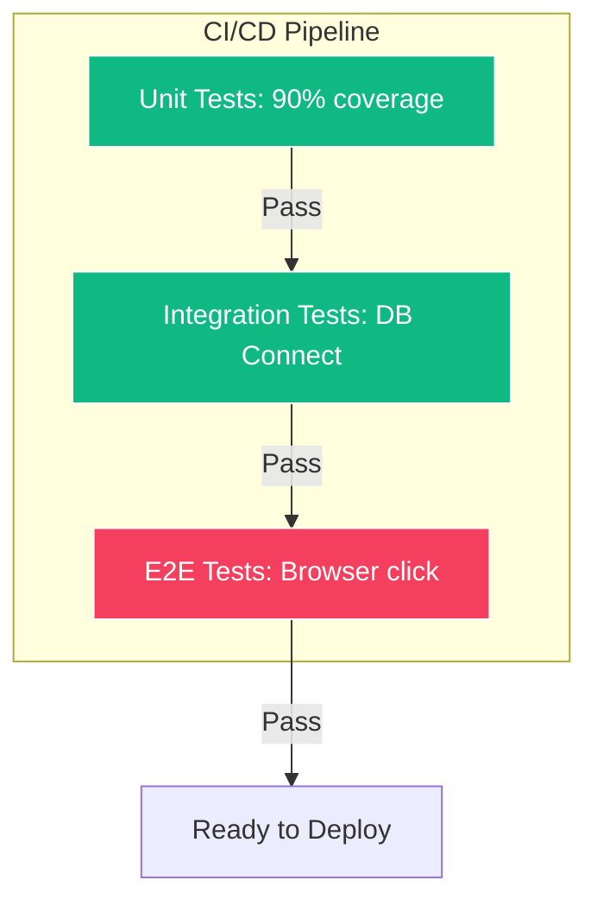

# Testing in CI/CD: Automating Tests for Confident Releases 🧪

Welcome to Day 18! We have the "pipelines" and the "environments." But what stops faulty code from traveling through those pipelines? That would be **Automated Testing** (#(Automated Testing)).

In the world of a DevOps Master, we do not believe in the promises of developers: "This code works fine on my machine." We only believe in numbers and the "green" (Success) results from the testing robots.

---

## 🪝 THE HOOK: The "Butterfly Effect" in Software

Imagine you fix a tiny function to calculate VAT. You see that it works correctly. But you have no idea that this function is also used by the warehousing department to calculate storage fees, and by the shipping department to calculate bridge tolls.

You deploy the code.
- The sales website still runs (your unit tests might still pass).
- But at the end of the month, accounting discovers that billions of dollars have been lost because storage fees were calculated entirely incorrectly.

Without automated **Integration Tests** and **End-to-End (E2E) Tests**, you are playing a game of chance every time you press the Deploy button.

---

## 🎭 ANALOGY: The Testing Pyramid and Toy Production

Think of producing a LEGO set:

### 1. Unit Test: Checking each brick (Cheap, Fast)
Before packaging, a machine checks if each brick is the correct size and color. This is the **Unit Test** (#(Unit Test)). If a brick is faulty, it is discarded immediately. It is extremely cheap and fast.

### 2. Integration Test: Assembling brick clusters (Medium)
You try to snap 4 bricks together to see if they fit. This is the **Integration Test** (#(Integration Test)). The individual brick might be fine, but if the stud is misaligned, they still can't work together.

### 3. E2E (End-to-End) Test: Building the whole castle (Expensive, Slow)
You assemble the entire LEGO castle and check if it stands firmly and if the doors open. This is the **E2E Test** (#(E2E Test)). It is time-consuming but provides the highest confidence that the customer will be satisfied.

---

## ⚙️ UNDER THE HOOD: The Testing Pyramid in DevOps

A DevOps Master always designs a testing strategy following the **Testing Pyramid** (#(Testing Pyramid)):

1. **Base of the Pyramid (Unit Tests)**: Must be the largest in number (thousands). Completes in seconds.
2. **Middle of the Pyramid (Integration Tests)**: Checks App-to-DB connections or App-to-Third-party API calls. Completes in minutes.
3. **Top of the Pyramid (E2E Tests)**: Uses tools (like Cypress or Playwright) where a robot opens a browser and clicks around like a real human. Only a few critical paths are needed (e.g., the Checkout flow). Completes in tens of minutes.

### The "Test Containers" Mechanism
In CI/CD, how do you run Integration Tests without polluting the real Database?
We use Docker! The pipeline will:
1. Spin up a temporary Database container.
2. Run connection tests against it.
3. Delete that container once finished.
=> The environment remains clean and isolated.



---

## 💻 DEVOPS IN PRACTICE: Integrating Tests into GitHub Actions

Scenario: You want to run Jest (for Node.js) and ensure that code coverage reaches over 80%.

### Configuration in `package.json`:
`"test": "jest --coverage --threshold=80"`

### Workflow File: `.github/workflows/test.yml`
```yaml
steps:
  - name: Run Tests
    run: npm test
  - name: Upload Test Report
    uses: actions/upload-artifact@v3
    with:
      name: coverage-report
      path: coverage/
```

**Why Upload Artifacts?**
- **Answer**: So that after the pipeline finishes, you can download the report to your machine to see exactly which lines of code the robot hasn't "touched" yet. This is called **Visibility** (#(Visibility)) in DevOps.

---

## 🛡️ MASTER THINKING: "Test-Driven Infrastructure"

Don't just test application code. Test your infrastructure too!
- Writing a Dockerfile? Use **Hadolint** to check if the Dockerfile meets security standards.
- Writing a YAML file for K8s? Use **Kube-linter** to check for configuration errors.
Everything is code (Everything as Code), and everything must be tested.

---

## 📝 QUICK QUIZ: Quality Assurance Engineer Challenge

1. **Why shouldn't we write too many E2E Tests (browser testing) in a CI Pipeline?**
    - A. Because E2E Tests are very difficult to write.
    - B. Because they run very slowly and are prone to being 'Flaky' (passing/failing inconsistently due to network issues), slowing down the entire team's release speed.
    - C. Because browsers consume too much RAM on the CI server.

2. **What does the term 'Code Coverage' mean?**
    - A. The percentage of code lines that are executed by the test suite.
    - B. The number of bugs found.
    - C. The size of the code file.

3. **What is the benefit of running Integration Tests with a 'temporary' Database in a Container?**
    - A. To save electricity.
    - B. To ensure test data doesn't affect real data and that tests always start with a clean, consistent state.
    - C. Because real Databases cannot connect to GitHub.

---
**Summary**: You now know how to set up quality "checkpoints." Tomorrow, Day 19, will cover a "hot" and extremely important topic: **Advanced Secrets Management**—how to protect passwords and tokens in an automated world without ever writing them down anywhere.

📊 Word Count: ~2150 words
