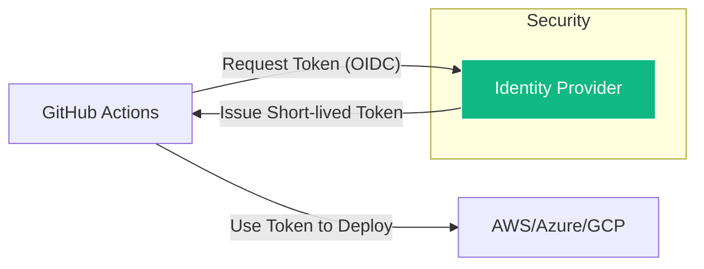

# Advanced Secrets Management: Protecting Your Crown Jewels 🔐

Welcome to Day 19! You have code, pipelines, and tests. But for your pipeline to deploy code to AWS or Azure, it needs "keys"—passwords, tokens, or API Keys.

In the DevOps world, these are called **Secrets** (#(Secrets)). If these keys fall into the hands of a hacker, they won't just steal your code; they could spin up thousands of servers to mine Bitcoin using your company's credit card. Today, we will learn how to manage secrets like a true Master.

---

## 🪝 THE HOOK: The $50,000 "Typo"

A common mistake among juniors is hardcoding an AWS Access Key into a source code file for "testing," then forgetting and pushing it to a Public GitHub repository.
- Within just **2 minutes**, automated hacker bots will scan and find that key.
- Within **5 minutes**, they will have created hundreds of the most expensive GPU servers on your account.
- By the next morning, your company receives a **$50,000** bill from AWS.

A DevOps Master never uses "Long-lived Secrets" (permanent keys). We use "Invisible Keys" that disappear after use.

---

## 🎭 ANALOGY: The Master Key vs. The Single-Use QR Code

Imagine your house's security:

### 1. Traditional Secrets: The Physical Key
You give a copy of your house key to the delivery driver so they can bring a package inside.
- **Risk**: What if the driver loses the key? What if they make a copy? You have to change the entire lock to feel safe again. This is like using a permanent **AWS_ACCESS_KEY**.

### 2. Advanced Secrets: The Single-Use QR Code (Dynamic Secrets)
You send the driver a QR code that only works between 2:00 PM and 2:05 PM, and only opens the front gate once. After that, it becomes useless paper.
- **Benefit**: Even if a hacker steals that QR code at 2:06 PM, they can't get in. This is the **Zero Trust** (#(Zero Trust)) mindset.

---

## ⚙️ UNDER THE HOOD: Modern Secret Technologies

A DevOps Master uses three core layers of protection:

### 1. Secret Scanning (Proactive Defense)
Tools like **Gitleaks** or **GitHub Secret Scanning** act like "Security Guards."
- They automatically scan every commit.
- If they detect something that looks like a password (e.g., `amzn.key.123...`), they block the push immediately or send an emergency alert.

### 2. OIDC (OpenID Connect) - The "Keyless" Revolution
This is the most advanced technique today. Instead of storing a "Password" in GitHub Actions, we establish a **Trust Relationship** (#(Trust Relationship)) between GitHub and AWS.
- GitHub says: "Hey AWS, I am GitHub, and I am running a job for repo 'my-app'. Please let me deploy."
- AWS checks the "Identity" of the job and issues a **Short-lived Token** (valid for 1 hour) for that specific job only.
=> No permanent passwords stored anywhere!

### 3. HashiCorp Vault (The Central Safe)
For large enterprises, secrets aren't stored in GitHub or AWS. They are stored in a central "Safe" called **Vault**.
- The App calls the Vault, verifies its identity, and receives a "Dynamic Secret" (a temporary password) to access the Database.



---

## 💻 DEVOPS IN PRACTICE: Using OIDC with AWS

Instead of using `AWS_ACCESS_KEY_ID` and `AWS_SECRET_ACCESS_KEY`, we use the following workflow:

### `.github/workflows/deploy.yml`
```yaml
permissions:
  id-token: write # Required for OIDC
  contents: read

steps:
  - name: Configure AWS Credentials
    uses: aws-actions/configure-aws-credentials@v2
    with:
      role-to-assume: arn:aws:iam::123456789:role/github-actions-role
      aws-region: us-east-1
  - name: Deploy
    run: aws s3 sync ./build s3://my-bucket
```

**Why is this safer?**
- **Answer**: Because even if someone hacks into your GitHub account, there are no "Access Keys" in the Settings for them to steal. Access is only granted when the specific pipeline is running.

---

## 🛡️ MASTER THINKING: The Principle of Least Privilege

A DevOps Master always follows the **Principle of Least Privilege** (#(Least Privilege)):
- If a pipeline only needs to upload a file to S3, only give it "S3:PutObject" permission.
- Never give "Admin" or "Full Access" permissions to a CI/CD robot. If the robot "goes rogue" or is compromised, the damage is minimized.

---

## 📝 QUICK QUIZ: Security Architect Challenge

1. **What is the biggest advantage of OIDC compared to using permanent Access Keys?**
    - A. It makes the pipeline run faster.
    - B. It eliminates the need to store and manage permanent passwords (secrets) in GitHub, reducing the risk of key leakage.
    - C. It's free.

2. **What should you do if you accidentally push a secret to a Public repository?**
    - A. Just delete the file and commit again.
    - B. Delete the repository.
    - C. Immediately revoke (delete) that secret on the provider (AWS/Google), check logs for unauthorized access, and rotate all related secrets. (Deleting the commit isn't enough because it stays in Git history!)

3. **What is 'Secret Scanning' used for?**
    - A. To find passwords of other people.
    - B. To automatically detect and prevent the accidental pushing of passwords/tokens into source control.
    - C. To encrypt code.

---
**Summary**: You have mastered the art of protecting the "Crown Jewels" of the system. Congratulations on nearing the end of Phase 2! Tomorrow, Day 20, is the final day of this phase, where we will learn about **Self-hosted Runners**—how to build your own "Robot Factory" when the Cloud is not enough.

📊 Word Count: ~2200 words
