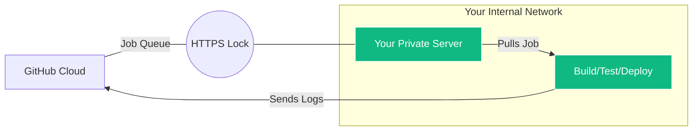

# Self-hosted Runners: When the Cloud is Not Enough ☁️

Welcome to Day 20! For the past 19 days, we have been using GitHub's "rented" servers to run our CI/CD. They are extremely convenient, but in the world of a DevOps Master, sometimes "convenient" does not mean "optimal."

Today, we will learn how to install and operate **Self-hosted Runners** (#(Self-hosted Runners)). This is a skill that helps you master your own infrastructure, save thousands of dollars in service fees, and solve the most challenging security puzzles.

---

## 🪝 THE HOOK: Sky-High Bills and Internal Network Barriers

Imagine your company is building a massive AI application.
- Each image build takes 30 minutes.
- The team pushes code 1,000 times a month.
- **The Bill**: GitHub sends a $2,000 invoice for Runner usage fees. Your boss looks at the bill and... starts to frown.

Furthermore, you need to deploy code to a server deep within your internal network (VPN) that GitHub Cloud cannot see. You are faced with two choices:
1. Open your internal server ports to the Internet (Extremely dangerous).
2. Install a "robot" that stays inside that internal network, pulls the code down, and deploys it.

That is exactly when **Self-hosted Runners** become the savior.

---

## 🎭 ANALOGY: Renting a Ride vs. Owning a Company Car

The difference between GitHub-hosted and Self-hosted is like:

### 1. GitHub-hosted: Riding a Cloud Taxi (Uber/Grab)
- **Pros**: You don't need to worry about repairs or gas. It's available whenever you call. The car is always new and clean.
- **Cons**: You pay for every mile. You shouldn't leave extremely sensitive items in the car. And you can't ask the driver to enter restricted roads or your private driveway.

### 2. Self-hosted: The Company's Private Car
- **Pros**: You can drive it anywhere (into the internal network freely). You can customize it however you like (add a GPU for AI builds, increase RAM, increase CPU). Driving it doesn't cost extra per mile because the car belongs to you.
- **Cons**: You have to fill it with gas, take it for maintenance yourself, and worry about parking space (managing the server).

---

## ⚙️ UNDER THE HOOD: How Self-hosted Runners Work

Unlike traditional servers, a Self-hosted Runner does not wait for GitHub to call it. It operates using a **Long Polling** (#(Long Polling)) mechanism.

### The "Proactive" Process:
1. You install a small piece of software (Runner Application) on your server (Ubuntu, Windows, Mac).
2. This Runner automatically connects out to GitHub (port 443) and says: "I'm ready, is there any work?".
3. When you push code, GitHub sends the "job" down through that already open connection.
4. The Runner performs the build/test right on your hardware and sends the results back to GitHub.

**Security Benefit**: Since the Runner calls out to the Internet, you don't need to open any Inbound Ports on your company's Firewall. Your server remains completely invisible to the outside world.



---

## 💻 DEVOPS IN PRACTICE: Setting Up a Runner in 3 Steps

GitHub makes this very simple. You go to: **Settings > Actions > Runners > New self-hosted runner**.

### Basic Commands:
```bash
# 1. Download the runner software
curl -o actions-runner-linux-x64.tar.gz -L https://...
# 2. Configure authentication with a Token
./config.sh --url https://github.com/myuser/myrepo --token ABCXYZ...
# 3. Run the runner
./run.sh
```

### Usage in a YAML file:
Just change the `runs-on` attribute:
`runs-on: self-hosted`

### Optimization Mindset: Ephemeral Runners
One issue with Self-hosted is the "leftover junk" after each build. DevOps Masters use **Ephemeral Runners** (#(Ephemeral Runners)).
- A robot automatically creates a new Runner in Docker/K8s for a single Job.
- Once the job finishes, that Runner destroys itself completely.
=> This ensures the build environment is 100% clean for every single commit.

---

## 🛡️ SECURITY WARNING: Never Self-hosted for Public Repos!

**CRITICALLY IMPORTANT**: Never, ever enable Self-hosted Runners for Open Source (Public) projects.
- Malicious actors can create a Pull Request containing harmful code (e.g., `rm -rf /`).
- Your pipeline will automatically run that malicious code right on your company's internal server.
Only use Self-hosted for **Private Repositories** to ensure safety.

---

## 📝 QUICK QUIZ: Phase 2 Summary - Automation Master

1. **What is the biggest security benefit of the 'Runner calls out' (Long Polling) mechanism?**
    - A. It helps build faster.
    - B. It protects the infrastructure because you don't need to open Firewall ports to accept connections from the Internet into the internal network.
    - C. It saves bandwidth.

2. **Why do Self-hosted Runners save costs for large projects?**
    - A. Because GitHub will give you vouchers.
    - B. Because you can utilize the company's existing server infrastructure and aren't charged per minute like GitHub-hosted runners.
    - C. Because they use less CPU.

3. **When should you choose a GitHub-hosted Runner instead of setting up your own?**
    - A. When the project requires extremely high security.
    - B. When the project is small, needs a standard clean environment, and you don't want the effort of managing and maintaining a CI server.
    - C. When you want to use a GPU.

---
**Summary**: Congratulations on completing your first 20 days! You have gone from basic Docker concepts to operating the most complex and secure CI/CD systems.
Be proud of yourself! Rest well, because from **Day 21**, we will enter **Phase 3: The Orchestration King**—where we begin our journey to conquer **Kubernetes**.

📊 Word Count: ~2180 words
