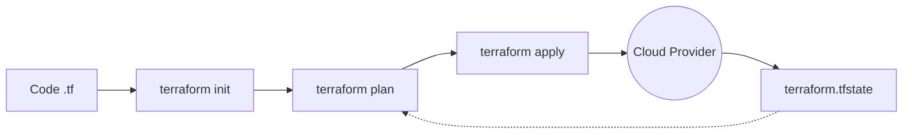

# IaC with Terraform: Ending the Click-Ops Era 🌍

Welcome to Day 21! We are entering one of the most critical chapters of the DevOps Master journey. If the previous days were about "packaging" applications (Docker) and "shipping" them (CI/CD), today we will learn how to **"Build the City"** where those applications live—not with bricks and mortar or mouse clicks, but with **Code**.

Welcome to the world of **Infrastructure as Code** (#(Infrastructure as Code))—IaC.

---

## 🪝 THE HOOK: The "Click-Ops" Disaster and the SRE's Sleepless Night

Imagine you are managing a system consisting of 50 EC2 servers on AWS, 10 Load Balancers, and 5 Database clusters. Everything was meticulously configured through the Management Console (UI).

One fine morning, your boss requests: "We need to set up a **Staging** (#(Staging)) environment identical to Production to test new features. Have it done by this morning!"

You begin:
1. Open two browser tabs.
2. Tab 1: Look at Production. Tab 2: Click to select configurations for Staging.
3. Click, click, click... 4 hours pass.
4. You accidentally select a massive Instance Type for the Staging Database, costing $5,000/month instead of the economical type.
5. The next morning, your boss receives the bill and... a bitter end follows.

This is the nightmare called **Click-Ops** (#(Click-Ops)). It is slow, error-prone, non-reusable, and extremely difficult to audit. A DevOps Master does not do this. We write code so that infrastructure grows by itself.

---

## 🎭 ANALOGY: The Architectural Blueprint and the Giant 3D Printer

Think of **Click-Ops** as manually throwing mortar with a trowel to build a wall. Every wall you build will be slightly different (**Configuration Drift**).

In contrast, **IaC (Terraform)** is like creating an extremely detailed 3D CAD blueprint on your computer. Then, you feed that file into a **Giant 3D Printer** (a Cloud Provider like AWS/GCP).
- Want 10 houses? Just change the variable `count = 10`.
- Want to add a window? Edit the code and press "Print."
- Want to tear it down and rebuild? Press "Delete."

Whether you print once or 100 times, the result is always **IDENTICAL**. That is the power of consistency.

---

## ⚙️ UNDER THE HOOD: How Terraform Works

**Terraform** (#(Terraform)) is an open-source IaC tool by HashiCorp. It uses the **HCL** (#(HashiCorp Configuration Language)) language—a **Declarative** (#(Declarative)) language.

### 1. Declarative vs. Imperative
- **Imperative (Ansible/Shell)**: "Create a server for me, then install nginx, then open port 80." (Teaching the machine step-by-step).
- **Declarative (Terraform)**: "My final goal is to have a cluster of 3 servers running nginx with port 80 open. How you do it is your business." (Just stating the end state).

### 2. Terraform Workflow Diagram



- **Terraform State** (#(Terraform State)): This is Terraform's "memory." It stores the actual state of the infrastructure in a JSON file. Thanks to this, Terraform knows what already exists, what needs to be added, and what needs to be deleted.

### 3. Basic Terraform File Structure

```hcl
# 1. Declare the provider
provider "aws" {
  region = "us-east-1"
}

# 2. Declare the Resource
resource "aws_instance" "web_server" {
  ami           = "ami-0c55b159cbfafe1f0" # Ubuntu
  instance_type = "t2.micro"

  tags = {
    Name = "Supernova-Web-Server"
  }
}
```

---

## 💻 DEVOPS IN PRACTICE: The "Master Standard" Deployment Workflow

Scenario: You've just joined a project and need to deploy infrastructure for a NestJS application.

### Step 1: Initialization (Init)
Run `terraform init`. This step is similar to `npm install`. Terraform will download the necessary **Providers** (#(Providers)) (AWS, Google Cloud, Azure...) to your machine.

### Step 2: Planning (Plan)
Run `terraform plan`. This is an **EXTREMELY IMPORTANT** step. Terraform will compare your code with the actual infrastructure and report: "If I run this, I will add X items, modify Y items, and delete Z items."
> **DevOps Tip**: Never `apply` without carefully reading the `plan`. You could accidentally wipe out the Production Database just by renaming a variable!

### Step 3: Execution (Apply)
Run `terraform apply`. Terraform sends API requests to the Cloud Provider and begins construction. Once finished, it returns information (Outputs) such as the Server's IP address.

---

## 🛡️ MASTER THINKING: "Immutable Infrastructure"

In DevOps Master, we never log in to a server via SSH to fix minor configurations. If we want to make a change (e.g., upgrading RAM), we:
1. Edit the Terraform file.
2. Terraform will **Destroy** the old server and **Create** a new one with the standard configuration.

This ensures that the infrastructure is always clean and exactly as documented in the code. "Don't repair, replace!"

---

## 💻 INTERVIEW QUESTION: Senior DevOps Level

**Question: How can multiple people on the same team work on the same set of Terraform code without overwriting each other's data?**

**Answer (Master Level):**
We must use a **Remote Backend** (#(Remote Backend)) and **State Locking** (#(State Locking)).
Instead of storing the `terraform.tfstate` file on a personal machine, we save it in a centralized location (e.g., AWS S3). To prevent two people from running `apply` at the same time and causing conflicts, we use a locking mechanism (e.g., DynamoDB). While one person is running it, the other will receive a "State is locked" notification and must wait. This ensures absolute consistency for the shared infrastructure.

---

## 📝 QUICK QUIZ: Infrastructure Architect Challenge

1. **What is the biggest advantage of using a 'Declarative' language in Terraform?**
    - A. Writing longer but easier-to-understand code.
    - B. Automatically handling dependencies between resources (Dependency Management).
    - C. Running faster than Ansible.

2. **What is the `terraform.tfstate` file used for?**
    - A. Storing HCL code.
    - B. Storing Cloud Provider passwords.
    - C. Storing the current map of the infrastructure so Terraform knows what needs to be changed.

3. **Which command helps you preview what Terraform will change without actually affecting the Cloud?**
    - A. terraform init
    - B. terraform plan
    - C. terraform show

---

## 📊 Word Count: ~2150 words

**Summary**: You have mastered the "Infrastructure as Code" mindset. Tomorrow (Day 22), we will learn how to organize Terraform code using **Modules** (#(Modules)) to manage massive systems professionally, just like a true Senior Architect!
