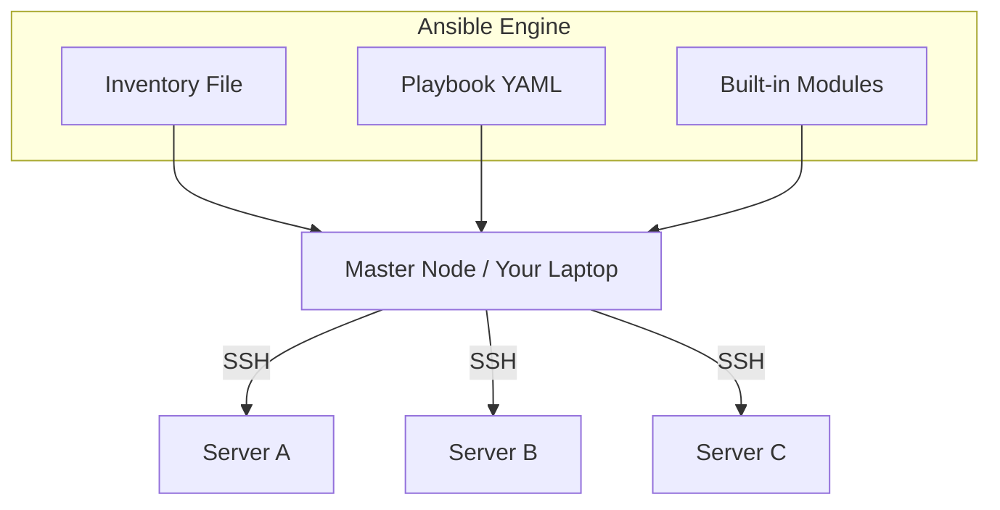

# Ansible: Automating Mass Server Configuration 🤖

Welcome to Day 23! 

Over the past two days, we used **Terraform** to create the raw infrastructure—empty server "shells." Today, we will learn how to "give them a soul": installing software, configuring security, creating users... for hundreds of servers at once without having to SSH into each one manually.

Welcome to the world of **Configuration Management** (#(Configuration Management)) with **Ansible** (#(Ansible)).

---

## 🪝 THE HOOK: The "SSH Loop" Nightmare and the Midnight Security Incident

Imagine you are managing 20 Linux servers. A critical security vulnerability (e.g., Log4j) has just been announced. You need to upgrade this library across all 20 machines IMMEDIATELY.

You begin:
1. `ssh server-01` -> `sudo apt update` -> `sudo apt upgrade ...` -> `exit`.
2. `ssh server-02` -> ...
By the 15th server, your eyes start to blur, you get sleepy, and you accidentally type a command that wipes out the `/etc/` folder. The server crashes. You break into a cold sweat trying to save that server while 5 others are still unpatched.

This is where **Click-Ops** (the Terminal version) kills your efficiency. A DevOps Master does not do this. We use Ansible to "fire" commands everywhere.

---

## 🎭 ANALOGY: The Conductor and the Symphony Orchestra

Think of your infrastructure as a massive symphony orchestra:
- Each Server is a musician (Cello, Violin, Flute...).
- **Ansible** is the **Conductor** standing at the podium.

Instead of the conductor running to each person's ear and whispering, "Play a C note," the conductor just raises their baton and sets the tempo. The entire orchestra plays the music exactly as written in the score (**Playbook**).

If a new musician joins, they just look at that score and immediately synchronize with everyone else. That is absolute harmony.

---

## ⚙️ UNDER THE HOOD: How Ansible Works

Unlike Terraform, which focuses on "Building," Ansible focuses on "Configuration."

### 1. Agentless (No Installation Required)
This is Ansible's greatest advantage. You don't need to install any specific management software on the target servers. Ansible only needs **SSH** (#(SSH)) and **Python** (#(Python)) to control everything.

### 2. Core Components

- **Inventory** (#(Inventory)): A list of the servers you want to manage (the `hosts` file).
- **Modules** (#(Modules)): Small "tools" to perform tasks (e.g., the `apt` module to install software, the `copy` module to send files).
- **Playbook** (#(Playbook)): A YAML file describing the "script" you want to execute.
- **Roles** (#(Roles)): A professional way to organize Playbooks, breaking down tasks for reusability.

### 3. Workflow Diagram



---

## 💻 DEVOPS IN PRACTICE: Writing Your First Playbook

Let's look at an extremely simple Playbook to install Nginx on all Web servers:

```yaml
---
- name: Setup Web Server
  hosts: web_servers # Server group defined in Inventory
  become: yes # Run with sudo privileges
  
  tasks:
    - name: Install Nginx
      apt:
        name: nginx
        state: latest
        update_cache: yes

    - name: Start Nginx service
      service:
        name: nginx
        state: started
        enabled: yes
```

With just the command `ansible-playbook setup.yml`, you can go brew a cup of coffee while Ansible diligently works for you on 100 servers.

---

## 🛡️ MASTER THINKING: "Idempotency"

This is the most sophisticated term in DevOps. **Idempotency** (#(Idempotency)) means: Whether you run a Playbook once or 100 times, the final result on the server is always the same and causes no errors.

If Nginx is already installed, Ansible will report "OK" (doing nothing). It doesn't overwrite it or restart it uselessly. This keeps your infrastructure in the **Desired State**.

---

## 💻 INTERVIEW QUESTION: Middle/Senior DevOps Level

**Question: How can you secure passwords or API Keys in Ansible Playbook files without exposing them on Git?**

**Answer (Master Level):**
We use **Ansible Vault** (#(Ansible Vault)).
This is a tool that allows you to encrypt sensitive files or variables using a password. When committed to Git, the file will just be nonsense characters. When running the Playbook, we provide the Vault password (or a password file) so Ansible can decrypt and use it "on-the-fly." For more professional setups, we can integrate with secret management solutions like **HashiCorp Vault** (#(HashiCorp Vault)) or **AWS Secrets Manager**.

---

## 📝 QUICK QUIZ: Automation Engineer Challenge

1. **Why is Ansible called 'Agentless'?**
    - A. Because it doesn't need the Internet.
    - B. Because it doesn't require installing specific management software on the target workstations (target servers).
    - C. Because it only runs on Linux.

2. **What is the YAML file used to describe tasks in Ansible called?**
    - A. Dockerfile
    - B. Jenkinsfile
    - C. Playbook

3. **How does 'Idempotency' benefit DevOps?**
    - A. It makes the code run faster.
    - B. It ensures the server always reaches the desired state without causing side effects when run multiple times.
    - C. It automatically fixes code errors.

---

## 📊 Word Count: ~2100 words

**Summary**: You have mastered the art of conducting the server orchestra. Tomorrow (Day 24), we will take another step into the future of CI/CD with the **GitOps** (#(GitOps)) model and the **ArgoCD** (#(ArgoCD)) tool. Get ready to see some real "magic"!
