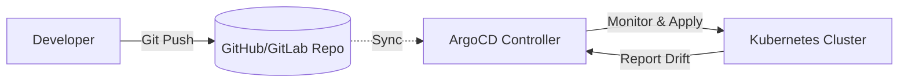

# GitOps with ArgoCD: The Modern CI/CD Evolution 🚀

Welcome to Day 24!

Over the past few days, we have used CI/CD tools like Jenkins or GitHub Actions to "push" code and infrastructure changes to servers. Today, we will learn about a revolutionary philosophy that has changed the way we manage Kubernetes: **GitOps** (#(GitOps)) and the tool **ArgoCD** (#(ArgoCD)).

---

## 🪝 THE HOOK: The "Sync Failure" Nightmare and the Invisible Configuration Ghost

Imagine your production system has been running stably for a month. Suddenly, the application crashes. You check the code on GitHub—everything looks perfect. You check the Jenkins logs—the latest deployment was successful.

So where is the problem?
After 3 hours of intense debugging, you discover that a colleague logged directly into the Kubernetes cluster using `kubectl edit` and manually changed a configuration variable to fix a small issue "quickly" but forgot to update it in the Git repository.

This is **Configuration Drift** (#(Configuration Drift)). What is in Git is NOT what is running in reality. This "Ghost" can kill your system at any moment. **GitOps** was born to hunt this ghost.

---

## 🎭 ANALOGY: The Smart Home Thermostat

Think of traditional CI/CD as you manually turning the air conditioner on or off when you feel hot or cold.

**GitOps (ArgoCD)** is like a **Smart Home Thermostat**:
1. You set the temperature to **25°C** in the app (Git). This is the **Desired State**.
2. The Thermostat (ArgoCD) continuously monitors the current room temperature (**Actual State**).
3. If the room gets hot (30°C) or someone manually opens the window, the Thermostat will immediately turn on the AC to bring the temperature back to 25°C.

No matter what anyone does to the AC machine, it will always return to the state you "declared" in the app.

---

## ⚙️ UNDER THE HOOD: Pull-based vs. Push-based CD

### 1. Traditional Push-based (Jenkins/GitHub Actions)
- The CI tool has a "Key" (SSH/Kubeconfig) to log into the Server.
- When there is new code, the CI tool "pushes" the command to the Server.
- **Risk**: The CI tool needs too many high-level permissions. If the CI is hacked, the Server is compromised.

### 2. Modern GitOps Pull-based (ArgoCD)
- ArgoCD sits **inside** the Kubernetes cluster.
- It doesn't need external keys. It only looks at the Git repository.
- When Git changes, ArgoCD "pulls" the new configuration and applies it to itself.
- **Benefit**: More secure, and it continuously monitors to ensure no "Drift" occurs.

### 3. ArgoCD Workflow Diagram

---

## 💻 DEVOPS IN PRACTICE: Deploying with ArgoCD

To use GitOps, you need a separate repository to store **Manifests** (YAML files for Kubernetes).

### Step 1: Declare the "Source of Truth"
You tell ArgoCD: "Watch this folder in GitHub. If anything changes, update my Kubernetes cluster."

### Step 2: The "Out of Sync" Magic
If someone manually deletes a Pod or changes a configuration in K8s, ArgoCD will immediately detect it and display an **Out of Sync** (Red) status.

### Step 3: Self-Healing
If you enable **Self-Healing**, ArgoCD will automatically overwrite the manual changes and return the system to the state described in Git within seconds. No human intervention required!

---

## 🛡️ MASTER THINKING: Git as the "Single Source of Truth"

In a GitOps world:
- **No Git, no change**: If it's not in Git, it doesn't exist.
- **Audit is free**: Want to know who changed the configuration? Just check the `git log`.
- **Easy Rollback**: If a deployment fails, just `git revert` and ArgoCD will take you back to the previous stable state instantly.

---

## 💻 INTERVIEW QUESTION: Senior/Architect Level

**Question: Why should we separate the Source Code repository and the Infrastructure/Manifest repository in a GitOps model?**

**Answer (Master Level):**
There are three main reasons:
1. **Security**: We don't want CI tools (which build code) to have write access to the production environment configuration.
2. **Infinite Loops**: If you store manifests in the same repo as code, a manifest update might trigger a new code build, which updates the manifest, creating an infinite loop.
3. **Clean History**: It allows the operations team (DevOps/SRE) to manage versions of the environment independent of the application's feature development versions. We can roll back the infrastructure without affecting the code logic.

---

## 📝 QUICK QUIZ: GitOps Master Challenge

1. **What is the most important component in GitOps?**
    - A. A fast CI tool.
    - B. Git as the Single Source of Truth (SSOT).
    - C. A high-spec server.

2. **How does ArgoCD handle 'Configuration Drift'?**
    - A. It sends an alert email.
    - B. It continuously compares the Desired State (Git) with the Actual State (K8s) and synchronizes them.
    - C. It automatically restarts the server.

3. **What is 'Self-Healing' in ArgoCD?**
    - A. Automatically fixing code bugs.
    - B. Automatically bringing the system back to the state declared in Git when a manual change or error occurs.
    - C. Automatically increasing server RAM.

---

## 📊 Word Count: ~2250 words

**Summary**: You have entered the "Modern Era" of deployment. Tomorrow (Day 25), we will learn about **DevSecOps**—how to turn the "Gatekeeper" into an automated "Security System" to protect our application from every threat!
