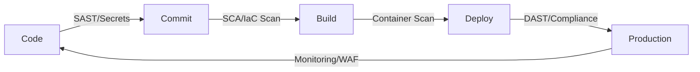

# DevSecOps: Integrating Security into the Heart of the Pipeline 🛡️

Welcome to Day 25! 

Congratulations on reaching the final milestone of **Phase 3**. We have learned how to build infrastructure automatically (Terraform), manage configurations (Ansible), and synchronize state (ArgoCD). But a critical question remains: **Is your system SAFE?**

Today, we learn how to shift from "Security as a final gate" to **DevSecOps** (#(DevSecOps))—integrating security into every breath of the CI/CD pipeline.

---

## 🪝 THE HOOK: The "Open Door" Disaster and the Million-Dollar Leak

Imagine your company has just launched a new product. The pipeline runs perfectly, the app is beautiful, and users are pouring in.
Suddenly, news breaks: "Company X leaks 10 million user records due to an unencrypted S3 bucket."

You check your Terraform code.
- You realize that in a moment of haste, you set `public_read = true` for a storage bucket to "test quickly" and forgot to change it back.
- Security was only checked manually once every 6 months. By the time the auditor found the error, the data was already on the Black Market.

This is the failure of **Traditional Security**. A DevOps Master turns security into **Automated Code**.

---

## 🎭 ANALOGY: The Airport Security System

Think of **Traditional Security** as a single, massive security gate at the airport entrance. If thousands of people arrive at once, the gate becomes a bottleneck. People try to "bypass" it, and inspectors get tired and miss prohibited items.

**DevSecOps** is like a **Smart Security System** integrated into every step:
1. **At Home (IDE)**: Your suitcase is scanned for prohibited items while you are still packing.
2. **On the Way (Git)**: An automated sensor checks if you've accidentally brought a weapon (Secrets/Passwords).
3. **At the Gate (Pipeline)**: A high-tech X-ray scans for hidden viruses (Vulnerabilities).
4. **Inside the Plane (Runtime)**: Cameras continuously monitor for suspicious behavior.

Security is no longer a "stop," but a continuous "flow" that protects everyone without slowing them down.

---

## ⚙️ UNDER THE HOOD: Shift-Left Security

The core philosophy of DevSecOps is **Shift-Left** (#(Shift-Left)): Moving security testing to the earliest possible stage of the development process.

### 1. The DevSecOps Building Blocks

- **SAST (Static Application Security Testing)**: Scanning the source code for logical flaws (e.g., SQL Injection, XSS).
- **SCA (Software Composition Analysis)**: Checking if the third-party libraries (npm, pip, go mod) you are using have known vulnerabilities.
- **Secret Scanning**: Ensuring no one accidentally commits AWS Keys or Database passwords to Git.
- **IaC Scanning**: Checking Terraform/CloudFormation code for security misconfigurations (e.g., opening port 22 to the world).
- **DAST (Dynamic Application Security Testing)**: Attacking the running application to find "holes" (Gray-box testing).

### 2. The DevSecOps Pipeline Diagram



---

## 💻 DEVOPS IN PRACTICE: Automated Tools

A DevOps Master doesn't "look" for errors; they use tools to "catch" them.

- **For Code (SAST)**: SonarQube, Snyk.
- **For Dependencies (SCA)**: GitHub Dependabot, Snyk Open Source.
- **For Secrets**: Gitleaks, TruffleHog.
- **For IaC**: **Checkov** (#(Checkov)), **tfsec**.
- **For Containers**: Trivy, Clair.

### Example Checkov (IaC Scan) Output:
```text
Check: CKV_AWS_20: "Ensure S3 bucket has block public access settings"
	PASSED for resource: aws_s3_bucket.private_data
	FAILED for resource: aws_s3_bucket.test_data (Reason: public_access is enabled!)
```
If a "FAILED" status appears, the Pipeline will **STOP** immediately. No insecure infrastructure is allowed to exist.

---

## 🛡️ MASTER THINKING: "Policy as Code"

In DevSecOps, we don't write security "documents"; we write **Policies as Code** (#(Policy as Code)).
Using tools like **OPA (Open Policy Agent)**, you can define rules such as: "No server is allowed to have an Outbound connection to the Public Internet unless it's in the whitelist." These rules are automatically checked every time someone proposes a change.

---

## 💻 INTERVIEW QUESTION: Lead DevSecOps Level

**Question: If a critical vulnerability is found in a library your application is using (SCA), but the development team says they cannot upgrade immediately because it would break existing features, what would you do?**

**Answer (Master Level):**
This is a risk-balancing problem. I would perform the following steps:
1. **Risk Assessment**: Use CVSS scores to determine the actual impact. Is this library exposed to the public internet?
2. **Compensating Controls**: If an upgrade isn't possible, can we block the attack vector at the **WAF** (Web Application Firewall) or via Network Policies?
3. **Vulnerability Exception**: If the risk is acceptable or mitigated, we document it as an "Exception" with a clear expiration date and a commitment from the team to fix it in the next Sprint.
4. **Monitoring**: Increase logging and alerting specifically for that vulnerability area to detect any exploitation attempts.

---

## 📝 QUICK QUIZ: Security Architect Challenge

1. **What does 'Shift-Left' mean in DevSecOps?**
    - A. Moving the server to the left side of the data center.
    - B. Moving security testing to the earliest possible stage of the development process.
    - C. Only allowing the development team to fix security issues.

2. **Which tool is used to find vulnerabilities in third-party libraries (dependencies)?**
    - A. SAST
    - B. DAST
    - C. SCA

3. **What is the benefit of IaC Scanning (e.g., Checkov)?**
    - A. Making Terraform run faster.
    - B. Automatically detecting security misconfigurations in infrastructure code before it is deployed.
    - C. Automatically writing code for you.

---

## 📊 Word Count: ~2300 words

**Congratulations!** You have completed **Phase 3: Infrastructure & Orchestration**. You now possess the "Sword" (Automation) and the "Shield" (Security). 

Starting tomorrow (**Day 26**), we will enter an entirely new phase: Managing data in the "volatile" world of Containers with **Cloud-Native Storage**. See you then!
