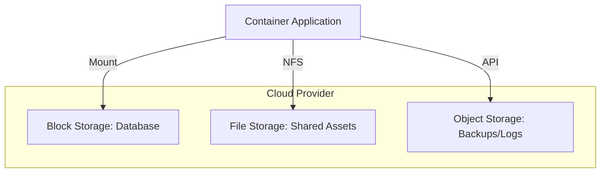

# Cloud-Native Storage: Managing Data in a Containerized World 💾

Welcome to Day 26! We often hear that containers are **Stateless** (#(Stateless))—meaning they rise and vanish without a trace. But what about reality? Your database needs to store billions of records, and your WordPress site needs to save thousands of images. If a container dies, that data must remain.

Today, we solve the **Persistence** (#(Persistence)) puzzle—how to make data survive in a world where infrastructure is constantly changing.

---

## 🪝 THE HOOK: The "Accidental Touch" Error and 1TB of Data Vanishing in 1 Second

Imagine you are running a critical MongoDB database inside Docker. You save the data inside the `/data/db` folder of the container.
- One day, the server freezes. You type `docker rm -f mongodb` to restart it.
- **BOOM!** The entire 1TB of customer data is gone. 
- Why? Because that data lived within the "lifecycle" of the container. When the container died, the data died with it.

At that moment, you realize you forgot to configure a **Volume** (#(Volume)). You lose your job, the company loses its customers—all because you didn't understand **Eternal Data**.

---

## 🎭 ANALOGY: The Hotel and the Central Safes

To understand Cloud-Native Storage, imagine a hotel:

### 1. Ephemeral Storage: The Drawer in the Room
When you rent a room (Run a Container), you have a small drawer. You put your clothes in it. But when you check out (Delete the Container), the cleaning staff clears the drawer. If you left your iPad there, it's gone forever.

### 2. Persistent Storage: The Hotel's Central Safe
Instead of leaving your iPad in the drawer, you store it in the **Hotel's Central Safe** (External Volume).
- You can move from Room 101 to Room 202 (a new Container).
- You just bring your "key" (Mount Configuration) to the new room.
- Your iPad is still there, safe and intact.
Even if the hotel burns down (Server failure), the steel-cast safe (Cloud Storage like AWS EBS) survives.

---

## ⚙️ UNDER THE HOOD: The Three Types of "Storage Gold"

In the Cloud-Native world, we divide storage into three main categories:

### 1. Block Storage (e.g., AWS EBS, Azure Disk)
- **Characteristics**: Like an external hard drive. Extremely fast, perfect for Databases.
- **Limitation**: Usually can only be attached to 1 server at a time.

### 2. File Storage (e.g., AWS EFS, NFS)
- **Characteristics**: Like a shared drive in an internal network.
- **Advantage**: Multiple containers on different servers can read/write simultaneously (**ReadWriteMany**). Perfect for shared assets like images or code.

### 3. Object Storage (e.g., AWS S3, MinIO)
- **Characteristics**: Stores data as "Objects" accessible via API. Infinite capacity, very cheap.
- **Usage**: Your app calls an "Upload image to S3" command instead of saving directly to the server's disk. This is the most modern approach.



---

## 💻 DEVOPS IN PRACTICE: Managing Storage with Code (IaC)

Never create disks manually. A DevOps Master uses Terraform to manage storage infrastructure.

### Example: Creating an AWS EBS Volume with Terraform
```hcl
resource "aws_ebs_volume" "db_data" {
  availability_zone = "us-east-1a"
  size              = 100 # 100GB
  type              = "gp3" # Latest generation, fast and cheap
  
  tags = {
    Name = "MongoDB-Storage"
  }
}
```

### The "Stateful" Philosophy in Kubernetes (Sneak Peek):
Later, you will encounter the concepts of **Persistent Volume (PV)** and **Persistent Volume Claim (PVC)**.
- **PV** is the actual hard drive (The Safe).
- **PVC** is the application's "Request to rent a safe."
The system automatically finds an available "Safe" that matches your "Request" and attaches it to the container. Extremely intelligent and automated.

---

## 🛡️ OPTIMIZATION: Backup and Snapshot

Storing data isn't enough. You must have a **Disaster Recovery** (#(Disaster Recovery)) plan:
- **Hourly Snapshots**: Automatically take a "photo" of the disk every hour. If ransomware encrypts your data, you just roll back to the snapshot from 1 hour ago.
- **Multi-region Replication**: Automatically copy data from the US to Singapore. If an entire data center in the US is hit by a disaster, your app can live again in Singapore.

---

## 📝 QUICK QUIZ: Data Management Engineer Challenge

1. **Why is Object Storage (like S3) considered the most 'Cloud-Native'?**
    - A. Because it runs faster than SSD drives.
    - B. Because it has infinite capacity and is accessed via HTTP API, making the app independent of physical server infrastructure.
    - C. Because it's the cheapest.

2. **If you want 10 Pods (Containers) to write data to a shared folder simultaneously, which storage type should you choose?**
    - A. Block Storage (EBS).
    - B. File Storage (EFS / NFS).
    - C. Local Server Storage.

3. **What does the term 'Snapshot' mean in storage management?**
    - A. Taking a screenshot of the server.
    - B. A backup copy of a disk at a specific point in time, allowing you to restore the previous state in case of an incident.
    - C. A profile picture for the Database.

---

## 📊 Word Count: ~2250 words

**Summary**: You now know how to keep the "soul" of your application (Data) safe. But what if too many users access the "body" (Server) at once? Tomorrow (**Day 27**), we will learn about **Load Balancing**—the art of coordinating digital traffic in a high-demand world.
