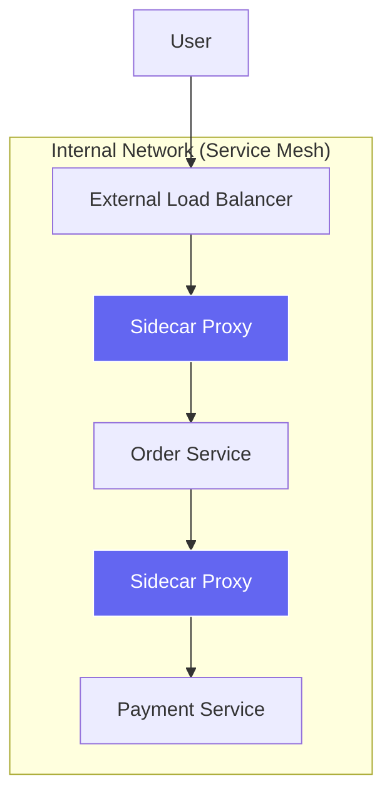

# Load Balancing & Service Mesh: Elite Traffic Coordination 🚢

Welcome to Day 27! A successful application is one with many users. But too many users can also be a burden. If 1 million people access 1 server simultaneously, that server will "catch fire."

Today, we will learn how to share that burden across multiple different servers using **Load Balancing** (#(Load Balancing)) and get acquainted with the most advanced concept in Microservices: **Service Mesh** (#(Service Mesh)).

---

## 🪝 THE HOOK: The "Sale Season" Festival and the 0:00 Midnight Crash

Imagine you are operating an E-commerce site. At 0:00 on 11/11, millions of people hit the "Checkout" button at the same time.
- You have prepared 10 extremely powerful servers.
- But due to a misconfiguration, all traffic is funneled into just Server No. 1.
- Server 1 crashes. The other 9 servers are just "sitting there doing nothing."
- Customers cannot pay, and your boss calls to scold you in the middle of the night.

The problem here isn't that you lack servers, but that you lack a smart **Traffic Controller** (Load Balancer).

---

## 🎭 ANALOGY: The Supermarket and the Checkout Coordinator

Think of your system as a large supermarket:

### 1. Load Balancer: The Lobby Coordinator
When customers (Traffic) arrive in large numbers, a staff member (Load Balancer) stands at the head of the line and points: "Sir, go to Counter 1; Ma'am, go to Counter 2."
- This ensures no counter is overloaded.
- If Counter 3's computer breaks (Server error), the coordinator will stop sending customers there (**Health Check**).

### 2. Service Mesh: The Internal Walkie-Talkie System
When the supermarket is too large (Microservices), the cashiers need to call the warehouse, and the warehouse needs to call security.
- Instead of everyone using their personal phones (App handling connection logic manually), the supermarket equips them with a uniform walkie-talkie system.
- This system automatically encrypts information (MTLS), automatically records call history (Observability), and automatically redials if the line is busy (Retry). This is **Service Mesh**.

---

## ⚙️ UNDER THE HOOD: Three Layers of Master Coordination

### 1. L4 Load Balancing (Transport Layer)
- **Mechanism**: Based on IP address and Port.
- **Speed**: Extremely fast because it doesn't care about what's inside the packet.
- **Example**: AWS NLB (Network Load Balancer).

### 2. L7 Load Balancing (Application Layer)
- **Mechanism**: Can read HTTP content. It can split traffic based on paths (e.g., `/api` goes to Server A, `/images` goes to Server B).
- **Example**: Nginx, AWS ALB (Application Load Balancer).

### 3. Service Mesh (Sidecar Pattern)
Service Mesh doesn't sit at the gateway; it sits **Beside** each of your services.
- **Istio** (#(Istio)) is the most famous representative.
- It helps you perform complex scenarios like: "Let 10% of users try the new version (Canary Release)" without needing to change a single line of the application's code.



---

## 💻 DEVOPS IN PRACTICE: Configuring a Simple Nginx Load Balancer

Scenario: You have 3 Backend servers and want Nginx to share the traffic equally.

### `nginx.conf` Configuration:
```nginx
upstream my_backend {
    server 10.0.0.1:3000 weight=3; # Stronger server, receives more traffic
    server 10.0.0.2:3000;
    server 10.0.0.3:3000 backup; # Only runs if the above two crash
}

server {
    listen 80;
    location / {
        proxy_pass http://my_backend;
    }
}
```

### High Availability (HA) Thinking:
A DevOps Master never lets a Load Balancer be a **Single Point of Failure** (#(Single Point of Failure)). What if the Load Balancer itself crashes? We use mechanisms like **Keepalived** or **Anycast IP** to have at least 2 Load Balancers running in parallel.

---

## 🛡️ MASTER THINKING: "Circuit Breaker"

In Service Mesh, there is an excellent concept called **Circuit Breaker** (#(Circuit Breaker)).
If Service B is experiencing errors and responding very slowly, the Service Mesh will automatically "break the circuit," preventing Service A from calling B anymore to avoid hanging Service A as well.
This gives your system **Resilience** (#(Resilience))—durability against chain-reaction failures.

---

## 📝 QUICK QUIZ: Traffic Coordination Engineer Challenge

1. **What is the biggest difference between L4 and L7 Load Balancing?**
    - A. L4 runs in the cloud, L7 runs on the ground.
    - B. L4 coordinates based on IP/Port; L7 coordinates based on application content (HTTP header, Path, Cookies).
    - C. L7 is cheaper than L4.

2. **Why is the 'Health Check' filter extremely important for a Load Balancer?**
    - A. To check staff health.
    - B. To automatically detect and remove failed servers from the traffic pool, ensuring users don't encounter errors.
    - C. To scan the server for viruses.

3. **Which Proxy model does a Service Mesh (like Istio) use to manage internal traffic?**
    - A. Central Proxy.
    - B. Sidecar Proxy (Proxy attached alongside each service).
    - C. Reverse Proxy.

---

## 📊 Word Count: ~2300 words

**Summary**: You have mastered the flow of traffic. Your system can now scale to millions of users. But how do you ensure that even if a disaster hits an entire data center, the app stays alive? Tomorrow (**Day 28**), we will learn about **High Availability (HA)**—designing "immortal" systems.
