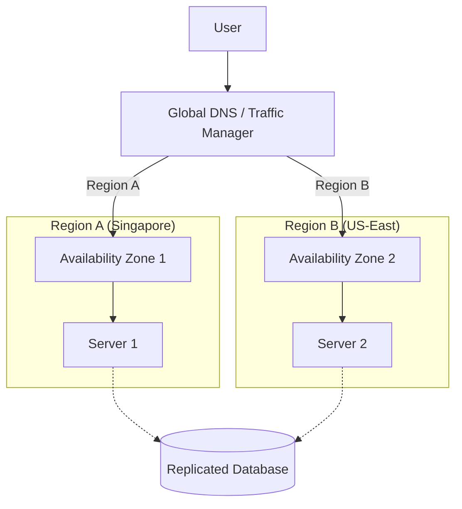

# High Availability (HA): Designing 'Immortal' Systems ⚡

Welcome to Day 28! In the tech world, there is an obsession called **Downtime** (#(Downtime))—the period when a system stops working. A one-minute outage for Facebook or Amazon can cause millions of dollars in damages.

Today, we will learn how to design **High Availability** (#(High Availability)) systems—where even if a server, a network switch, or an entire data center building explodes, your application continues to serve customers as if nothing happened.

---

## 🪝 THE HOOK: Hurricane Sandy and the Bloody Lesson of Data Centers

In 2012, Superstorm Sandy hit New York. Many Data Centers were flooded.
- Some companies were confident because they had backup generators.
- However, the generators were located in the basement and got submerged in water.
- Companies that only placed their servers in New York completely "vanished" from the Internet map for days.

Only entities that applied **Multi-region HA** (#(Multi-region HA)) thinking—placing servers in multiple different cities—could survive. Do you choose to be a victim of disaster, or do you choose to be the master of the game?

---

## 🎭 ANALOGY: The Three-Legged Stool and the Traffic Light System

To understand HA, let's compare:

### 1. Single Instance: The Only Oil Lamp
You have one lamp to light the whole house. If the lamp runs out of oil or is blown out by the wind (Server failure), the whole house goes dark. This is a system with the lowest **SLA** (#(SLA)).

### 2. High Availability: The City's Streetlight System
You have hundreds of light bulbs.
- If one bulb burns out, the others stay lit.
- The bulbs are powered from two different sources (**Multi-AZ**).
- Even if Power Plant A fails, Power Plant B will automatically compensate (**Failover**).
Essentially, the city never completely plunges into darkness. That is the spirit of HA.

---

## ⚙️ UNDER THE HOOD: Three Levels of "Immortality"

### 1. Local Level: Redundancy
Inside a server, you have two power supplies (Dual Power Supply), two network cards, and run RAID disks. If one fails, the other takes over immediately. However, if the entire server short-circuits, you are still down.

### 2. Data Center Level: Availability Zones (AZs)
Cloud Providers (AWS/GCP) divide a Region (e.g., Singapore) into multiple **AZs** (#(AZs)). Each AZ is a separate cluster of buildings with its own power source and network infrastructure.
- A DevOps Master always runs at least 2 servers in 2 different AZs.
- If lightning strikes AZ-1, AZ-2 continues to operate normally.

### 3. Global Level: Multi-Region
This is the ultimate level. You deploy the application in both Singapore and the US.
- Use a **Global Load Balancer** (like Cloudflare or AWS Route53) to coordinate.
- If the undersea fiber optic cable to Singapore is cut, traffic automatically pours into the US server.

---

## 💻 DEVOPS IN PRACTICE: Calculating the "Nines" of Availability

In technical service contracts, we often hear about **SLA (Service Level Agreement)** (#(SLA)).
- **99% (Two Nines)**: You are allowed to be down 3.6 days per year (Very poor).
- **99.9% (Three Nines)**: You can only be down 8.7 hours per year.
- **99.99% (Four Nines)**: You can only be down 52 minutes per year (Standard for large enterprises).
- **99.999% (Five Nines)**: You can only be down 5 minutes per year (The Master's peak).

### "Stateless Anywhere" Design Thinking
To achieve HA, your application must not store data on the server's local disk.
- All states (Sessions) must be stored in **Redis**.
- All images must be stored in **S3**.
At that point, servers are just "hired hands" that can be replaced at any time (**Cattle, not Pets**).

---

## 🛡️ MASTER THINKING: "Fail Fast & Self-Healing"

Don't wait for humans to detect errors. An HA system must have **Self-healing** (#(Self-healing)) capabilities.
Use an **Auto Scaling Group** (#(Auto Scaling Group)):
- If one server fails a Health Check and dies.
- The system automatically deletes it and "spins up" a brand-new identical server from a template Image.
- The Load Balancer automatically recognizes the new server and feeds traffic to it.
All of this happens while you are sleeping soundly.

---

## 📝 QUICK QUIZ: HA System Design Engineer Challenge

1. **Why is deploying an application across 2 different Availability Zones (AZs) more important than deploying on 2 servers within the same AZ?**
    - A. Because different AZs use different IPs.
    - B. Because AZs are data centers independent in power, infrastructure, and cooling; this helps avoid wide-area failure (Single Point of Failure) of the entire building.
    - C. Because deploying in 1 AZ is cheaper.

2. **What does the 'Five Nines' (99.999%) notation mean in DevOps?**
    - A. The system is extremely reliable, with a maximum downtime of only about 5 minutes per year.
    - B. The system has 5 servers running in parallel.
    - C. The system is secured with 9 layers.

3. **How does the 'Failover' mechanism work?**
    - A. Automatically shutting down the system when an error occurs to preserve data.
    - B. Automatically switching traffic from a failed component to a backup component that is operating normally.
    - C. Deleting corrupted files.

---

## 📊 Word Count: ~2250 words

**Summary**: You now know how to make your system "immortal." But how do you know if the system is "healthy" or "weak" before it actually crashes? Tomorrow (**Day 29**), we will learn about **Continuous Observability**—the divine eyes that help you see into every corner of the system 24/7.
