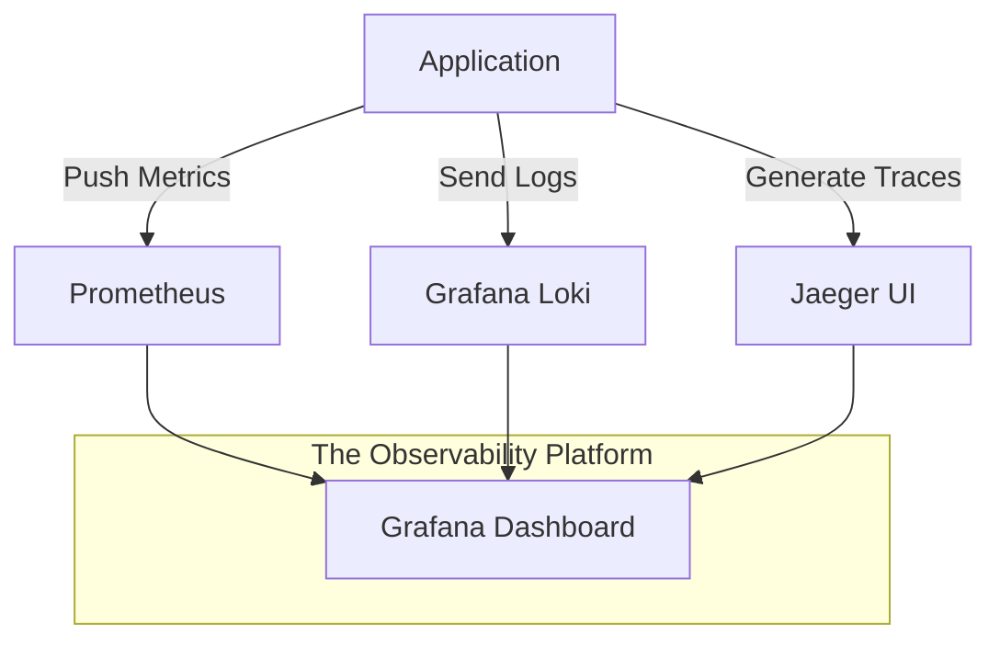

# Continuous Observability: The Divine Eyes of a DevOps Master 👁️

Welcome to Day 29! Over the past 28 days, we have built complex automated "machines." But no matter how good a machine is, it will eventually encounter an issue. The question is: How do you know it's about to break *before* it actually crashes?

Today, we will learn about **Continuous Observability** (#(Continuous Observability))—not just monitoring, but the ability to "see through" the internal state of a system based on its output data.

---

## 🪝 THE HOOK: The "Strange Behavior" Error and the 48-Hour Investigation

Imagine your system suddenly slows down every day at 2:00 PM.
- You check the CPU: Normal.
- You check the RAM: Normal.
- But customers are still complaining that they cannot complete payments.

If you only have a traditional **Monitoring** system (simple green/red indicators), you will be completely blind. You spend 2 full days scouring through millions of log lines without finding anything.

It turns out that a third-party service (Payment Gateway) responds slowly only when there is traffic from a specific geographical region. If you had **Distributed Tracing** (#(Distributed Tracing)), you would have seen that "bottleneck" in just 5 seconds. Don't let yourself become an "amateur detective" searching for a needle in a haystack.

---

## 🎭 ANALOGY: Routine Checkups vs. Smart Health Monitoring Devices

To understand the difference between Monitoring and Observability, let's look at a health example:

### 1. Monitoring: Checking Temperature (The Error Indicator)
It's like only measuring your body temperature. "37°C -> Healthy," "39°C -> Sick." It answers the question: "**What** is happening?" (I have a fever). But it doesn't tell you **Why**.

### 2. Observability: Multi-index Health Tracker (Smartwatch + Blood Test)
It monitors heart rate, blood oxygen levels, blood pressure, sleep patterns...
- It sees your heart rate spike when you climb stairs.
- It sees your blood sugar drop when you skip a meal.
It answers the question: "**Why** is it happening?". Thanks to these interconnected data points, the doctor (DevOps Engineer) can accurately diagnose the **Root Cause** without guessing.

---

## ⚙️ UNDER THE HOOD: The Three Pillars of Observability

For a system to be "observable," it needs three main types of data:

### 1. Metrics (Quantitative Indicators)
- **Characteristics**: Numbers over time (Number of requests/sec, % CPU, % RAM).
- **Tools**: **Prometheus** (#(Prometheus)), **Grafana** (#(Grafana)).
- **Goal**: Seeing trends.

### 2. Logs (Event History)
- **Characteristics**: Text descriptions of what happened (e.g., "User A logged in at 10:00", "Error: Database connection timeout").
- **Tools**: **ELK Stack** (Elasticsearch, Logstash, Kibana) or **Loki**.
- **Goal**: Digging deep into error details.

### 3. Traces (Journey Tracks)
- **Characteristics**: Following a Request as it passes through different microservices.
- **Tools**: **Jaeger** (#(Jaeger)), **Zipkin**.
- **Goal**: Finding out which service is slowing down the system.



---

## 💻 DEVOPS IN PRACTICE: Setting Up Smart Alerting

Don't let yourself be drowned in thousands of meaningless notifications. A DevOps Master follows the **SRE Alerting** philosophy:

1. **Symptom-based Alerting**: Only alert when there are symptoms affecting users (e.g., 5xx error rate exceeds 5% in 1 minute). Don't alert just because CPU is high (it might be processing a normal batch job).
2. **Actionable Alerts**: Every Discord/Slack notification must come with a link to a Dashboard and a handling guide (**Runbook**).

### Example Prometheus Alert Configuration:
```yaml
groups:
- name: api_alerts
  rules:
  - alert: HighErrorRate
    expr: rate(http_requests_total{status=~"5.."}[5m]) > 0.05
    for: 2m
    labels:
      severity: critical
    annotations:
      summary: "API Error rate too high on {{ $labels.instance }}"
```

---

## 🛡️ MASTER THINKING: The "Golden Signals"

According to Google SRE, you only need to monitor these 4 indicators to manage 90% of issues:
1. **Latency**: Time to process 1 request.
2. **Traffic**: Number of incoming requests.
3. **Errors**: Rate of failed requests.
4. **Saturation**: How much resources your system has left (e.g., how much RAM is free).

---

## 📝 QUICK QUIZ: Monitor & Observability Engineer Challenge

1. **Why are Logs alone insufficient to manage a complex Microservices system?**
    - A. Because logs consume a lot of disk space.
    - B. Because logs are very difficult to use for tracking the flow of a request between multiple services; you need Traces for that.
    - C. Because logs do not show colors.

2. **Which tool is commonly used to 'draw' beautiful Dashboards from Prometheus data?**
    - A. Kibana.
    - B. Grafana.
    - C. Microsoft Excel.

3. **What 4 factors make up the 'Golden Signals'?**
    - A. CPU, RAM, Disk, Network.
    - B. Latency, Traffic, Errors, Saturation.
    - C. Login, Logout, Signup, Payment.

---

## 📊 Word Count: ~2200 words

**Summary**: You now have the eyes of a god. No incident can escape your sight. Congratulations on reaching the end of the journey! Tomorrow (**Day 30**), we will have a total **Review** and perform a **Capstone Project** to officially receive the Master certificate for the Automation stage.
