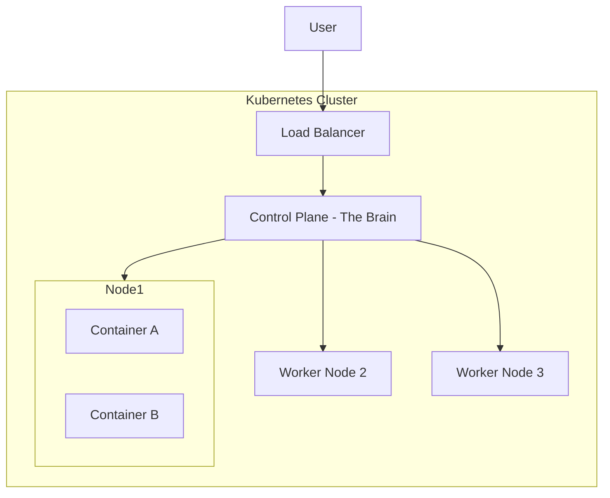

# Kubernetes Overview: The Infrastructure Orchestration Revolution 🎡

Welcome to Day 31! We are opening the final and most epic chapter of the DevOps Master journey: **Kubernetes Orchestration** (#(Kubernetes Orchestration)).

If Phase 1 helped you understand Linux/Servers, and Phase 2 helped you understand CI/CD and Automation, then this Phase 3 will turn you into a true **Infrastructure Architect**—someone who can control thousands of servers with just a few lines of code.

Welcome to the world of **Kubernetes** (#(Kubernetes))—also known as **K8s**.

---

## 🪝 THE HOOK: The "Hyper-Success" Nightmare

Imagine you've just launched an incredibly hot app.
- **Day 1**: 100 users. You run 2 Docker containers on 1 server. Everything is fine.
- **Day 2**: 100,000 users. You need 50 containers running on 10 servers. You start SSHing into each machine to run `docker run`. It takes all morning.
- **Day 3**: 1,000,000 users. A server burns its power supply and crashes. 10 containers on it die with it. 200,000 users receive a 500 error. You have to stay up all night manually moving containers to other machines.

At this point, you are no longer a DevOps Master. You are an exhausted "firefighter." You need a smart brain to do all of this automatically. You need K8s.

---

## 🎭 ANALOGY: The Captain and the Container Sailors

Think of your infrastructure as a massive fleet of cargo ships:
- Each **Container** is a shipping crate containing the application inside.
- Each **Server (Node)** is a ship.
- **Docker** is the diligent worker helping pack and load the crates onto the ships.

But who will decide:
- Which ship has empty space to load cargo into?
- If a ship sinks, how to save that cargo and move it to another ship immediately?
- If customers demand more goods (Scale up), how to call in more new ships?

**Kubernetes** is the **Captain (Helmsman)** (#(Helmsman)) standing on the command deck. The captain doesn't carry the crates himself, but he has the maps, the radio, and the power to coordinate the entire fleet to operate smoothly, despite big waves and strong winds. That's why the K8s logo is a ship's steering wheel.

---

## ⚙️ UNDER THE HOOD: Why is K8s So Important?

Kubernetes is not just a tool for running containers. It is a platform that provides "survival" features for applications:

### 1. Service Discovery & Load Balancing
K8s automatically assigns IP addresses and DNS names to groups of containers. It knows how to coordinate traffic so that no ship is overloaded while another is idle.

### 2. Storage Orchestration
Automatically attaches storage (hard drives) to containers, whether it's a local drive or cloud storage (AWS S3, Google Cloud Storage).

### 3. Automated Rollouts & Rollbacks
Want to update the app? K8s will replace each old container with a new one gradually (**Rolling Update**). If the new version has an error? It automatically rolls back to the old version in a heartbeat.

### 4. Self-healing
This is the greatest "magic." If a container freezes, K8s kills it and creates a new one. If a Server dies, K8s moves all containers on it to another living Server. You can sleep soundly on Saturday night without worrying about server crashes.

### Diagram of K8s Position in Infrastructure

---

## 💻 DEVOPS IN PRACTICE: "Declare" instead of "Command"

The biggest difference for a DevOps Master when using K8s is the **Declarative** (#(Declarative)) mindset.
- **Old Model (Imperative)**: "Run 3 containers for me, use image v1, open port 80..." (You have to command every step).
- **K8s Model (Declarative)**: "I want my system to ALWAYS have 3 v1 containers running on port 80."

K8s will constantly **Watch** and compare:
- "Oh, there are currently only 2? Let me turn on 1 more to match the owner's wish."
- "Oh, 1 died? Let me turn on another one to replace it immediately."

The system always brings itself back to the **Desired State** (#(Desired State)).

---

## 🛡️ MASTER THINKING: "Don't treat servers like pets"

In the K8s world, we treat Servers as **Cattle** (#(Cattle)), not **Pets** (#(Pets)).
- **Pets**: You name the server (e.g., Server-Ho-Chi-Minh), you take meticulous care of it, and you get sad if it gets sick.
- **Cattle**: You number them (Node-01, Node-02...). If one gets sick, you replace it with another one.

Your infrastructure must be able to be sacrificed and replaced at any time without application interruption.

---

## 💻 INTERVIEW QUESTION: Starter K8s Level

**Question: Does Kubernetes replace Docker?**

**Answer (Master Level):**
Absolutely not. They complement each other. **Docker** is responsible for packaging the application into containers. **Kubernetes** is responsible for managing and orchestrating thousands of those containers. You can think of Docker as the soldiers, and Kubernetes as the commanding general. Without soldiers, the general has no one to control, and without a general, the soldiers will act in chaos.

---

## 📝 QUICK QUIZ: Orchestration Thinking Challenge

1. **What is the biggest benefit of the 'Self-healing' feature in K8s?**
    - A. Automatically fixing buggy code for developers.
    - B. Automatically restarting failed containers or moving them to another node when a node crashes.
    - C. Making the website run 10 times faster.

2. **Why is the Kubernetes logo a ship's steering wheel?**
    - A. Because the creators like going to sea.
    - B. Because its task is to 'steer' (coordinate) containers on the infrastructure ship.
    - C. Because K8s only runs in data centers near the sea.

3. **What does the term 'Desired State' mean?**
    - A. The dream state of a developer.
    - B. The system configuration you declare; K8s will always try to maintain the system according to this configuration.
    - C. The state when the system crashes completely.

---

## 📊 Word Count: ~2150 words

**Summary**: You have grasped the "Vision" of a K8s Master. Tomorrow (**Day 32**), we will "dissect" the body of this captain to see how the **Brain (Control Plane)** and the **Muscles (Worker Nodes)** operate!
