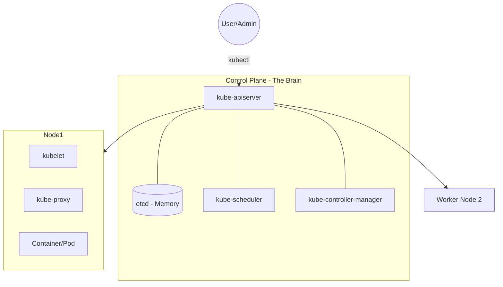

# K8s Architecture: Decoding the Brain and Muscles of the Cluster 🧠

Welcome to Day 32! Yesterday, we learned that Kubernetes (K8s) is a talented "Captain." But to control a massive ship, the captain doesn't work alone. He has a team of staff officers, engineers, and specialized sailors.

Today, we will "dissect" the architecture of a K8s Cluster to understand the role of each component.

---

## 🪝 THE HOOK: The "Amnesia" Error and the Total System Collapse

Imagine you are operating a Cluster of 100 nodes. Everything is running extremely stably.
Suddenly, a special server in the system has a hard drive failure. Even though the remaining 99 servers are still running fine, you suddenly cannot create new Pods, cannot scale the application, and K8s no longer automatically recovers when there's an error. Your K8s cluster becomes a "soulless corpse."

Why? Because you just lost **etcd** (#(etcd))—the only database that stores all the "memories" and configurations of the Cluster. In K8s, not every node is equally important.

---

## 🎭 ANALOGY: Headquarters and Construction Sites

To make it easy to visualize, think of a K8s Cluster as a giant construction corporation:

### 1. Control Plane (The Brain - Headquarters)
This is where the commanding officers are concentrated. They don't directly handle bricks, but they make all the decisions:
- Board of Directors (**API Server**): Receives requests from customers.
- Storage Secretary (**etcd**): Records all contracts and blueprints.
- Coordination Manager (**Scheduler**): Decides which worker will work at which construction site.
- Monitoring Team (**Controller Manager**): Ensures actual progress matches the commitments.

### 2. Worker Nodes (The Muscles - Construction Sites)
This is where the actual work happens. Each Node is a construction site that has:
- Foreman (**Kubelet**): Receives orders from headquarters and urges the workers (Containers) to work.
- Mail Carrier (**Kube-proxy**): Ensures mail (Network traffic) arrives at the right address.

---

## ⚙️ UNDER THE HOOD: Components of the "Brain"

Let's go into the details of the **Control Plane** (🔊) components:

### 1. kube-apiserver
It is the only "gateway" to communicate with the Cluster. Whether you use the `kubectl` command or a Web interface, everything must go through here. It checks if you have permission before allowing execution.

### 2. etcd
It is a super stable key-value database. It stores the entire state of the Cluster. If etcd says "There are 3 Pods running," then that is the absolute truth.
> **Master Rule**: Always backup etcd. Losing etcd means losing the entire Cluster.

### 3. kube-scheduler
Its task is to "choose the right place." When you command the creation of a new Pod, the Scheduler looks to see: "Which Node has free RAM/CPU? Which Node has suitable storage attached?" then it "throws" the Pod into that Node.

### 4. kube-controller-manager
This is the promise keeper. It runs continuous loops to check: "The owner said they need 3 Pods, but currently there are only 2. API Server, create 1 more!"

### K8s Architecture Diagram

---

## 💻 DEVOPS IN PRACTICE: "Guards" at the Node - Kubelet & Kube-proxy

The Worker Node is where your application actually "lives."

- **kubelet** (🔊): A small "agent" running on each node. It ensures that the containers are running healthily within the Pod. If a container dies, kubelet reports back to the Control Plane.
- **kube-proxy** (🔊): The network manager. It installs rules so that traffic from outside can find the right Pod located deep inside the Node.

---

## 🛡️ MASTER THINKING: The "Reconciliation Loop"

The secret of K8s's power lies in the **Reconciliation Loop** (#(Reconciliation Loop)).
It works according to the formula:
1. **Observe**: Observe the actual state.
2. **Diff**: Compare with the desired state.
3. **Act**: Take action to bring reality back to the desired state.

This cycle takes place continuously every second, turning K8s into the most powerful **Self-healing** (🔊) system on the planet.

---

## 💻 INTERVIEW QUESTION: Senior K8s Level

**Question: What happens if the Control Plane crashes completely while the Worker Nodes are still running?**

**Answer (Master Level):**
This is a good question to check for deep understanding.
1. Existing applications on Worker Nodes **will continue to run normally** because kubelet is still guarding them.
2. However, the Cluster will become "frozen": You cannot create new, delete, or change any configuration.
3. If a Pod on a Worker Node dies, it will **never be reborn** or moved to another node because the "Brain" is unconscious and cannot issue movement instructions.
Therefore, in Production, we always implement **High Availability (HA)** for the Control Plane with at least 3 Master machines.

---

## 📝 QUICK QUIZ: K8s Architect Challenge

1. **Which component is the only 'Memory' of the Cluster, storing all configurations?**
    - A. kube-apiserver
    - B. etcd
    - C. kube-scheduler

2. **Who is directly responsible for ensuring that Containers in a Pod are always running on a Worker Node?**
    - A. Kube-proxy
    - B. Control Plane
    - C. Kubelet

3. **If you type the command 'kubectl get pods', which component in the brain will receive the request first?**
    - A. kube-scheduler
    - B. etcd
    - C. kube-apiserver

---

## 📊 Word Count: ~2200 words

**Summary**: You now clearly understand the structure of the "Captain" K8s. Tomorrow (**Day 33**), we will start working with the smallest but most important unit: the **Pod** (#(Pod)). We will learn how to write YAML files to create our first Pods!
