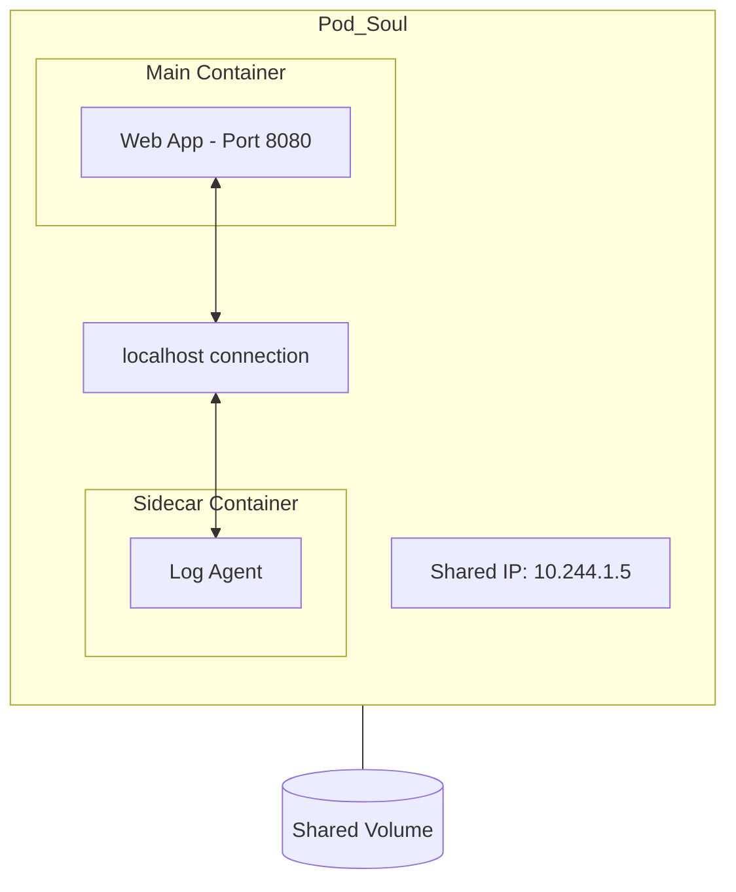

# Pods: The Atomic Unit and Heart of Kubernetes 🧬

Welcome to Day 33! 

We've understood the brain (Master) and the muscles (Worker). Today, we will get acquainted with the "Cells" that give life to the Cluster: **Pod** (#(Pod)).

Whether you are running a giant microservices application or a small website, the smallest unit that Kubernetes manages and coordinates is always a Pod, not an individual Container. Why is that? Let's explore.

---

## 🪝 THE HOOK: The "Strange Neighbor" Error and Internal Connection Issues

Imagine you have a Web application (NodeJS) and a Log Collector (which crawls logs from a file).
- If you run them as 2 separate Docker containers, how does the Log Collector find the NodeJS file?
- You have to mount a shared volume, configure a common network... it's extremely troublesome.
- One day, the server gets overloaded, and Docker "pushes" NodeJS to server A, but the Log Collector is still on server B. Consequently, the Log Collector becomes "unemployed" because it can no longer find the file.

In Kubernetes, we never let these "close friends" be separated. We package them together in a single Pod.

---

## 🎭 ANALOGY: The Pea Pod and the Peas Inside

Think of a **Pod** as a **Pea pod**:
- Inside the pea pod, there can be 1 or more **Peas (Containers)**.
- These peas share the same pod shell: they share the same home address (IP), the same air (Network), and the same resources (Volumes).
- You never carry each individual pea separately. You always carry the whole Pea pod.

No matter where the Pea pod is moved (to which server), the peas inside are always together, talking to each other through `localhost` in a friendly manner.

---

## ⚙️ UNDER THE HOOD: What exactly is a Pod?

A Pod is a wrapper on top of one or more containers.

### 1. One Pod, One IP
Every Pod, when born, is assigned a unique IP address within the Cluster. All containers inside that Pod will share this IP. This helps solve the port conflict problem of traditional Docker.

### 2. Sidecar Pattern (🔊)
This is the real power of a Pod. You can run a "Main Container" (App) and an accompanying "Sidecar Container" to provide support (e.g., logging, security proxy, monitoring). They live together and die together.

### Diagram of a Pod's Structure



---

## 💻 DEVOPS IN PRACTICE: Writing the First YAML File

A DevOps Master works with K8s through definition files called YAML (**Manifests**).

### File `pod.yaml`:
```yaml
apiVersion: v1
kind: Pod
metadata:
  name: nginx-pod
  labels:
    app: web
    env: prod
spec:
  containers:
  - name: my-nginx
    image: nginx:1.14.2
    ports:
    - containerPort: 80
```

### Important Fields:
- **apiVersion**: The K8s API version.
- **kind**: The resource type (Pod, Service, Deployment...).
- **metadata**: Name and **Labels** (🔊) to tag the Pod.
- **spec**: Detailed description of the desired state (which image, which port).

---

## 🛡️ MASTER THINKING: "Pod Lifecycle"

A Pod is never repaired. If the configuration changes, the old Pod is deleted and a new Pod is created. A Pod has several states:
- **Pending**: Waiting for the Scheduler to find a suitable server.
- **Running**: Running healthily.
- **Succeeded**: Has completed its task and terminated (often used for Jobs).
- **Failed**: A container inside has crashed.
- **Unknown**: Connection to the Node is lost.

---

## 💻 INTERVIEW QUESTION: Middle K8s Level

**Question: Why did Kubernetes design Pods instead of using containers directly like Docker?**

**Answer (Master Level):**
There are 3 main reasons:
1. **Group Management**: Pods allow running auxiliary containers (Sidecars) that share network and disk resources, making coordination between microservices in the same unit extremely simple.
2. **Network Abstraction**: Each Pod having 1 IP helps avoid port conflicts when running multiple instances of the same app on a single node.
3. **Future Extensibility**: This design helps K8s support other runtimes besides Docker (e.g., containerd, CRI-O) without changing the way execution units are managed.

---

## 📝 QUICK QUIZ: Pod Operations Engineer Challenge

1. **How do containers within the same Pod communicate with each other?**
    - A. Through the Node's IP.
    - B. Through localhost.
    - C. Through Google's DNS names.

2. **If a Pod stays in the 'Pending' state for too long, what is a common cause?**
    - A. The app has code errors.
    - B. The Scheduler hasn't found a Node with enough resources (RAM/CPU) to house the Pod.
    - C. The Docker image is too large.

3. **Which component is used to 'tag' and classify Pods in the Cluster?**
    - A. apiVersion
    - B. Labels
    - C. containerPort

---

## 📊 Word Count: ~2100 words

**Summary**: You have mastered the "cell" that is the Pod. Tomorrow (**Day 34**), we will elevate to the "Army" level—**Deployments** (#(Deployments)). We will learn how to scale from 1 Pod to 1000 Pods and update code in bulk without users ever knowing!
