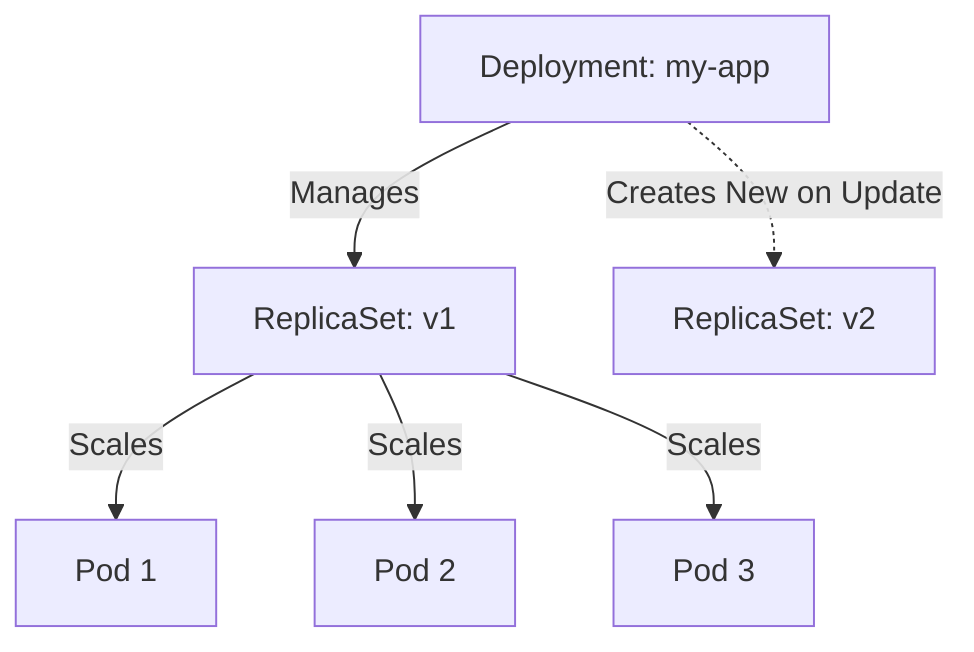

# Deployments: Coordinating the Container Army and Infinite Scaling Strategies 📈

Welcome to Day 34! 

Yesterday, we learned how to create individual **Pod** "Cells." But in the real world, no DevOps Master creates Pods manually one by one. If you need 10 instances of an application to handle a load, would you write 10 YAML files? Or if you want to update to a new app version, would you delete 10 old Pods and create 10 new Pods by hand?

The answer is NO. We use **Deployments** (#(Deployment)).

---

## 🪝 THE HOOK: The "Blind Update" Error and the 2-Minute Server Death

Imagine you are running a single Pod for your website. You commit new code and use the command `kubectl delete pod` followed by `kubectl apply` for the new version.
- During the 30 seconds to 1 minute it takes for the new app version to start, users accessing the website will receive a **404** or **Connection Timeout** error.
- If the new code has a bug, the website will crash completely until you discover it and manually revert to the old version.

This is the "Stone Age" way of doing things. In the K8s era, applications must be updated smoothly (**Zero Downtime**) and expanded automatically during traffic spikes.

---

## 🎭 ANALOGY: The Coordinator and the Choreographed Dance Troupe

Think of a **Deployment** as a **Coordinator** managing a dance troupe:
- You (the Admin) only need to tell the Coordinator: "I want to always have 5 dancers on stage."
- If one dancer trips and falls (Pod crash), the Coordinator immediately pushes a backup dancer in to replace them so that the troupe always has 5 people.
- If you want to change costumes (Update code), the Coordinator won't make the whole troupe stop. He will have each person go to change clothes one by one. Only after one person is done and returns to the stage does the next person go.

The troupe continues to perform, and the audience (Users) doesn't notice any disruption. This is **Rolling Update**.

---

## ⚙️ UNDER THE HOOD: Hierarchical Structure in a Deployment

A Deployment does not directly manage Pods. It controls them through an intermediate layer called a **ReplicaSet** (🔊).

1. **Deployment**: Manages update strategies (Rolling Update, Recreate).
2. **ReplicaSet**: Ensures the number of Pods (Replicas) is always exactly as desired.
3. **Pod**: The actual object running the container.

### Hierarchical Diagram:


### Rolling Update Strategy (Default):
When you change the image from v1 to v2:
- Deployment creates ReplicaSet v2.
- It spins up 1 Pod in v2; after Pod v2 is alive, it shuts down 1 Pod in v1.
- The process repeats until 100% of the Pods are v2. This is the secret of **Zero Downtime Deployment** (#(Zero Downtime Deploy)).

---

## 💻 DEVOPS IN PRACTICE: Scaling Infrastructure in 5 Seconds

Let's look at a Master-standard Deployment file:

```yaml
apiVersion: apps/v1
kind: Deployment
metadata:
  name: supernova-web
spec:
  replicas: 3 # Number of Pods desired
  selector:
    matchLabels:
      app: web
  template: # This is the blueprint for the Pod inside
    metadata:
      labels:
        app: web
    spec:
      containers:
      - name: nginx
        image: nginx:1.21
```

### The "Magic" Scaling Command:
If there is a sudden spike in users, you only need to type:
`kubectl scale deployment supernova-web --replicas=10`
In an instant, 7 new Pods will appear. No need to install servers, no need to SSH.

---

## 🛡️ MASTER THINKING: "The Art of Rollback"

Every Master can make mistakes, but a Master knows how to fix mistakes the fastest.
What if you accidentally deploy buggy code that causes Pods to crash continuously?
`kubectl rollout undo deployment supernova-web`
Deployment will immediately reverse the process, shutting down v2 Pods and turning back on the stable v1 Pods. The system is saved in 10 seconds!

---

## 💻 INTERVIEW QUESTION: Senior K8s Level

**Question: How do you ensure your application is not disrupted during an update, but also doesn't consume too many redundant resources during the update?**

**Answer (Master Level):**
We use 2 important parameters in the `strategy`:
1. **maxSurge**: The number of Pods that can exceed the specified level during an update (e.g., `25%`). K8s will spin up new machines before shutting down old ones.
2. **maxUnavailable**: The maximum number of Pods allowed to be "down" during an update (e.g., `25%`).
By fine-tuning these two numbers, we can balance update speed and system stability depending on available resources.

---

## 📝 QUICK QUIZ: Scaling Systems Engineer Challenge

1. **Which component is directly responsible for keeping the correct number of Pods (Replicas) running?**
    - A. Deployment
    - B. ReplicaSet
    - C. Pod

2. **What is the biggest benefit of the 'Rolling Update' strategy?**
    - A. Making Docker images smaller.
    - B. Updating to a new version without service disruption (Zero Downtime).
    - C. Automatically fixing bugs in code.

3. **Which command helps you return to a previous stable version when an update fails?**
    - A. kubectl undo
    - B. kubectl rollout undo
    - C. kubectl delete deployment

---

## 📊 Word Count: ~2200 words

**Summary**: You now know how to control a powerful army of Pods. Tomorrow (**Day 35**), we will learn how to "communicate" and configure that army without changing code—exploring **ConfigMaps** (#(ConfigMaps)) and **Secrets** (#(Secrets))!
