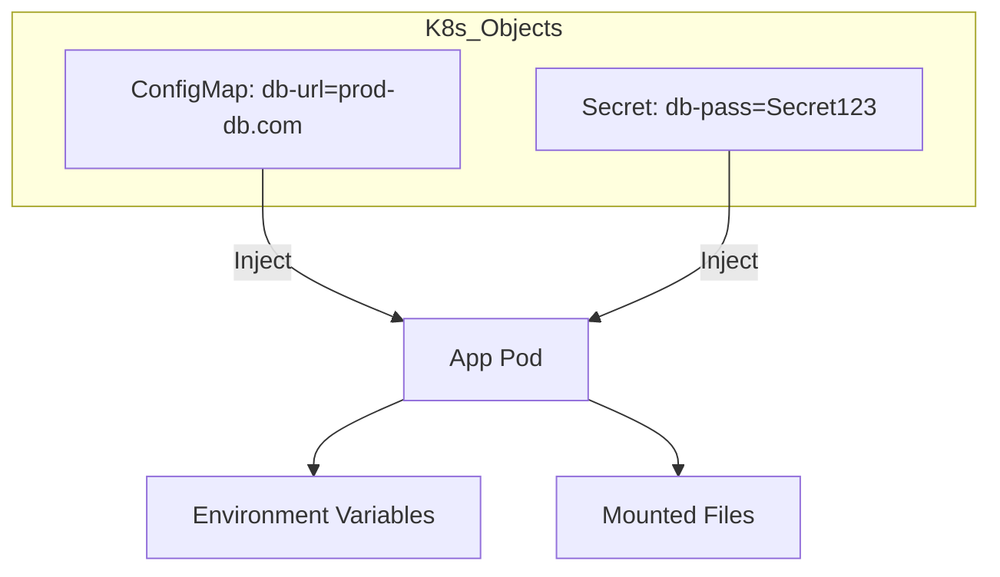

# ConfigMaps & Secrets: The Art of Decoupling Configuration and Data Security 🔒

Welcome to Day 35! 

We've learned how to create a powerful "Army" of Pods. But how does that army know which Database to connect to? Or what the password is? 
- If you write the password directly into the code (Hardcoding)? Extremely dangerous.
- If you write the password in the `Dockerfile`? Anyone who downloads the image can see it. 

Today, we will learn how to completely decouple **Code** (Application logic) and **Configuration** using **ConfigMaps** and **Secrets** (#(Secrets)).

---

## 🪝 THE HOOK: The "Dr. Jekyll and Mr. Hyde" Error and Password Leaks

Imagine you've built a top-notch Docker Image. You use it for both **Dev** and **Prod** environments.
- In Dev, your Database is `dev-db.supernova.com`.
- In Prod, the Database is `prod-db.supernova.com`. 
- If you embed the DB address inside the Image, you'll have to build 2 different Images just to change one domain name. 

Even worse, you accidentally commit a configuration file containing the Production Database password to a public GitHub repository. Just 5 minutes later, a hacker uses a script to scan it, and all customer data is encrypted for ransom. 

A DevOps Master always keeps their Code "Clean" and "Neutral." All configurations will be "Injected" from the outside at startup.

---

## 🎭 ANALOGY: The Universal Remote and the Batteries

Think of a **Pod** as a **TV Remote**:
- The remote itself (Code/Image) is mass-produced identically at the factory. It doesn't know which TV it will control.
- **ConfigMap** is like setting the buttons: "Button 1 is HBO, Button 2 is Disney." You set them differently depending on the house.
- **Secret** is like the **Battery** (🔊): It is sensitive energy. You never mold the battery permanently into the remote. You only insert it when you need to use it. If the remote breaks, you take the battery out and put it into a new one.

The remote remains the same, but it can serve any TV just by changing the configuration and batteries from the outside.

---

## ⚙️ UNDER THE HOOD: ConfigMap vs. Secret

The most important difference lies in the intended use:

### 1. ConfigMap (General Configuration)
- **Used for**: Non-sensitive information (e.g., Database name, log level, third-party API URLs).
- **Storage**: Stored as plain text.

### 2. Secrets (Sensitive Information)
- **Used for**: Passwords, API Keys, Tokens, SSH Keys...
- **Storage**: K8s encodes them in **Base64** (🔊). 
> **Master Warning**: Base64 is only a form of obfuscation, not true encryption. For absolute security of Secrets, we need to combine them with solutions like HashiCorp Vault or encryption at the K8s storage layer.

### Data Injection Flow Diagram



---

## 💻 DEVOPS IN PRACTICE: Two Ways to "Inject" Data into Pods

There are 2 main ways for an application to read configurations from K8s:

### 1. Via Environment Variables
Suitable for small applications or simple configurations.
```yaml
env:
- name: DB_URL
  valueFrom:
    configMapKeyRef:
      name: my-config
      key: database_url
```

### 2. Via Volume (File Mount)
Suitable for large configuration files or apps that require reading files (e.g., `nginx.conf`, `settings.json`).
K8s will turn the ConfigMap into a real file located on the Container's hard drive. When you update the ConfigMap, this file will automatically be updated without needing to restart the Pod!

---

## 🛡️ MASTER THINKING: "Immutable Config"

In a massive system, changing a ConfigMap mid-stream can be risky (the app might read the new config but not be ready). 
Senior DevOps often use the mindset: **Every time you change the config, create a new ConfigMap with a new version** (e.g., `my-config-v1`, `my-config-v2`). Then update the Deployment to point to the new one. This allows us to **Rollback** both code and configuration safely.

---

## 💻 INTERVIEW QUESTION: Senior K8s Level

**Question: How do you secure Secrets in Kubernetes in the most professional way?**

**Answer (Master Level):**
1. **RBAC**: Limit access to Secrets (Only those with the role should be able to view them).
2. **Encryption at Rest**: Configure K8s to encrypt Secret data before storing it in `etcd`.
3. **External Secrets**: Use the **External Secrets Operator** (#(External Secrets Operator)) to fetch passwords directly from top-tier vaults like AWS Secrets Manager or HashiCorp Vault. The Secret in K8s is just a temporary "cache."
4. **GitOps**: Never, ever save Secrets to Git (even if they are base64). Use tools like **SealedSecrets** or **Sops** to encrypt them before committing.

---

## 📝 QUICK QUIZ: Data Guardian Challenge

1. **What is the biggest difference between a ConfigMap and a Secret?**
    - A. ConfigMap runs faster.
    - B. Secret is used for sensitive data and is Base64 encoded to be less visible.
    - C. ConfigMap can only be used for Docker.

2. **Which method allows an application to receive new configuration without writing code to read the K8s API?**
    - A. Send an email to the system.
    - B. Use a ConfigMap mounted as a Volume (File).
    - C. Use the `kubectl apply` command continuously.

3. **Is K8s Secret's Base64 encoding truly secure against professional hackers?**
    - A. Yes, extremely secure.
    - B. No, it is just data reformatting; anyone with K8s access can decode it easily.

---

## 📊 Word Count: ~2300 words

**Summary**: You now know how to protect the "soul" (Data) and "personality" (Config) of your application. Congratulations on completing this series of lessons! You are ready to operate K8s like a true professional. See you in the next challenges!
