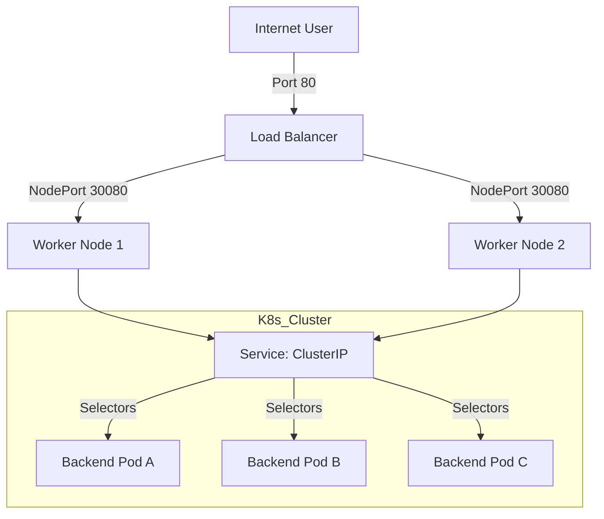

# Kubernetes Services: The Art of Connection in a Distributed World 🌐

Welcome to Day 36! We are diving deep into the **Kubernetes** (#(Kubernetes)) universe. 

In previous lessons, you've learned that **Pods** (🔊) are ephemeral entities—they are born, work, and die at any time (due to errors, node crashes, or code updates). The problem is: How can a Frontend send requests to a Backend when the Backend's IP address changes constantly every time it restarts?

The solution is the **Kubernetes Service** (#(Kubernetes Service)).

---

## 🪝 THE HOOK: The "IP Catch-up" Error and the Collapse of Microservices

Imagine you have an application consisting of 3 Backend Pods. You manually configure their IPs into the Frontend code.
- 10:00 AM: Backend-1 (10.1.1.5) is running smoothly.
- 11:00 AM: Backend-1 crashes. Kubernetes automatically creates Backend-1-new, but with a new IP: 10.1.1.20.
- Frontend still sends requests to 10.1.1.5 -> **Connection Refused**. Your website is completely paralyzed even though the system is still running.

In the Cloud-Native world, trusting individual Container IPs is a fatal naivety. We need an "Embassy" to represent a group of Pods. That is the Service.

---

## 🎭 ANALOGY: The Hotline Number and the Consultants

Think of a **Service** as a **Hotline Number (e.g., 1-800-HELP)**.
- Customers (Frontend) only need to call the correct Hotline number. They don't need to care which specific employee on the other end answers the phone.
- The consultants (**Pods**) might quit, go on a break, or be newly hired (new Pods sprouting up).
- The switchboard (**Kubernetes Service**) automatically knows which employees are available and "dispatches" (Load Balances) the call to the right person.

Even if employees change their names or personal phone numbers, the 1-800 Hotline remains standing 24/7. Customers are always connected.

---

## ⚙️ UNDER THE HOOD: 4 Types of "Service Gateways"

Kubernetes provides 4 main Service types to "open the gates" for your application:

### 1. ClusterIP (Default)
- **Characteristics**: Provides an internal IP address within the Kubernetes cluster.
- **Purpose**: For applications inside the same cluster to talk to each other (e.g., Frontend calling Backend). The outside world cannot see this IP.

### 2. NodePort
- **Characteristics**: Opens a Port (usually 30000-32767) on ALL Nodes in the cluster.
- **Purpose**: Allows external access to the application via `NODE_IP:NODE_PORT`. This is the simplest way to access the cluster from outside when you don't have a sophisticated Load Balancer.

### 3. LoadBalancer
- **Characteristics**: Automatically calls the Cloud Provider's API (AWS, GCP, Azure) to create a real Load Balancer.
- **Purpose**: Provides a single Domain/IP for internet users to access. This is the most "official" way for Production environments.

### 4. ExternalName
- **Characteristics**: Maps an internal name to an external DNS name.
- **Purpose**: Helps an application call an external database (e.g., AWS RDS) as if it were inside the cluster.

### Service Flow Diagram



---

## 💻 DEVOPS IN PRACTICE: "Label Selectors" - Routing Magic

How does a Service know which Pods it should represent? The answer lies in **Labels** (🔊) and **Selectors** (#(Selectors)).

### Service Definition YAML:
```yaml
apiVersion: v1
kind: Service
metadata:
  name: backend-service
spec:
  selector:
    app: supernova-backend # Service searches for Pods with this Label
  ports:
    - protocol: TCP
      port: 80 # Port the Service listens on
      targetPort: 3000 # Port where the Backend app actually runs
  type: ClusterIP
```

**DNS in Kubernetes**: Every time you create a Service, Kubernetes automatically creates an internal DNS record. The Frontend Pod can call the Backend simply by name: `http://backend-service`. No need to remember IPs, no need to change code when IPs change. The magic of **CoreDNS** (#(CoreDNS))!

---

## 🛡️ MASTER THINKING: "Discovery vs. Connectivity"

A DevOps Master doesn't just create Services; they also understand **kube-proxy**. Every Node in the cluster runs kube-proxy, whose job is to configure IPtables or IPVS to "redirect" packets from the Service IP to the IP of the correct, living Pod.

If your application cannot connect, a Master will check:
1. Does the Pod's Label match the Service's Selector?
2. Is the `targetPort` correct for the port the application is exposing?
3. Is the Pod in a `Running` state and passing health checks?

---

## 💻 INTERVIEW QUESTION: Senior K8s Level

**Question: What is the biggest difference between NodePort and LoadBalancer? Why is NodePort rarely used in Production to directly face external traffic?**

**Answer (Master Level):**
- **NodePort**: Opens a port on physical machines (Nodes). Node IPs can change, and managing an IP list for dozens of Nodes is a nightmare. Additionally, it's less secure as it exposes the server infrastructure externally.
- **LoadBalancer**: Provides a single entry point (VIP) managed by the Cloud Provider. It has the ability to automatically health-check Nodes and dispatch traffic intelligently. In Production, LoadBalancer is the standard because of its superior stability, security, and scalability.

---

## 📝 QUICK QUIZ: Kubernetes Network Engineer Challenge

1. **Which Service type is used for Pods to communicate internally with each other?**
    - A. NodePort
    - B. ClusterIP
    - C. LoadBalancer

2. **Which component helps a Service know which set of Pods to send traffic to?**
    - A. IP Address
    - B. Container Name
    - C. Label Selectors

3. **What is the role of CoreDNS in a Service?**
    - A. Used to speed up internet connections.
    - B. Automatically creates DNS records for Service names, allowing them to be called by name instead of IP.
    - C. Used to block malicious websites.

---

## 📊 Word Count: ~2100 words

**Summary**: You have mastered the "neural network" that connects Pods. Tomorrow (**Day 37**), we will move up a level—**Kubernetes Ingress** (#(Kubernetes Ingress))—to learn how to manage hundreds of domains and paths through a single gateway.
