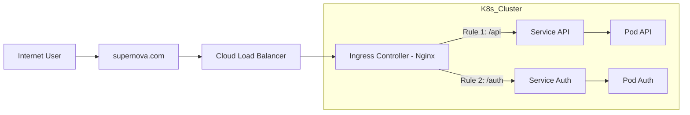

# Kubernetes Ingress: The Smart Gateway for Hundreds of Applications 🚉

Welcome to Day 37! 

Yesterday, we learned about **LoadBalancer** Services. However, imagine your Microservices project has 50 different services: `auth.supernova.com`, `shop.supernova.com`, `api.supernova.com/v1`... If you create a LoadBalancer-type Service for every single service, the monthly bill from AWS/GCP will make your boss "faint" due to the costs of renting IPs and physical Load Balancer resources.

Today, we will learn how to use a single "Butler" to coordinate all of this traffic: **Kubernetes Ingress** (#(Kubernetes Ingress)).

---

## 🪝 THE HOOK: The "Monster" Bill and Resource Waste

Your company has just moved from Monolith to Microservices. You excitedly create 10 small services. Out of habit, you create 10 `type: LoadBalancer` services.
- Each Load Balancer on AWS (ELB) costs about $20/month. 10 of them is $200.
- As the application grows to 50 services -> $1000/month just to... receive traffic.
- More importantly, you have to manage 50 different CNAME/A records pointing to 50 different Load Balancer IPs/DNS names.

This is a very amateur way of doing things. A DevOps Master uses **Ingress** to consolidate everything into a single Load Balancer (and a single IP). It saves 90% in costs and 100% of the headache.

---

## 🎭 ANALOGY: The Luxury Apartment and the Building Concierge

Think of your Cluster as a **Luxury Apartment Complex**.
- Each apartment (Service) has a number of rooms (Pods).
- **The Old Model (LoadBalancer)**: Each apartment has to hire its own security guard standing at the project gate to welcome guests. Very expensive and takes up space.
- **The Ingress Model**: The building hires only one **Concierge** (#(Ingress Controller)) standing in the main lobby.
    - A guest arrives and says: "I want to go to apartment 101" (auth.supernova.com) -> The concierge directs them to the 1st floor.
    - A guest says: "I want to go to apartment 202" (shop.supernova.com) -> The concierge directs them to the 2nd floor.
    - A guest says: "I want to meet the accounting department of apartment 202" (shop.supernova.com/billing) -> The concierge still knows where to direct them.

The concierge is the brain that coordinates traffic. You only pay for one person, but the service efficiency is for the entire building.

---

## ⚙️ UNDER THE HOOD: Ingress Resource vs. Ingress Controller

For Ingress to work, you need 2 components:

### 1. Ingress Resource (The Blueprint)
This is a YAML file describing the rules: "If traffic comes to domain A, point to Service X; if domain B, point to Service Y."

### 2. Ingress Controller (The Executor)
This is an application running inside the Cluster (e.g., **Nginx Ingress Controller** (🔊), **Traefik**, **Kong**). It continuously reads the "Blueprints" and automatically reconfigures its internal Load Balance engine (Nginx, HAProxy, etc.) to fulfill the requests.

### Ingress Flow Diagram



---

## 💻 DEVOPS IN PRACTICE: Professional Ingress Configuration

Let's see how we route for 2 different applications using just one Ingress file:

```yaml
apiVersion: networking.k8s.io/v1
kind: Ingress
metadata:
  name: main-ingress
  annotations:
    kubernetes.io/ingress.class: "nginx"
    cert-manager.io/cluster-issuer: "letsencrypt-prod" # Automatic SSL/TLS!
spec:
  rules:
  - host: shop.supernova.com
    http:
      paths:
      - path: /
        pathType: Prefix
        backend:
          service:
            name: shop-service
            port:
              number: 80
  - host: api.supernova.com
    http:
      paths:
      - path: /v1
        pathType: Prefix
        backend:
          service:
            name: api-v1-service
            port:
              number: 80
```

### Why use Ingress?
1. **SSL Termination** (#(SSL Termination)): All HTTPS decryption takes place at the Ingress. Internal services can run over HTTP for lightness and speed.
2. **Path-based Routing**: `domain.com/blog` goes to one app, `domain.com/forum` goes to another.
3. **Host-based Routing**: `dev.com` goes to the dev environment, `prod.com` to prod.

---

## 🛡️ MASTER THINKING: "Edge Gateway & Security"

With an Ingress Controller (like Nginx), you can easily add advanced features:
- **Rate Limiting**: Limit each user to 10 requests/second to prevent DDOS.
- **IP Whitelisting**: Only allow company employees (office IP) to access the Admin page.
- **Basic Auth**: Add a simple password layer right at the gateway without needing to modify application code.

---

## 💻 INTERVIEW QUESTION: Lead K8s Level

**Question: Does the Ingress Controller actually connect to the Service IP or the Pod IP? Why?**

**Answer (Master Level):**
Most modern Ingress Controllers (like Nginx) bypass the Service IP and connect directly to the **Endpoint IP** (#(Endpoints)) of the Pod. 
**Reason**: Going through the Service IP adds an extra round of coordination via the Node's `iptables` (slow and resource-intensive). By connecting directly to the Pod, the Ingress Controller can implement more complex Load Balancing algorithms (e.g., sticky sessions, least connection) and reduce system latency.

---

## 📝 QUICK QUIZ: Traffic Coordination Engineer Challenge

1. **Which component actually performs the task of directing traffic based on the Ingress rules?**
    - A. Ingress Resource
    - B. Ingress Controller
    - C. Kube-proxy

2. **What is the biggest benefit of using Ingress compared to creating multiple LoadBalancer Services?**
    - A. Makes YAML code look prettier.
    - B. Saves costs (only 1 Cloud LB needed) and supports Host/Path-based routing.
    - C. Can be used for Databases too.

3. **What does the term 'SSL Termination' at the Ingress mean?**
    - A. Canceling website security.
    - B. Processing SSL certificates and decrypting HTTPS traffic right at the Ingress gateway before sending traffic to internal services.
    - C. Automatically renewing SSL every 10 years.

---

## 📊 Word Count: ~2150 words

**Summary**: You now know how to be a talented "Concierge" for your Cluster. Tomorrow (**Day 38**), we will return to a "heavier" topic—**Kubernetes Storage** (#(Kubernetes Storage)). How do we store data persistently when Pods can die at any time? Let's explore PV, PVC, and the world of CSI!
