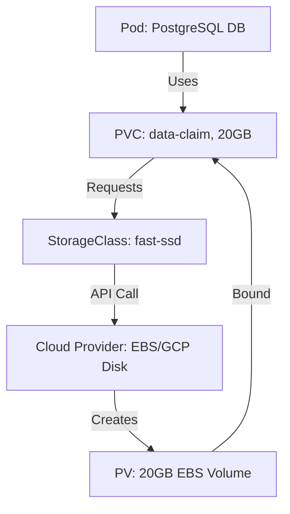

# Kubernetes Storage: Managing Data in an 'Impermanent' World 💾

Welcome to Day 38! 

In Kubernetes, Pods are ephemeral entities—they are here today and gone tomorrow. When a Pod is deleted or restarted, all the data you stored inside the Container (e.g., logs, uploaded files, database records) will **DISAPPEAR FOREVER**. 

To solve this problem, we need a persistent storage mechanism. Today, we will learn about the "Power Trio": **PV**, **PVC**, and **StorageClass** (#(StorageClass)).

---

## 🪝 THE HOOK: The "Deleted Pod, Lost Database" Error

Imagine you are running a PostgreSQL Database on Kubernetes. You forget to configure a Persistent Volume.
- At 2:00 AM, the Node crashes. Kubernetes automatically creates a new PostgreSQL Pod to replace it.
- You breathe a sigh of relief: "Thank goodness, K8s self-healed."
- But when you open the app, you discover that the last 2 years of data... is gone.
- Why? Because the new Pod uses a completely new and clean hard drive space. The old data was left in the old, dead Pod.

This is the most basic mistake but one that causes the greatest damage. In the Container world, data must be completely separated from the Pod's lifecycle.

---

## 🎭 ANALOGY: The Hotel (Pod) and the Safes (Volume)

Imagine you are a guest checking into a hotel room (Pod).

1. **Ephemeral Storage**: You leave your things in the room's drawer. When you check out and someone else moves in, the drawer is cleared out. You lose your things.
2. **Persistent Volume (PV)**: These are **Giant Safes** located in the hotel basement. They are already there (Static Provisioning) or are cast new when needed (Dynamic Provisioning).
3. **Persistent Volume Claim (PVC)**: This is the **Safe Rental Request**.
    - You write on the request: "I want to rent a 100-liter safe with a fingerprint lock."
    - The hotel manager (Kubernetes) goes to find a safe (PV) that matches your request and "Mounts" it to your room.

Even if you move from room 101 to room 505 (a new Pod), you just need to bring that "Rental Request" with you. The old safe will automatically be moved to your new room. Your belongings remain exactly as they were.

---

## ⚙️ UNDER THE HOOD: Automatic Storage Provisioning Process

In large systems, we cannot create every hard drive manually. Kubernetes uses automatic **Provisioning** (#(Provisioning)).

### 1. StorageClass (Service Type)
Defines the "Type of safe." E.g., "Super-fast SSD safe" (gp3) or "Low-cost HDD safe" (st1).

### 2. Persistent Volume Claim - PVC (App Request)
The application (Pod) will declare: "I need 20GB of SSD-type storage."

### 3. Persistent Volume - PV (Hard Drive Entity)
Based on the PVC, Kubernetes calls the Cloud Provider (AWS, GCP, etc.) to create a real hard drive and "Binds" it to the PVC.

### Storage Flow Diagram



### 4. CSI (Container Storage Interface)
**CSI** (#(CSI)) is a standard that allows Kubernetes to talk to any type of hard drive (AWS, Google, NetApp, VMWare, etc.) without needing to modify the core K8s code. It's like a universal USB port.

---

## 💻 DEVOPS IN PRACTICE: Master-standard Storage Configuration

Let's see how we request a hard drive for a Database:

```yaml
# 1. Declare Request (PVC)
apiVersion: v1
kind: PersistentVolumeClaim
metadata:
  name: database-storage
spec:
  accessModes:
    - ReadWriteOnce # Only 1 Pod can write at a time
  resources:
    requests:
      storage: 50Gi
  storageClassName: premium-rwo # SSD type storage
```

### Access Modes - Can you share the hard drive?
- **ReadWriteOnce (RWO)** (🔊): Most common (EBS). Only 1 Node can read/write.
- **ReadWriteMany (RWX)** (🔊): Used for shared file systems (EFS, NFS). Multiple Pods on different Nodes can read/write at the same time (e.g., storing images for a web app).

---

## 🛡️ MASTER THINKING: "Reclaim Policy" - What happens when a PVC is deleted?

A DevOps Master must care about Cleanup:
- **Delete** (Default): When you delete the PVC, the real hard drive (PV) on the Cloud is also deleted. Clean, but dangerous if deleted by mistake.
- **Retain**: When the PVC is deleted, the PV remains on the Cloud. You must delete it manually or use a command to reuse it. This is the safe way for Production.

---

## 💻 INTERVIEW QUESTION: Architect K8s Level

**Question: My Pod is running on Node A and has an EBS (AWS) volume attached. If the Pod dies and Kubernetes recreates it on Node B, what happens?**

**Answer (Master Level):**
This is a common issue. 
1. Since EBS is a storage type attached to an **Availability Zone (AZ)**, if Node B is in a different AZ from Node A, the Pod will not be able to start because the hard drive cannot be "lifted" to another zone.
2. If Node B is in the same AZ, Kubernetes will: **Detach** the hard drive from Node A and **Attach** it to Node B. This process can take 1-2 minutes.
3. **Master Choice**: To improve speed, we should use **Affinity Rules** to force the Pod to always return to a Node in that exact AZ, or use storage types that support multi-zone (Multi-AZ storage).

---

## 📝 QUICK QUIZ: Storage Engineer Challenge

1. **What role does a Persistent Volume Claim (PVC) play?**
    - A. Holds the application's data.
    - B. It is a declaration of the capacity and type of storage that the Pod needs.
    - C. Used for backing up data.

2. **Which Access Mode 'ReadWriteMany' is suitable for which situation?**
    - A. SQL Database.
    - B. A shared image storage system for a fleet of Web Frontend Pods.
    - C. Storing sensitive configuration.

3. **Which component helps K8s connect flexibly with hundreds of different hard drive types?**
    - A. Docker Engine
    - B. CSI (Container Storage Interface)
    - C. Kube-proxy

---

## 📊 Word Count: ~2200 words

**Summary**: You have mastered the "memory" of the Cluster. Tomorrow (**Day 39**), we will learn how to manage the Health and Resources of Pods. How do we prevent a Pod from eating up all the server's RAM? How does K8s know when a Pod is hung so it can restart it? Explore **Resources** & **Probes**!
