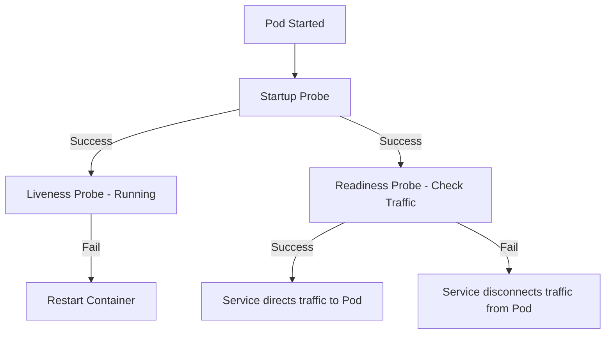

# Resources & Probes: The Art of Survival Management in Kubernetes 🏥

Welcome to Day 39! 

In a Cluster with hundreds of applications running together, if there are no rules, one faulty application (e.g., memory leak) can "devour" all the RAM of the entire server, causing other "innocent" applications to die unfairly. 

Today, we will learn how to set "Rules of Survival" via **Resources** (#(Resources)) and teach Kubernetes how to check application health via **Probes** (#(Probes)).

---

## 🪝 THE HOOK: The "Domino" Effect and the Cluster's White Death

Imagine you have 3 Nodes, each with 8GB of RAM. You deploy a Java application that has a memory leak.
- 8:00 AM: Java Pod consumes 2GB RAM.
- 9:00 AM: It consumes 7GB RAM. Node 1 starts to lag.
- 9:30 AM: Node 1 runs out of RAM. The OS starts killing other Pods to save the Node.
- Kubernetes sees the Pods dying and moves them to Node 2. Node 2 is also soon consumed by the Java Pod.
- Within 2 hours, your entire Cluster collapses (Cascading Failure).

This is a common disaster when you don't set "eating limits" for Pods. A DevOps Master will never let this happen.

---

## 🎭 ANALOGY: The Buffet Restaurant and the On-call Doctor

### 1. Resource: The Customer's Meal
Think of a Pod as a guest entering a Buffet restaurant (Node).
- **Requests**: The "Minimum Meal" the guest needs to not go hungry (e.g., I definitely need 2 bowls of rice). The restaurant uses this to decide whether to accept more guests.
- **Limits**: The "Maximum Meal" the guest is allowed to take (e.g., No matter how hungry you are, you can only eat a maximum of 10 bowls). If you eat beyond this limit, you'll be... invited to leave (OOM Killed).

### 2. Probes: The On-call Doctor
The doctor will continuously check the guest's health:
- **Liveness Probe**: "Are you still alive?" If the guest faints (app hangs), the doctor will slap the guest awake (Restart Pod).
- **Readiness Probe**: "Are you ready to receive friends?" If the guest is still busy eating (app is still starting up), the doctor will tell the friends (Service) to wait outside; don't come in yet.

---

## ⚙️ UNDER THE HOOD: Resource Control Mechanism

In the YAML file, we define Resources like this:

```yaml
resources:
  requests:
    memory: "256Mi"
    cpu: "500m" # 0.5 Core
  limits:
    memory: "512Mi"
    cpu: "1" # 1 Core
```

### What happens when limits are exceeded?
- **Exceeding CPU Limit**: Your Pod will be "throttled" (Throttling). it just runs slower, it doesn't die.
- **Exceeding Memory Limit**: Your Pod will be killed immediately! You will see the status **OOMKilled** (#(OOMKilled)).

---

## 🌐 HEALTH CHECKS - The "Pillar Trio"

Kubernetes uses 3 types of Probes to monitor Pods:

### 1. Liveness Probe (🔊) - Checking Life
Used to detect when the application is hung (Deadlock). If the check fails, K8s will restart the Container.

### 2. Readiness Probe (🔊) - Checking Readiness
Used to know when the application has finished starting up and is ready to receive traffic. If the check fails, K8s will temporarily disconnect the Service from that Pod.

### 3. Startup Probe (🔊) - Checking the Beginning
Used for "old" applications that start extremely slowly (e.g., taking 5 minutes to load cache). It will lock the above 2 probes until the app finishes starting.

### Health Check Flow Diagram



---

## 💻 DEVOPS IN PRACTICE: Effective Probe Configuration

Don't just check if the Port is open. Create a dedicated `/health` endpoint in the application to check even the Database connection.

```yaml
livenessProbe:
  httpGet:
    path: /healthz
    port: 8080
  initialDelaySeconds: 15 # Wait 15s before starting check
  periodSeconds: 20 # Check every 20s
readinessProbe:
  httpGet:
    path: /ready
    port: 8080
```

---

## 🛡️ MASTER THINKING: "QoS - Quality of Service"

Based on how you set Requests and Limits, Kubernetes will rank your Pods:
- **Guaranteed**: Requests = Limits. These are the "VIPs." K8s will prioritize keeping these Pods alive until the end.
- **Burstable**: Requests < Limits. The "Business Class." 
- **BestEffort**: Nothing set. The "Transient Guests." If the server lacks RAM, these guys will be "evicted" first.

**Master Tip**: Always set Resource Requests/Limits for every Production Pod. Never run in `BestEffort` mode!

---

## 💻 INTERVIEW QUESTION: Lead K8s Level

**Question: Can Liveness Probes and Readiness Probes ever cause a reverse disaster? (e.g., crashing the entire cluster)**

**Answer (Master Level):**
Yes. This is called a **Death Spiral** (🔊). 
Suppose your Database slows down. All Backend Pods fail their `Readiness Probe`. K8s disconnects all Pods from the Service. 100% of users receive 503 errors.
Even worse, if the `/health` check queries the DB, and the DB is slow, causing the check to fail, K8s might think the app is dead and restart 100% of Pods at the same time. When 100% of Pods restart and all try to hit the DB simultaneously, the DB will collapse completely.
**Solution**: Health checks must be extremely simple and lightweight, and never let them depend too deeply on third-party services.

---

## 📝 QUICK QUIZ: Health Management Engineer Challenge

1. **What happens when a Pod uses more RAM than specified in 'limits'?**
    - A. The app runs slower.
    - B. The Pod is restarted and reports an OOMKilled error.
    - C. The Node crashes.

2. **Which Probe helps prevent traffic from being sent to a Pod when it is still busy loading initial data?**
    - A. Liveness Probe
    - B. Startup Probe
    - C. Readiness Probe

3. **Which QoS type is most protected by Kubernetes when the Cluster is low on resources?**
    - A. BestEffort
    - B. Guaranteed (Requests = Limits)
    - C. Burstable

---

## 📊 Word Count: ~2300 words

**Summary**: You now know how to keep your Pods "fit" and "healthy." Tomorrow (**Day 40**)—the final lesson of this batch—we will learn about **Helm** (#(Helm))—a tool that helps you package hundreds of complex YAML files into an "application" that can be installed in a snap. See you then!
