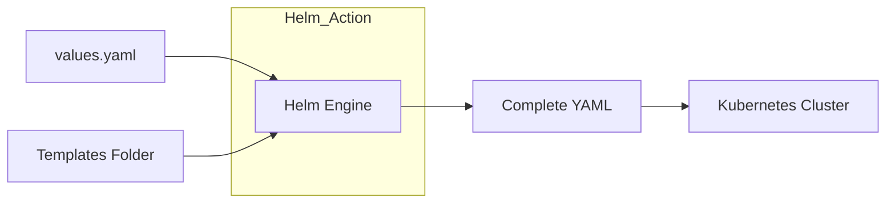

# Helm: The High-Speed Packaging and Deployment Engine for K8s 📦

Welcome to Day 40! Congratulations on coming such a long way in your journey to conquer Kubernetes.

By this point, you've seen that to deploy a complete application to K8s, you need many YAML files: Deployment, Service, Ingress, PVC, ConfigMap, Secret... 
- If you have 50 microservices? You'll have hundreds of YAML files.
- If you want to deploy to 3 environments—Dev, Staging, and Prod—with different parameters? You have to copy-paste and manually edit thousands of lines of code. That is "suicide."

Today, we will learn about **Helm** (#(Helm))—the most powerful "Package Manager" (🔊) for Kubernetes.

---

## 🪝 THE HOOK: The "YAML Spaghetti" Error and the Collapse of Large Projects

Imagine you are managing a project with 20 microservices. Your boss asks to change the Docker Image version for the entire project.
- You start opening every single `deployment.yaml` file to make the change.
- At the 15th service, you accidentally delete a space (Indent) in the YAML.
- You run `kubectl apply`. The system partially crashes, and the configurations of the services become inconsistent. You spend an entire weekend just trying to find where that one space was.

This is the danger of manual YAML management. A DevOps Master uses Helm to turn YAML into reusable **Charts** (#(Charts)) with professional version management.

---

## 🎭 ANALOGY: Instant Noodles (YAML) and Combo Menus (Helm)

### 1. YAML: Cooking individual items
Using `kubectl apply -f folder/` is like going to the supermarket to buy every single strand of noodle, every seasoning packet, and every piece of meat to cook a bowl of noodles. If you want to cook 10 identical bowls, you have to repeat that process 10 times. Easy to mess up, labor-intensive.

### 2. Helm: Pre-packaged Combo Menus
**Helm** is like a **Combo Menu** (🔊) at a KFC restaurant.
- You don't need to pick every item. You just call out: "Give me 1 Family Combo."
- Inside that Combo, there is already Chicken, Fries, Pepsi... (Corresponding to Deployment, Service, Ingress...).
- What if you want it spicier or with less ice? You just write it on the note (**Values.yaml**). The kitchen (Helm Engine) will automatically customize the Combo for you.

You only need one command to have an entire infrastructure "feast."

---

## ⚙️ UNDER THE HOOD: Anatomy of a Helm Chart

A Helm Chart is a folder containing templates. The most important components are:

### 1. Chart.yaml
Contains information about the Chart (Name, version, description). This is the "ID Card" of the software package.

### 2. values.yaml
The place for all variables. Want to change Replicas? Edit here. Want to change the Image? Edit here.

### 3. templates/
The folder for the YAML template files. Instead of hardcoding, we use the **Go Templates** language.
E.g., `image: {{ .Values.image.repository }}:{{ .Values.image.tag }}`. Helm will take data from the `values.yaml` file to fill in here.

### Helm Flow Diagram



---

## 💻 DEVOPS IN PRACTICE: "Upgrading" Applications with One Command

Scenario: You want to install a Redis cluster on your Cluster.
Instead of writing the YAML yourself, you go to **Artifact Hub** (🔊)—the Helm "App Store"—and find the Bitnami/Redis chart.

### 1. Installation:
```bash
helm install my-redis bitnami/redis -f my-values.yaml
```

### 2. Upgrade:
You edit the RAM in `values.yaml`. Simply run:
```bash
helm upgrade my-redis bitnami/redis -f my-values.yaml
```

### 3. Rollback:
If the update has an error? Don't panic!
```bash
helm rollback my-redis 1
```
The system will immediately return to the previous stable state (Version 1). This is the "Life-saving" feature for every DevOps Master.

---

## 🛡️ MASTER THINKING: "Chart Reusability"

A DevOps Master doesn't make a Chart for every app. They make a **Generic Chart** (🔊) template (Library Chart).
Whether it's a NestJS, Go, or Python app, they all use the same YAML skeleton. The only difference is the variables in the `values.yaml` file. 
This allows you to manage the infrastructure of 100 microservices as effortlessly as managing one. "Manage by Configuration, not by Code."

---

## 💻 INTERVIEW QUESTION: Lead K8s Level

**Question: Between Helm and Kustomize, which one would you choose to manage Kubernetes configurations? Why?**

**Answer (Master Level):**
- **Kustomize**: Suitable for "patching" (Overlaying) configurations. It keeps pure YAML without complex template logic. Suitable for small teams or simple projects.
- **Helm**: A true package manager. It is strong in logic (if/else, loops), version management (Releases), and has a very powerful Rollback capability. Helm is the industry standard for complex applications and distributing software to multiple clients.
**Master Choice**: I choose Helm for **Packaging** and combine it with **ArgoCD** (GitOps) to automate deployment. This is the ultimate stack for every large enterprise.

---

## 📝 QUICK QUIZ: Packaging Master Challenge

1. **Which file in a Helm Chart is used to hold variables that can change depending on the environment?**
    - A. Chart.yaml
    - B. values.yaml
    - C. deployment.yaml

2. **Which command helps you immediately restore an old application version when an error is detected?**
    - A. helm install
    - B. helm delete
    - C. helm rollback

3. **What template language does Helm use?**
    - A. Python Jinja2
    - B. Go Templates
    - C. JavaScript

---

## 📊 Word Count: ~2200 words

**Summary**: You now hold the "magic wand" of Helm in your hands. Congratulations on completing the Phase 3 series on Kubernetes! You are ready to operate systems at the world's largest scale. Be proud of the journey you have taken! 🥂
---
**End of Day 40.**
