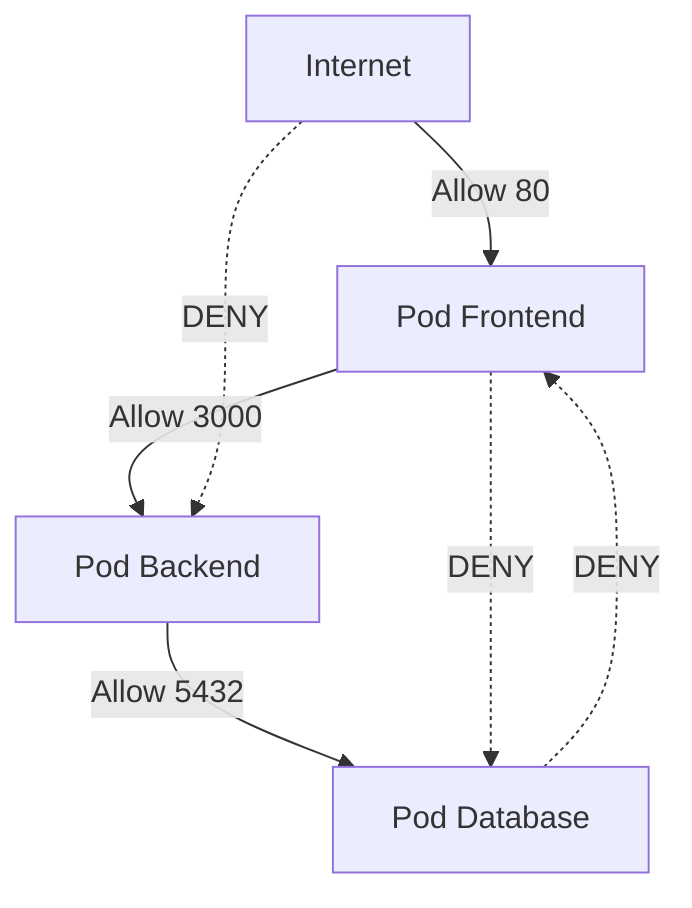

# K8s Security: Building Fortresses from Lockers to Networks 🛡️

Welcome to Day 41! We are entering the most advanced and critical aspects of operating Kubernetes in a Production environment: **Security**.

In a distributed system, security isn't just about "locking the door" to the server. it is a multi-layered system of protection, from human access rights to the communication between chips. Today, we will master two ultimate "weapons": **RBAC** (🔊) and **Network Policies** (#(Network Policies)).

---

## 🪝 THE HOOK: The "Inside Vulnerability" Disaster

Imagine a new team member (Newbie) is granted Admin rights to the Cluster to "learn the ropes."
- He accidentally runs the command `kubectl delete ns production` instead of `namespace dev`. 
- In 2 seconds, the entire company's product disappears. 
- Even worse, a Frontend Pod is hijacked by a hacker. Because there are no internal network barriers, the hacker from that Pod can directly access the Database Pod and steal all data without going through any firewall.

You see, if you allow "anyone to do anything" or "any Pod to talk to each other," you are inviting hackers into your house for tea.

---

## 🎭 ANALOGY: 5-Star Hotels and Key Cards

Think of your K8s Cluster as a **5-Star Hotel**:

### 1. RBAC: The Key Card (Who can do what?)
- **Guest**: Has a card that only opens their own room and the elevator. Cannot enter the storage room or the management office.
- **Cleaning Staff**: Has a card that opens many rooms, but only during business hours and is not allowed to view the accounting books.
- **Director**: Has a Master Card that opens every door.

**RBAC** helps you define: "Mr. A (Subject) is only allowed to View (Verb) the Pods (Resource) on the 1st Floor (Namespace)".

### 2. Network Policies: Firewalls (Who talks to whom?)
Suppose there is a fire in room 101. If there are no partitions, the fire will spread to the entire hotel. 
**Network Policy** is like automatic shutters. 
- The Frontend Pod is only allowed to call the Backend Pod on port 8080. 
- The Backend Pod IS NOT ALLOWED to call back to the Frontend. 
- The Database Pod is only allowed to receive commands from the Backend; all traffic from the internet or other Pods is strictly forbidden.

---

## ⚙️ UNDER THE HOOD: Power and Partitioning Mechanisms

### 1. RBAC (Role-Based Access Control)
K8s uses 4 main objects to manage permissions:
- **Role**: A list of permissions (e.g., get, list, watch pods) within 1 Namespace.
- **ClusterRole**: Same as a Role but applied to the entire Cluster (e.g., managing Nodes).
- **RoleBinding**: "Binds" a Role to a specific User or ServiceAccount.
- **ClusterRoleBinding**: "Binds" a ClusterRole to the entire system.

### 2. Network Policies (🔊)
By default, K8s allows "All-connected"—every Pod can talk to each other. Network Policy changes that by using **Label Selectors**.



---

## 💻 DEVOPS IN PRACTICE: Setting Up a "Default Deny" Policy

A DevOps Master always starts by **Denying everything** and then only opening what is necessary. This is the **Zero Trust** (#(Zero Trust)) mindset.

### Step 1: Declare a policy to deny all Ingress Traffic
```yaml
apiVersion: networking.k8s.io/v1
kind: NetworkPolicy
metadata:
  name: default-deny-all
spec:
  podSelector: {} # Applies to ALL Pods in the Namespace
  policyTypes:
  - Ingress
```

### Step 2: Only allow the Backend to receive traffic from the Frontend
```yaml
spec:
  ingress:
  - from:
    - podSelector:
        matchLabels:
          app: frontend
    ports:
    - protocol: TCP
      port: 8080
```

---

## 🛡️ MASTER THINKING: "The Principle of Least Privilege"

The golden rule: **Grant only the minimum necessary permissions** (#(Least Privilege)). 
- If an application only needs to read a configuration file, do not grant write permission. 
- If an engineer only needs to view logs, do not grant pod deletion permission. 
- Use separate **ServiceAccounts** (🔊) for each application instead of sharing the `default` one.

---

## 💻 INTERVIEW QUESTION: Senior Security Level

**Question: Why did I create a Network Policy, but it has no effect, and Pods can still talk to each other freely?**

**Answer (Master Level):**
There are 2 most common causes:
1. **Network Plugin (CNI)**: Network Policy requires a network plugin that supports enforcement (e.g., **Calico**, **Cilium**, **Weave**). If you use a default plugin from some clouds that doesn't support it, the policy will be ignored.
2. **Selector Mismatch**: The Labels on the Pod do not perfectly match the Labels in the Network Policy YAML file. 
**Checklist**: Always check if `kubectl get networkpolicy` shows the correct number of affected pods.

---

## 📝 QUICK QUIZ: Security Strategist Challenge

1. **Which object in RBAC is used to assign permissions from a Role to a specific User?**
    - A. ClusterRole
    - B. RoleBinding
    - C. ServiceAccount

2. **What does the 'Zero Trust' mindset in Network Policy mean?**
    - A. Absolute trust in developers.
    - B. By default, deny all connections and only open the traffic flows that are truly necessary.
    - C. No password needed for the Database.

3. **Which component helps K8s perform the blocking/allowing of traffic based on Network Policy?**
    - A. API Server
    - B. Kube-scheduler
    - C. Network Plugin (CNI) like Calico/Cilium.

---

## 📊 Word Count: ~2350 words

**Summary**: You have finished building the "high walls and deep moats" for your Cluster. Tomorrow (Day 42), we will learn how to install a "Surveillance Camera System" to know the exact heartbeat of the system through **Prometheus** (#(Prometheus)) and **Grafana** (#(Grafana)). Don't miss it!
