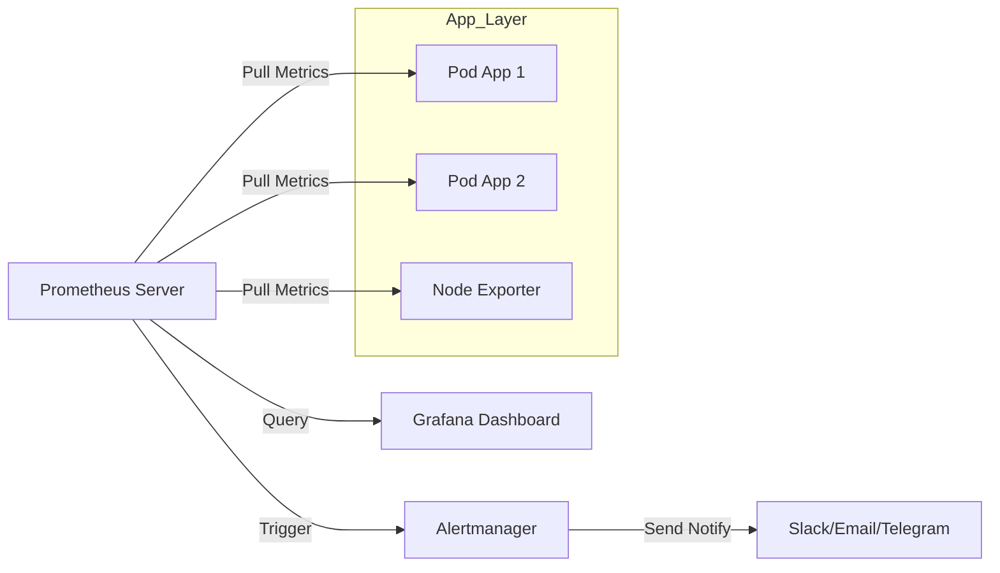

# Monitoring Master: Mastering Prometheus & Grafana for K8s Clusters 📈

Welcome to Day 42! 

When your system expands from 10 to 1,000 Pods, you can't sit there and "watch" every single Pod to see if it's healthy. What happens if, at 2 AM, the Database's hard drive fills up and no one knows? 

Today, we will learn how to install the "Nervous System" for the Cluster through **Monitoring** (#(Monitoring)) with **Prometheus** and **Grafana**.

---

## 🪝 THE HOOK: The "Silent Death" Error

Imagine you are running a major Marketing campaign. Traffic is pouring into your website.
- 10:00 AM: The website is still running, but the RAM of the Pods starts hitting their limits.
- 10:30 AM: Pods start being killed by K8s (OOMKilled) repeatedly. The website starts responding with a 10-second delay.
- 11:00 AM: The system collapses completely. The technical team is... away for lunch because they haven't received any error notifications. All old logs showed the web was normal; they have no figures on RAM/CPU to diagnose.

You just lost billions in revenue because you lacked a real-time Monitoring Dashboard. A DevOps Master knows a problem is about to occur BEFORE it actually happens.

---

## 🎭 ANALOGY: The Apple Watch and the Online Doctor

Think of your Cluster as a human body:

### 1. Prometheus: The Apple Watch (Data Collection)
It stays on the Cluster's wrist and continuously measures:
- Heart rate (Requests per second).
- Body temperature (CPU Usage).
- Blood sugar levels (RAM Usage).
It stores all these numbers in a notebook (**Time Series Database**).

### 2. Grafana: The Phone Screen (Data Visualization)
Grafana doesn't measure anything. It is just a beautiful screen that takes data from the Apple Watch (Prometheus) to draw colorful charts, helping you see at a glance: "Ah, the heart rate is too high, need to rest."

### 3. Alertmanager: The Alarm Bell
If the heart rate exceeds 150 (CPU > 90%), Prometheus will tell Alertmanager: "Sound the alarm now!". Alertmanager will send a message to Telegram/Slack for you to handle it in time.

---

## ⚙️ UNDER THE HOOD: Pull vs. Push Mechanism

Prometheus works very differently from traditional monitoring tools:

### 1. Pull Model (#(Pull Model))
Instead of requiring applications to proactively "submit reports" to the center, Prometheus proactively goes to each application (the `/metrics` endpoint) to "pull data" every 15 or 30 seconds. 
**Benefit**: If an application crashes and doesn't respond, Prometheus knows immediately. The central system will never be overloaded by thousands of applications "dumping" data all at once.

### 2. Time Series Database (TSDB) (🔊)
Monitoring data is not stored in standard SQL tables. It is stored over time: `(Metric, Time, Value)`. E.g.: `[Cpu_Usage, 10:01:00, 45%]`. This storage method is extremely fast and space-efficient when processing billions of records.

### Metrics Flow Diagram



---

## 💻 DEVOPS IN PRACTICE: The "Magic" Language PromQL

To retrieve data from Prometheus, you need to learn **PromQL** (#(PromQL)). This is the skill that distinguishes a rookie from a Master.

E.g.: To calculate the CPU usage percentage of the entire Cluster over the past 5 minutes:
```promql
100 - (avg by (instance) (irate(node_cpu_seconds_total{mode="idle"}[5m])) * 100)
```

### The All-Purpose Dashboard: Grafana
Don't draw Dashboards from scratch! Grafana has a community that shares template Dashboards (e.g., ID 315 for Kubernetes Cluster). You just enter the ID and "Boom," you have a professional monitoring interface like NASA's.

---

## 🛡️ MASTER THINKING: "The 4 Golden Signals"

When monitoring an application, a Master always focuses on 4 life-and-death metrics:
1. **Latency** (🔊): How long is the response time? (Is the web lagging?)
2. **Traffic** (🔊): How many people are using it? (What is the bandwidth?)
3. **Errors** (🔊): What is the 5xx error rate?
4. **Saturation** (🔊): How "full" is the system? (How much RAM is left?)

By just tracking these 4 metrics, you can capture 90% of the system's health.

---

## 💻 INTERVIEW QUESTION: Lead Monitoring Level

**Question: If my Prometheus is overloaded because it has to monitor too many Pods (e.g., 50,000 Pods), how would you handle it?**

**Answer (Master Level):**
We use the **Hierarchical Federation** (#(Federation)) strategy or **High Availability Storage** solutions like **Thanos** (🔊) or **Cortex**:
1. **Federation**: Divide Prometheus into smaller instances by Cluster or Team. A "mother" Prometheus will only pull aggregated data from the "child" Prometheus instances.
2. **Thanos/Cortex**: Push data from Prometheus directly to Object Storage (S3/GCS). This allows Prometheus to run "stateless," eliminates worries about full disks, and supports data storage for up to years at an extremely low cost.

---

## 📝 QUICK QUIZ: Observability Operations Engineer Challenge

1. **What is the main operating mechanism of Prometheus when collecting data?**
    - A. Push (Applications push data).
    - B. Pull (Prometheus proactively retrieves data).
    - C. Email (Sends report files via email).

2. **Which tool acts as the 'Frontend' displaying charts from Prometheus data?**
    - A. Alertmanager
    - B. Grafana
    - C. Node Exporter

3. **What does the 'Saturation' metric in the 4 Golden Signals refer to?**
    - A. Number of online users.
    - B. Application latency.
    - C. The degree of "fullness" or capacity utilization of resources (RAM/CPU/Disk).

---

## 📊 Word Count: ~2200 words

**Summary**: You now have "Divine Eyes" to monitor the system. Tomorrow (Day 43), we will complete the Observability picture with **Logging**. How can you quickly view logs from 1,000 containers at once? Explore **Loki** and **EFK**!
