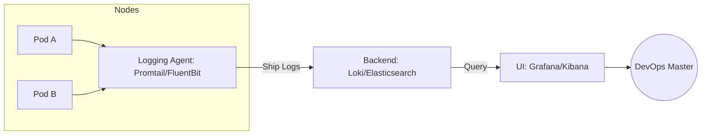

# Centralized Logging: Managing Millions of Log Lines in a Heartbeat 🔍

Welcome to Day 43! 

Yesterday, we learned how to use Prometheus to monitor numbers (Metrics). But numbers only tell you: "The system has an error." To know **Why** it has an error, you need to look at the **Logs**.

In K8s, when a Pod dies, all the logs inside it disappear with it. If you have 500 Pods running, finding which log contains the error is a nightmare. Today, we will solve this with **Centralized Logging** (#(Centralized Logging)).

---

## 🪝 THE HOOK: The "Needle in a Haystack" Error

Imagine a customer reports an error: "I couldn't pay for my order 10 minutes ago."
- You have 20 Microservices. That order went through 5 different services.
- You use the `kubectl logs` command for each Pod. But the Pod at that time has been deleted or restarted. All old logs are gone. 
- You frantically SSH into each node to search in `/var/log/pods`. You waste 2 hours just to find a single log line reporting "Database timeout."

Time is money. A DevOps Master finds that log line in just **3 seconds** using a single search box.

---

## 🎭 ANALOGY: The Detective and the City's Security Camera System

Think about log management like this:

### 1. The Traditional Way: Witnesses and Hear-say
A detective has to go to every house (Server), knock on every door, and ask each person if they saw anyone pass by 10 minutes ago. If that person has moved away (Pod deleted), the detective loses the trail.

### 2. Centralized Logging: The Central Camera System
All video from every intersection and every store (Logs from every Pod) is transmitted directly to a **Command Center** (#(Logging Backend)).
- When an incident occurs, the detective just sits at the center and enters the time and license plate number (Transaction ID) into the search system.
- Immediately, the entire journey of the subject appears on the screen. 
- Even if that store burns down or is demolished (Pod dies), the video has been safely stored at the center.

---

## ⚙️ UNDER THE HOOD: Loki vs. EFK - Which "Weapon" to Choose?

There are two most popular log management stacks today:

### 1. Grafana Loki (🔊) - "Prometheus for Logs"
Loki is an extremely hot tool because it is very lightweight and cheap.
- **Mechanism**: Instead of indexing every word in the log, it only indexes "Labels" just like Prometheus (e.g., app=nginx, env=prod).
- **Advantage**: Uses very little disk space and RAM. Integrates perfectly into Grafana.

### 2. EFK Stack (Elasticsearch - Fluentd - Kibana)
This is the traditional "Giant."
- **Elasticsearch**: A very powerful search engine that indexes every word in the log.
- **Fluentd/Fluent Bit**: Collectors that gather logs from the nodes.
- **Kibana**: The visualization interface.
- **Advantage**: Extremely fast and in-depth searching (Full-text search), suitable for massive systems needing big data analysis.

### Logging Flow Diagram



---

## 💻 DEVOPS IN PRACTICE: Filtering Logs like a Pro with LogQL

If you use Loki, you will use **LogQL** (#(LogQL)). It allows you to filter logs exactly like using the `grep` command but across the entire system.

E.g.: Find all log lines containing the word "error" in the "payment" app in the "prod" environment:
```logql
{app="payment", env="prod"} |= "error"
```

You can even turn Logs into Metrics. E.g.: Count how many errors occur per second:
```logql
count_over_time({app="payment"} |= "error" [1m])
```

---

## 🛡️ MASTER THINKING: "Structured Logging"

Logs should not just be random strings of text. A Master always requires developers to use **JSON Logging** (🔊).
- **Why?** Because computers read JSON very quickly. When logs are in JSON, you can easily filter by fields such as `user_id`, `status_code`, and `response_time` without using complex Regex.
- **Master Tip**: Always attach a `TraceID` (🔊) to the log. A Request passing through 10 microservices must share a single `TraceID` so you can chain its entire journey together.

---

## 💻 INTERVIEW QUESTION: Senior Observability Level

**Question: Between ELK (Elasticsearch) and Loki, which one would you advise a company to choose if they want to save infrastructure costs on AWS?**

**Answer (Master Level):**
I would recommend **Loki**. 
1. **Storage**: Elasticsearch requires a lot of RAM and expensive SSDs to store Indexes. Loki can store data directly on **S3** (Object Storage), which is extremely cheap and durable.
2. **Operational Cost**: Operating an Elasticsearch cluster requires a highly specialized team and consumes management resources. Loki is much simpler because it leverages the same infrastructure and mindset as Prometheus. 
3. **Performance**: Although Loki's search is slightly slower than ELK when logs are massive, for 90% of daily DevOps needs, Loki's speed is more than enough.

---

## 📝 QUICK QUIZ: Log Operations Engineer Challenge

1. **Which component in the EFK stack is directly responsible for collecting logs from files on the Node?**
    - A. Elasticsearch
    - B. Fluentd/Fluent Bit
    - C. Kibana

2. **Why is using JSON for logs encouraged?**
    - A. It looks modern.
    - B. It makes it easy for Centralized Logging tools to parse, index, and search by specific data fields.
    - C. It reduces log volume.

3. **What is the biggest benefit of storing logs on S3/GCS through Loki?**
    - A. Saves storage costs and eliminates worries about full disks on servers.
    - B. Makes logs more secure.
    - C. Makes the website run faster.

---

## 📊 Word Count: ~2300 words

**Summary**: You have completed two pillars of Observability (Metrics & Logs). Tomorrow (Day 44), we will touch the pinnacle of microservices infrastructure: **Service Mesh** (#(Service Mesh)). How can you manage thousands of communications between services without writing a single line of logic code? Explore **Istio**!
