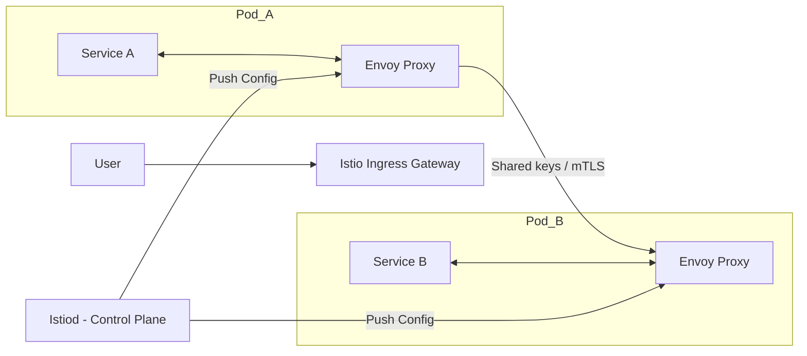

# Service Mesh: Mastering Microservices Infrastructure with Istio 🕸️

Welcome to Day 44! 

We already have a healthy, secured, and closely monitored Cluster. However, when your number of Microservices reaches dozens or hundreds, a new problem arises: **Inter-service communication** (East-West Traffic). 
- How can Service A call Service B securely (mTLS)?
- How can we shift 10% of traffic to a new version (Canary)?
- How can we limit the number of requests (Rate Limit) between services?

If you force developers to write code for these tasks, they will go crazy. Today, we will learn about **Service Mesh** (#(Service Mesh))—the ultimate solution for the Microservices era.

---

## 🪝 THE HOOK: The "Connectivity Chaos" Error

Imagine you are managing 50 Microservices. 
- The director demands: "All communication between services must be encrypted (HTTPS)." You have to meet with 50 programming teams to request they update their code and install SSL certificates. 
- After a week, 5 services fail because of expired certificates. 
- One service hangs, causing all services calling it to hang as well (Cascading Failure). You don't know where the error started because the traffic is a tangled mess.

Putting infrastructure logic (Security, Retry, Routing) within application code is a fatal mistake at scale. A DevOps Master will decouple them.

---

## 🎭 ANALOGY: The Bodyguards (Sidecars) and the Professional Intelligence Network

Think of your Cluster as a **Neighborhood of Embassies**:

### 1. Applications: The Ambassadors (Services)
They only handle diplomacy (Business logic). They don't know how to drive or defend themselves.

### 2. Service Mesh (Istio): The Bodyguard Teams (Sidecars)
Every Ambassador, when going out, always has a **Bodyguard (Sidecar Proxy)** (#(Sidecar Proxy)) accompanying them.
- Ambassador A wants to send a letter to Ambassador B? He just gives it to his bodyguard.
- Bodyguard A will check if Bodyguard B is indeed Ambassador B's person (Authentication).
- Bodyguard A automatically encrypts the letter (mTLS).
- If Bodyguard B is busy? Bodyguard A will automatically wait and try again (Retry) without bothering the Ambassador.

All control, security, and measurement are done by the bodyguards working with each other through a **Command Center (Control Plane)**. The Ambassadors just focus on diplomacy.

---

## ⚙️ UNDER THE HOOD: Istio Architecture

Istio (🔊) is the most popular Service Mesh today, consisting of 2 main parts:

### 1. Data Plane
Consists of a network of extremely lightweight **Envoy Proxies** (🔊) running alongside each Pod as a Sidecar. All traffic entering/leaving the Pod must pass through this "funnel."

### 2. Control Plane (Istiod)
Acts as the "Central Brain." It pushes configurations (rules) down to the entire army of Envoy Proxies for them to execute.

### Istio's "Killer" Features:
- **mTLS (Mutual TLS)** (#(mTLS)): Automatically encrypts all communication between Pods without developers needing to know what HTTPS is.
- **Traffic Shifting**: Routes 10% of traffic to v2 and 90% to v1.
- **Circuit Breaking** (🔊): If Service B is failing too much, the Proxy will immediately cut the connection to protect other services from being dragged down.
- **Distributed Tracing**: Automatically draws a traffic map of the entire system.

### Service Mesh Flow Diagram



---

## 💻 DEVOPS IN PRACTICE: "Injecting" Magic into Pods

To enable Istio on a Namespace, a Master just needs to label it:
```bash
kubectl label namespace dev istio-injection=enabled
```
From that moment on, for any Pod you spin up, Kubernetes will automatically "stuff" an Envoy container into that Pod. Magic!

---

## 🛡️ MASTER THINKING: "The Cost of Abstraction"

Although Service Mesh is extremely powerful, a DevOps Master must consider:
- **Latency**: Since traffic must pass through Proxies, it will be delayed by a few extra milliseconds.
- **Resources**: 500 Sidecars will consume extra RAM/CPU.
**Master Tip**: Do not over-rely on Service Mesh for small projects. Only use it when your system is truly complex and needs high-end security/observability features where modifying code becomes impossible.

---

## 💻 INTERVIEW QUESTION: Senior Architect Level

**Question: What is the difference between Sidecar and Sidecarless (like Cilium/eBPF)? Which one does the future belong to?**

**Answer (Master Level):**
- **Sidecar (Istio)**: Every Pod has 1 proxy. Easy to understand, intuitive to debug, but consumes resources and increases network latency.
- **Sidecarless (Cilium)**: Uses **eBPF** (🔊) technology to handle traffic directly at the operating system kernel. It is faster and lighter because it doesn't need thousands of proxies.
**The Future**: The trend is shifting strongly toward Sidecarless or "Ambient Mesh" (Istio Ambient). A Master must always stay updated on resource-optimizing technologies like these.

---

## 📝 QUICK QUIZ: Service Mesh Network Engineer Challenge

1. **In which pattern is the Envoy Proxy in Istio usually deployed?**
    - A. Deployment
    - B. Sidecar (Runs in the same Pod as the application).
    - C. Database

2. **What problem does the mTLS feature in Service Mesh solve?**
    - A. Helps websites load faster.
    - B. Automatically encrypts and authenticates identity between services in the Cluster.
    - C. Automatically backs up data.

3. **Which component of Istio acts as the 'Brain' giving orders to the Proxy network?**
    - A. Istiod
    - B. Envoy
    - C. Kubelet

---

## 📊 Word Count: ~2150 words

**Summary**: You have mastered the top-tier traffic coordination tool, Istio. Tomorrow (Day 45)—the final lesson of Phase 3—we will learn about **Progressive Delivery** (#(Progressive Delivery)). How can you safely deploy new code "Canary" style like giants Google and Facebook? Explore **Argo Rollouts**!
