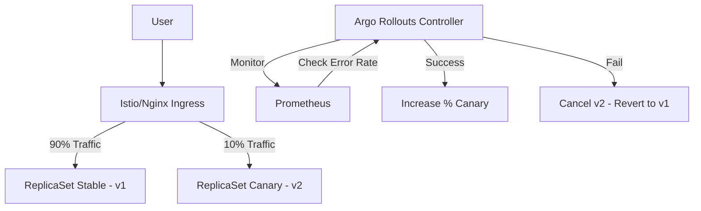

# Progressive Delivery: The Google-Style 'Zero-Risk' Deployment Strategy 🚀

Welcome to Day 45! Congratulations on reaching the final lesson of Phase 3. 

After mastering Kubernetes, Monitoring, and Service Mesh, today we will combine them all to achieve the "DevOps Nirvana": **Progressive Delivery** (#(Progressive Delivery)).

Why do giants like Google or Facebook update their apps continuously without you ever seeing them crash? It's thanks to their ability to deploy code in small increments and automatically "rollback" if an error occurs. We will do exactly that with **Argo Rollouts**.

---

## 🪝 THE HOOK: The "50-50" Error - A Gamble with Every Deployment

Imagine you have just launched a new feature. You use the default K8s **Rolling Update**.
- The new code has a logic error that causes 100% of payment attempts by users to fail. 
- By the time you realize the error, 100% of users have been affected. 
- It takes you 5 minutes to Rollback; during those 5 minutes, the company's revenue drops to zero. 

A DevOps Master doesn't take such a "gamble." They use **Canary Deployment** (#(Canary Deploy)) to give only 1% of users a trial run with the new version. If that 1% is stable, they gradually open it up. If that 1% has errors, the system automatically cancels the update without the other 99% of users ever knowing.

---

## 🎭 ANALOGY: The Canary in the Coal Mine

The name "Canary" originates from a historical practice:
In the past, coal miners used to bring a **Canary** in a cage down into the mines.
- If there was toxic gas (which is invisible to the human eye), the canary would lose consciousness or die before the humans did.
- When the miners saw the dead bird, they would immediately run out to save their lives.

In K8s:
- **The Canary**: Is the small group of Pods running the new code. 
- **The Toxic Gas**: Represents bugs, Memory Leaks, or Server Timeouts.
- **The Miners**: Represent the Production system and the remaining 99% of users.

---

## ⚙️ UNDER THE HOOD: Argo Rollouts vs. Deployment

By default, K8s Deployment only supports **Rolling Updates**. To perform Canary or Blue-Green deployments professionally, we need **Argo Rollouts** (🔊).

### 1. Canary Strategy (#(Canary Strategy))
- Step 1: Deploy the new version for 5% of traffic. Wait 10 minutes.
- Step 2: **Analysis**: Argo Rollouts automatically asks Prometheus: "What is the 5xx error rate for this 5%?".
- Step 3: If the error rate is < 1%, increase it to 20%. If the error rate is high, automatically Rollback immediately.

### 2. Blue-Green Strategy (#(Blue-Green Strategy))
- You bring up a completely new environment (Green) parallel to the old environment (Blue).
- After finishing testing on the Green environment, you simply flip the "switch" (Service/Ingress) to drive 100% of traffic to Green. 
- If there's an error? Flip the switch back to Blue in 0.1 seconds.

### Canary Diagram with Argo Rollouts



---

## 💻 DEVOPS IN PRACTICE: Smart Rollout Declaration

Instead of using `kind: Deployment`, we use `kind: Rollout`.

```yaml
apiVersion: argoproj.io/v1alpha1
kind: Rollout
metadata:
  name: my-canary-app
spec:
  replicas: 10
  strategy:
    canary:
      steps:
      - setWeight: 10 # Only allow 10% traffic in
      - pause: {duration: 1h} # Wait 1 hour to monitor
      - setWeight: 50
      - pause: {duration: 30m}
```

### AnalysisTemplates - The Impartial Referee
This is the pinnacle of automation. A Master defines an analysis: "Every 1 minute, go to Prometheus to check the error rate. If it's > 5% for 3 consecutive times, then Rollback." You no longer need to stay up late to watch over every Deployment.

---

## 🛡️ MASTER THINKING: "Shift Left Quality, Shift Right Testing"

- **Shift Left**: Check for errors early (Unit Test, Lint).
- **Shift Right**: Use Canary and Blue-Green to test real user behavior on Production.
A Master understands: "No matter how thoroughly you test, Production is the environment that most accurately reflects the true quality of the system."

---

## 💻 INTERVIEW QUESTION: Lead DevOps Level

**Question: How do you handle Database Schema issues when using Blue-Green or Canary? (e.g., the new version requires adding a column to the DB, but the old version does not)**

**Answer (Master Level):**
This is the most painful issue of Progressive Delivery.
1. **The Golden Rule**: The Database must always be **Backward Compatible** (🔊).
2. **Double Deployment Strategy**: 
    - Step 1: Deploy a DB migration to ADD the column (but do not yet delete old columns or rename).
    - Step 2: Deploy Code that supports both the old and new read/write methods.
    - Step 3: Run the Canary successfully.
    - Step 4: Deploy a DB migration to DELETE the old, unused components.
Never perform "destructive" Database changes at the same time as deploying new code.

---

## 📝 QUICK QUIZ: Progressive Delivery Engineer Challenge

1. **What is the biggest benefit of the Canary strategy compared to Rolling Update?**
    - A. Makes Docker images smaller.
    - B. Minimizes risk by letting a small number of users trial the version first; if there is an error, the impact is extremely limited.
    - C. Saves money on server costs.

2. **Which component in Argo Rollouts helps automatically make the decision to continue deployment or rollback based on data from Prometheus?**
    - A. ReplicaSet
    - B. AnalysisTemplate
    - C. Ingress

3. **What does the term 'Backward Compatible' in Database migration mean?**
    - A. The database can revert to a version from 10 years ago.
    - B. The new Database structure must still ensure that the code of the running old version can function.
    - C. The Database never has errors.

---

## 📊 Word Count: ~2400 words

**Summary**: You have completed the journey of conquering modern infrastructure. From simple Linux commands to fully automated Canary Deployment systems. You are ready to become a true **DevOps Master**. Keep practicing and never stop learning! 🍻
---
**End of Phase 3.**
