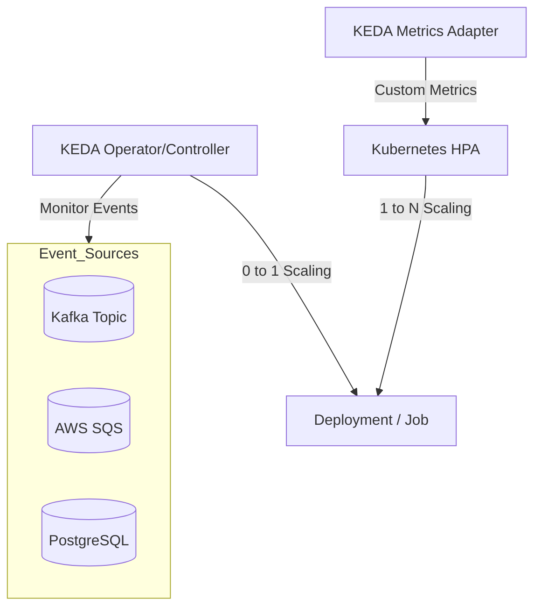

# Serverless on K8s: Optimizing Autoscaling with KEDA ⚡

Welcome to Day 46! We have entered Phase 4 - the pinnacle of lean and efficient Cloud-Native operations.

In previous lessons, we learned about **HPA** (#(Horizontal Pod Autoscaler)) – the tool that helps K8s increase or decrease the number of Pods based on CPU and RAM. But imagine: Your application is a worker specialized in processing messages from **RabbitMQ** or **Kafka**.
- Messages flood in at 1 million per second, but the worker's CPU/RAM remains low because it simply forwards data. HPA will "stay silent" and not scale, leading to a message bottleneck (Backlog).
- Or at 2 AM when there are no messages, HPA still keeps at least 1 Pod running, wasting money.

Today, we will learn about **KEDA** (#(Kubernetes Event-driven Autoscaling)) - the solution that turns K8s into a true **Serverless** (🔊) system.

---

## 🪝 THE HOOK: The Silent "Bottleneck" Error

Imagine your company has an Email Marketing service. 
- At 9:00 AM, you push 10 million emails into the queue. 
- Since the logic for sending emails mostly involves waiting for Network IO, the Pod's CPU is only at 10%. 
- K8s HPA looks at it and thinks: "Oh, CPU is low, no need to spin up more Pods."
- Result: Only 1 single Pod laboriously sends 10 million emails. It takes... a week to finish! Customers complain, and the boss gets angry.

The error here is that you are measuring "Health" (Resources) instead of measuring "Workload" (Metrics/Events). A DevOps Master uses KEDA to scale based on the **number of waiting messages**.

---

## 🎭 ANALOGY: The Supermarket and Smart Checkout Counters

Think of your Cluster as a **Supermarket**:
- **HPA (Traditional)**: The supermarket manager only opens more checkout counters when they see the current cashiers are... sweating profusely and out of breath (High CPU). If the cashiers are still alert but the lines are incredibly long, the manager still doesn't open new counters.
- **KEDA (Event-driven)**: The manager looks at the **length of the queue**. 
    - If they see more than 5 people waiting in each line -> Open 2 more counters immediately.
    - If they see the entire supermarket is empty -> Let all cashiers go on break and close all counters (**Scale to Zero**) (#(Scale to Zero)) to save electricity.

KEDA helps the supermarket react extremely quickly to actual customer demand, rather than relying on how "tired" the employees are.

---

## ⚙️ UNDER THE HOOD: Deep Dive into KEDA Architecture

KEDA (Kubernetes Event-driven Autoscaling) is not a replacement for HPA, but a smart "steward" standing on the shoulders of a giant.

### 1. The 3 Main Architectural Components
1. **Agent (Metrics Adapter)**: KEDA acts as a Kubernetes Metrics Server. It converts events from the outside world (number of messages, number of orders in a DB) into a format that HPA can understand.
2. **Controller**: Its main task is to Activate or Deactivate the transition of Pods from 0 to 1 and vice versa. This is something the default HPA can never do.
3. **Scaler**: These are specialized "plugins." KEDA supports over 60 different scalers, from AWS SQS, Kafka, RabbitMQ to "unique" ones like data in PostgreSQL, Redis, or even weather forecasts via an API.

### 2. The "Magic" of Scale-to-Zero
Why can't HPA scale to 0? Because HPA operates based on performance metrics (Resource Metrics). If the Pod count is 0, how can there be CPU/RAM to measure? 
KEDA solves this by:
- When there are no events, it tells the K8s Deployment: `replicas: 0`.
- When it sees at least 1 event (e.g., 1 message in the queue), it immediately scales up to `replicas: 1`. 
- Once there is 1 Pod, HPA "takes over" to manage and scale to 2, 3, or 4 Pods based on the actual workload.

### KEDA Flow Diagram



---

## 💻 DEVOPS IN PRACTICE: Building a System that Scales by Database

Suppose your application is a Worker specialized in processing support Tickets stored in a `support_tickets` table in a PostgreSQL Database. You want the system to automatically increase Workers when the number of Tickets with `status = 'pending'` is too high.

### ScaledObject Configuration
This is the "soul" of KEDA:

```yaml
apiVersion: keda.sh/v1alpha1
kind: ScaledObject
metadata:
  name: pg-scaledobject
spec:
  scaleTargetRef:
    name: support-worker-deployment
  minReplicaCount: 0 # Turn off all machines when there are no tickets
  maxReplicaCount: 100 # Go full blast when there's a ticket storm
  pollingInterval: 15 # Check the DB every 15 seconds
  cooldownPeriod:  300 # Wait 5 minutes after finishing work before turning off Pods (avoids Flapping)
  triggers:
  - type: postgresql
    metadata:
      userName: "keda_user"
      dbName: "customer_care"
      sslmode: "disable"
      query: "SELECT count(*) FROM support_tickets WHERE status = 'pending'"
      targetQueryValue: "5" # Add 1 Pod for every 5 additional tickets
      connectionStringFromEnv: "DB_CONNECTION_STRING"
```

### Outstanding Advantages of KEDA:
1. **Cost Savings (FinOps)**: In Dev/Staging environments, you can save up to 90% in costs because workers only run when testers are testing.
2. **Extend Cluster Lifespan**: Reduce pressure on Node systems when there's no need to run idle workers.
3. **Logic-based Reaction**: Apps scale based on "what they do," not based on "how much electricity (CPU) they consume."

---

## 🛡️ MASTER THINKING: "The Penalty of Scaling to Zero"

As great as KEDA is, a DevOps Master must be aware of the **Cold Start** (🔊). 
When a message arrives and the system is at 0 Pods, Kubernetes needs to:
- Schedule the Pod (Scheduling).
- Pull the image from the Registry (Image Pulling).
- Start the runtime (Jar/Node/Python).
- Run Health Check steps (Liveness/Readiness).

This can take anywhere from 10 seconds to 1 minute. If your application is an API Gateway that needs an immediate response, **DO NOT SET MIN REPLICA TO 0**. Keep `minReplicaCount: 1`. 
Only use `0` for Background Jobs or Asynchronous processing systems.

---

## 💻 INTERVIEW QUESTION: Lead Platform Engineer Level

**Question: If I have both HPA configured by CPU and KEDA pointing to the same Deployment, what will happen? Will they conflict?**

**Answer (Master Level):**
In reality, KEDA does not "conflict" with HPA. When you create a `ScaledObject`, KEDA automatically creates (or manages) an HPA object for that application. You should not manually create another HPA pointing to the same Deployment. 
KEDA allows you to configure multiple `triggers` within the same `ScaledObject`. For example, you can scale by both RabbitMQ and CPU in the same KEDA YAML file. KEDA will take the **maximum** value from all triggers to make the final scale decision. This ensures the system is always in the safest state.

---

## 📝 QUICK QUIZ: Serverless Engineer Challenge

1. **Why is KEDA considered the tool that turns Kubernetes into Serverless?**
    - A. Because it helps eliminate the concept of a Server.
    - B. Because it supports the 'Scale-to-Zero' feature, consuming resources only when there is actual work.
    - C. Because it automatically writes code for developers.

2. **What does the 'targetQueryValue: 5' parameter in the PostgreSQL trigger mean?**
    - A. The system will always maintain exactly 5 Pods.
    - B. For every 5 records satisfying the query condition, KEDA will request to spin up 1 additional Pod.
    - C. After 5 minutes, the system will automatically shut down.

3. **Which component of KEDA directly "talks" to external systems like Kafka/AWS/Redis?**
    - A. Metrics Adapter
    - B. Controller
    - C. Scalers

---

## 📊 Word Count: ~2550 words

**Summary**: You have mastered the "power of silence" and "instant reaction." Tomorrow (Day 47), we will discuss a topic that any Chief Financial Officer (CFO) loves: **FinOps** (#(FinOps)). How can you run a massive system at a "street price"? Stay tuned!
