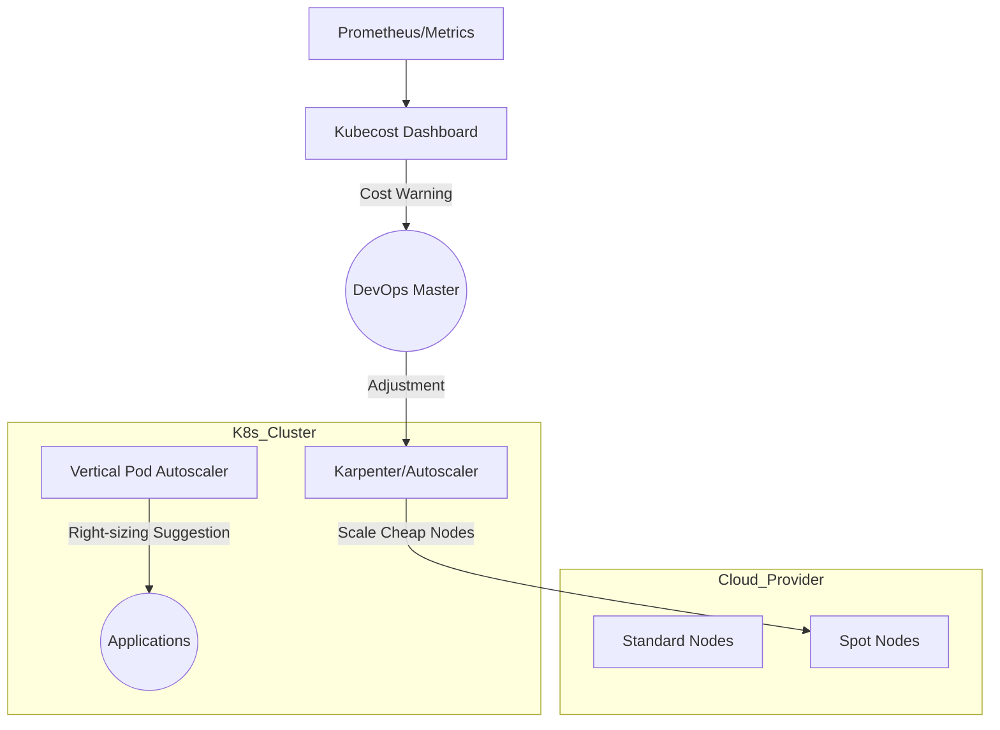

# FinOps: The Art of Master-Level Cloud Cost Optimization 💸

Welcome to Day 47! 

After building a modern, secure, and automated system, the next question every business will ask you is: **"Why is this month's AWS bill so high?"**. 

If you only know how to trade money for performance, you are just an ordinary engineer. A DevOps Master must master **FinOps** (#(FinOps))—the intersection of Finance and Operations—to ensure that every dollar spent brings maximum value.

---

## 🪝 THE HOOK: The "$100,000 Bill" Shock

Imagine you have just deployed a massive Kubernetes cluster. 
- You set `Resources Requests` quite high just to be safe (Over-provisioning). You think: "Better too much than too little."
- Your cluster has 50 "monster" virtual machines (m5.4xlarge). 
- At the end of the month, your boss calls you into the office with a serious expression and presents the AWS bill: $100,000. 
- Meanwhile, the company's revenue has only reached $10,000. 

When you look at the monitoring charts, you are horrified to realize: 80% of the resources you rented are... idle. The average CPU of the Cluster is only 5%. You are paying for "air." This is the fatal loophole that FinOps was born to fill.

---

## 🎭 ANALOGY: Ordering at a High-End Restaurant

Think of renting Cloud resources like dining at a luxury restaurant:

1. **On-Demand**: Like walking into the restaurant, picking up the menu, and ordering whatever you want immediately. You pay for what you eat. Convenient, but the most expensive price.
2. **Savings Plans / Reserved Instances**: Like signing a contract with the restaurant: "I will come in every day to eat at least one bowl of Pho for 1 year." The restaurant will give you a 40-70% discount because you have committed to loyalty.
3. **Spot Instances** (#(Spot Instances)): Like the restaurant having empty tables just before closing or surplus ingredients. They sell them to you at a 90% discount with one condition: If a VIP customer arrives, they have the right to ask you to leave with only a 2-minute warning.

A DevOps Master knows how to combine all 3 types of "tables": Use the "premium" tables for the boss (Critical apps) and use the "sidewalk" tables (Spot) for employees (Dev/Test/Workers).

---

## ⚙️ UNDER THE HOOD: Deep Dive into the FinOps Lifecycle

FinOps is not merely about "saving money"; it is about "optimizing value." A Master needs to master 3 phases:

### 1. Inform Phase (Transparency & Visibility)
You cannot optimize what you cannot see.
- **Tagging Strategy**: Every resource (EC2, S3, RDS) must have labels. For example: `Project: Supernova`, `Environment: Production`, `Team: Backend`. 
- **Cost Allocation**: K8s uses tools like CloudHealth or Kubecost to break down: "Who spent how much?". If the `dev` Namespace spends more than `production`, that is a red flag.

### 2. Optimize Phase (Optimization)
This is the system "surgery" phase:
- **Right-sizing** (#(Right-sizing)): This is the technique of adjusting CPU/RAM configurations as close as possible to actual usage. If an app only uses 1GB of RAM maximum, don't give it 4GB.
- **Spot Instance Automation**: Use tools like **Karpenter** (🔊) or **Ocean by Spot**. They will automatically find the cheapest virtual machines on the AWS market to spin up for your Cluster.
- **Auto-stop idle resources**: Automatically turn off Dev machines at 7 PM and turn them back on at 8 AM the next morning. This action alone can reduce the Dev machine bill by 60%.

### 3. Operate Phase (Execution & Culture)
- Turn cost into a technical metric (KPI). 
- Engineers who write optimized code that consumes fewer resources should be rewarded. 
- Build "Waste Hunting" initiatives (Cost-cutting hackathons).

### FinOps Architecture for K8s

---

## 💻 DEVOPS IN PRACTICE: Fighting Waste with Kubecost

In Kubernetes, the ultimate tool for FinOps is **Kubecost**. This is the "all-seeing eye" that helps you see through every penny.

### Steps a Master Performs Weekly:
1. **Check Unallocated Resources**: Which nodes are running without containing any Pods? -> Delete immediately.
2. **Check Abandoned PVCs**: Which hard drives still exist even though the Pod was deleted long ago? -> Delete immediately.
3. **Analyze Efficiency Score**: If the efficiency score is < 50%, it means you are throwing money out the window.

### Using Spot Instances like a Master:
Don't run Spot for everything. Use a **Mixed Node Groups** strategy:
- **30% On-Demand**: Reserved for core services (API, DB) to ensure the web never crashes 100%.
- **70% Spot**: For Workers processing images, videos, and dev environments. If Spot is reclaimed, the system only slows down a bit rather than dying completely.

---

## 🛡️ MASTER THINKING: "Efficiency is a Feature"

A Master does not consider saving as a "side job." 
- Senior Level: "My system never crashes."
- Master Level: "My system never crashes AND it is running with the highest economic efficiency."
Always ask: "If I can optimize $1,000 of Cloud costs per month, the company can use that money to hire another talented colleague for me." Saving for the company is also protecting your own interests.

---

## 💻 INTERVIEW QUESTION: Lead Cloud Architect Level

**Question: How do you resolve conflicts between the Finance Team (who wants to save) and the Technical Team (who wants surplus resources for safety)?**

**Answer (Master Level):**
This is a problem of FinOps culture. I would solve it by:
1. **Shared Accountability**: Bring the cost charts from the Kubecost Dashboard directly into the technical teams' Slack. When they see the price of every line of code they write, they will automatically be conscious of optimization.
2. **Error Budgets & Cost Budgets**: Establish a specific budget. If the backend team exceeds the budget, they must spend the next Sprint optimizing costs instead of building new features.
3. **Automated Guards**: Use `limit ranges` and `quotas` policies in K8s to prevent someone from accidentally occupying too many expensive Cluster resources.

---

## 📝 QUICK QUIZ: Cloud Finance Master Challenge

1. **Which type of virtual machine can reduce costs by up to 90% but carries the risk of being reclaimed by the Cloud Provider at any time?**
    - A. Savings Plans
    - B. Reserved Instances
    - C. Spot Instances

2. **What does the concept of 'Right-sizing' in FinOps refer to?**
    - A. Buying servers as large as possible.
    - B. Adjusting Resource Requests/Limits as close as possible to the application's actual usage.
    - C. Changing the size of the office.

3. **Which tool is most trusted by the K8s community to track costs by Namespace/Pod?**
    - A. Docker Hub
    - B. Kubecost
    - C. Electronic banking.

---

## 📊 Word Count: ~2600 words

**Summary**: You have mastered the cluster's purse strings. Tomorrow (Day 48), we will return to something a bit more hardcore: **Stateful Applications** (#(StatefulApps)). How can you run a Database on K8s without ever worrying about data loss? Explore **Operators** and **StatefulSets**!
