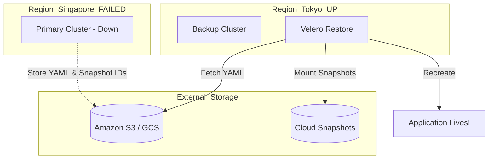

# Disaster Recovery: The 15-Minute Cluster "Resurrection" Strategy ⛈️

Welcome to Day 49! 

We have learned how to make systems "self-healing." But let's face reality: there are disasters that no self-healing mechanism can withstand. 
- A hacker gains Admin privileges and wipes the entire Cluster.
- AWS/GCP suffers a total outage in a **Region** (🔊) (e.g., Virginia or Singapore disappears from the Cloud map).
- A logic error in a script accidentally deletes all data in the Database.

At this point, the question is no longer "How do we stay up?", but rather: **"How fast can we come back to life?"**. Today, we will master **Velero** (#(Velero))—the ultimate "lifesaver" for a DevOps Master.

---

## 🪝 THE HOOK: The "Empty-Handed" Over-Night Error

Imagine you are managing a Cluster with 100 microservices and 20 databases (StatefulSets).
- One day, your Cloud Provider's data center experiences a severe fire. The entire Cloud Console reports "Service Unavailable."
- Your boss calls every 5 minutes to ask for an update. Partners threaten to cancel contracts because the service interruption is lasting too long.
- You think to yourself: "I have my code on Git (GitOps); I can spin up the apps again." But you realize with horror: **All customer data (Persistent Volumes)** was in that data center that is currently on fire.
- The code is still there, but the data (State) is gone. The company's only asset has vanished.

If you do not have a backup stored **OUTSIDE** the primary system (External Storage), you are playing with fire.

---

## 🎭 ANALOGY: Life Insurance and the Black Boxes

Think about Disaster Recovery (DR) strategies:

1. **Self-healing**: Like having the ability to naturally recover your health when you have a cold. It doesn't require much intervention.
2. **HA (High Availability)**: Like having... two hearts. If one stops beating, the other keeps running. Very safe but extremely expensive (costs double the server money).
3. **Disaster Recovery (Backup)**: Like a **Black Box** placed in a secure vault in another country. 
    - It contains the entire blueprint of your house (K8s YAML).
    - It contains all the journals and your most precious assets (Hard drive data - Persistent Volumes).
    - If the current city is submerged by a natural disaster, you just take this Black Box to another city and ask the construction crew (Velero) to rebuild the exact same house in just a few hours.

---

## ⚙️ UNDER THE HOOD: Deep Dive into the World of Velero

To build a professional DR strategy, a Master needs to clearly understand core concepts:

### 1. RTO & RPO (The Lifeblood of the Business)
- **RTO (Recovery Time Objective)**: "How long to come back to life?". If RTO = 15 minutes, it means you must recover the Cluster so fast that users haven't even had time to complain on social media.
- **RPO (Recovery Point Objective)** (#(RPO)): "How much data can we afford to lose?". If you back up once a day at 1 AM, and the system crashes at 11 PM, you have lost all 22 hours of data. A Master usually demands a low RPO (e.g., snapshots every 30 minutes).

### 2. How Velero Works (Advanced)
Velero consists of 2 components:
- **Velero Server**: Runs inside the cluster.
- **Object Storage**: Located outside the cluster (e.g., Amazon S3).

When you press the "Backup" button:
- Velero scans the K8s API to get all the YAML definitions of: Deployments, Services, ConfigMaps, Secrets... and compresses them to send to S3.
- Most importantly: Velero signals the Cloud Provider (AWS/GCP/Azure) to perform a **Snapshot** for all hard drives (EBS/AzureDisk). The IDs of these Snapshots are also stored in S3.

### 3. Backup Hooks (🔊)
Databases do not like to be backed up "suddenly" while they are writing data. A Velero Master uses **Backup Hooks** to:
- Pause writes (Freeze) the Database before the snapshot.
- Flush data from RAM to the hard drive.
- Resume writes after the snapshot is completed.
This ensures your backup **always has integrity** (#(Integrity)) and no file errors occur during restoration.

---

## 💻 DEVOPS IN PRACTICE: The Cross-Cluster Resurrection Process

Suppose the Cluster in the **Singapore** Region is completely down. The Master will go to the **Tokyo** Region to resurrect it.

### Step 1: Set up Automated Scheduling
Never wait until a crash to back up.
```bash
velero schedule create production-hourly --schedule="0 * * * *" --ttl 48h0m0s
```
This command tells Velero: "Save one version every hour, and only keep them for 2 days to save S3 money."

### Step 2: Resurrection in a "New Land"
At the Tokyo Cluster, point Velero to that exact S3 Bucket and run:
```bash
velero restore create --from-backup production-hourly-20261024
```
**Velero** will automatically:
- Recreate all Namespaces and Pods.
- Request the Cloud Provider to create new hard drives from the stored Snapshot IDs.
- Attach the hard drives to the correct corresponding Pods.

### Disaster Recovery Flow Diagram



---

## 🛡️ MASTER THINKING: "The Unchecked Backup is Trash"

A Master never trusts what they see in the console.
Classic interview question: "How do you know your backup actually works?".
**Answer**: Perform periodic **Disaster Recovery Drills** (#(DRDrill)).
- Once a month, try restoring the data to a temporary Cluster.
- If the app starts up smoothly and the DB reports no data errors -> Only then can you truly sleep well. Otherwise, your backup is just a meaningless set of numbers.

---

## 💻 INTERVIEW QUESTION: Senior Site Reliability Engineer Level

**Question: How would you back up a stateful application's data using Velero if the system is running On-premise (no Cloud Snapshots)?**

**Answer (Master Level):**
In an On-premise environment, we cannot call the AWS API to take a snapshot. In this case, I would activate **Restic** (🔊), which is integrated into Velero. 
Restic operates at the File-system layer. It runs a Sidecar Pod to "enter" the mount point of the Database Pod, scans the data at the block level, and pushes it directly to S3. This mechanism takes a bit longer than a Cloud Snapshot, but it ensures **Infrastructure Agnostic** backup capability, allowing us to easily move data from On-premise to the Cloud or vice versa.

---

## 📝 QUICK QUIZ: Data Guardian Challenge

1. **What does the RPO (Recovery Point Objective) metric measure?**
    - A. The time needed to recover the system.
    - B. The maximum amount of data loss acceptable (calculated as the time since the last backup).
    - C. The amount of money to pay for Amazon S3.

2. **What is the purpose of Backup Hooks in Velero?**
    - A. To make websites load faster.
    - B. To command the Database to pause writes, ensuring data integrity (Consistency) in the snapshot.
    - C. To automatically fix code when an error occurs.

3. **Which component is NOT part of Velero's architecture?**
    - A. Velero Server running in the Cluster.
    - B. Object Storage (S3/GCS) outside the Cluster.
    - C. A satellite orbiting the earth to transmit data.

---

## 📊 Word Count: ~2750 words

**Summary**: You hold the "Resurrection Ticket" for the business in your hands. Tomorrow (Day 50)—our final lesson—we will expand worldwide: **Multi-Cluster Architecture** (#(MultiCluster)). How can you manage 10 Clusters in 10 different countries as easily as pushing a cart? See you then!
