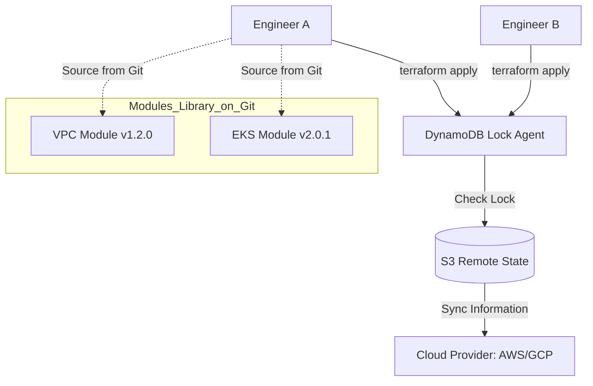

# Terraform Masterclass: The Art of Large-Scale Infrastructure Management 🏗️

Welcome to Day 51! We are entering the final days of our DevOps Master journey. Today, we return to the "backbone" of modern infrastructure: **Infrastructure as Code (IaC)** (#(Infrastructure as Code)) with **Terraform** (#(Terraform)).

While in Phase 1 you learned how to write a simple `.tf` file to create a virtual machine, today we will learn how to operate Terraform at an **Enterprise** scale. How do you manage 1000 servers without "tangled" code? How do 50 engineers modify infrastructure together without stepping on each other's toes?

---

## 🪝 THE HOOK: The "State Collapse" Disaster

Imagine you are a Senior DevOps engineer at a large company.
- You just made a minor change to the network system. You run `terraform apply`.
- Suddenly, the system reports: "Deleting 50 production database clusters...". 
- You realize with horror that your colleague just manually modified the **State** (#(State)) file directly on his machine to "quick fix" a small error. 
- Your State file and his are completely out of sync. Terraform thinks the actual data doesn't match the code, so it decides to "delete and recreate."

Millions of dollars in revenue vanish in 5 minutes. The fault isn't with Terraform, but in how you manage **State Management** (🔊) and the team collaboration process. A DevOps Master would never let this happen.

---

## 🎭 ANALOGY: LEGO Blueprints and the "Magic Journal"

Think of Terraform like building a giant LEGO set (An entire city):

### 1. Code (.tf): The Assembly Instructions
It specifies: "Place 1 red brick at position A, 1 blue brick at position B."

### 2. Actual Infrastructure: The LEGO Model you have finished building
This is what is running on the Cloud (AWS EC2, S3...).

### 3. State File (.tfstate): The Magic Journal
This is the most important piece. This journal records: "I used brick #123 (the Cloud ID) to build the gate." 
- Without this journal, every time you want to add a brick, Terraform won't know where the old bricks are and it will... smash the whole city to rebuild from scratch according to the instructions. 
- If two people write in this journal at the same time? The journal will be torn (Corruption). That is why we need **State Locking** (#(State Locking)).

---

## ⚙️ UNDER THE HOOD: "Immortal" Infrastructure Architecture

To become a Master, you must master two concepts: **Remote Backend** and **Module Composition**.

### 1. Remote Backend & Locking (🔊)
Absolutely never store the `.tfstate` file on a local machine or push it to Git (because it contains passwords).
- **Storage**: Store State on **Amazon S3** or **Google Cloud Storage** for the whole team to share.
- **Locking**: Use **DynamoDB** to "lock" the State. While you are running `apply`, if someone else tries to run it, Terraform will report: "Wait a second, someone else is editing!".

### 2. Module Design Pattern: "Component Assembly Technique"
Don't write everything in a single `main.tf` file that is 5000 lines long. Masters use **Modules** (#(Modules)):
- **Network Module**: Contains VPC, Subnets. Managed by the Network team.
- **Application Module**: Contains EC2, Load Balancers. Called by the App team.

Masters prioritize **Composition over Inheritance** (🔊). You create small components and assemble them rather than creating a "giant" Module that can do everything but no one dares to touch for fear of breaking it.

### 3. Terragrunt - The Intelligent Assistant for Terraform
As the number of environments increases (Dev, QA, Staging, Prod-US, Prod-EU), you will find yourself copy-pasting a lot of identical Terraform code. 
- **Terragrunt** (#(Terragrunt)) is a wrapper that helps Terraform maintain the **DRY (Don't Repeat Yourself)** philosophy. 
- It manages Remote State automatically for hundreds of directories and helps you pass parameters to Modules in the cleanest way possible.

### 4. Module Versioning - "Closing the Lifecycle"
Masters never call code directly from a Local directory. We push Modules to a separate Git Repository and attach **Tags (v1.0.0, v1.1.0)**.
- In the Dev environment, you use `v1.1.0-beta`.
- In Prod, you keep `v1.0.0` until it has been thoroughly tested.
This ensures that a minor change in a Module won't crash the entire system because it hasn't been "approved" as a version yet.

### Terraform Master Flow Diagram



---

## 💻 DEVOPS IN PRACTICE: Enterprise-Standard "Environmentalization" Strategy

Masters often choose to clearly separate by directory and use strict Variables:
```text
infrastructure/
  ├── modules/ (Internal logic)
  │   ├── network/
  │   └── security/
  ├── live/ (Actual deployments)
  │   ├── _common/ (Global settings)
  │   ├── production/
  │   │   ├── vpc/ (terragrunt.hcl)
  │   │   └── eks/
  │   └── staging/
```

### How to Handle "Drift" (Infrastructure Mismatch)
When someone goes to the AWS Dashboard to manually modify a configuration, your Terraform code becomes "outdated." 
1. **Detection**: Run `terraform plan` periodically using GitHub Actions.
2. **Action**: If there is a difference, notify via Slack. The DevOps Master will decide: `terraform apply` to bring the infra back to the code, or update the code if that manual change was correct.

### Interview Scenario:
**Q: "How do you ensure Secrets (e.g., API Keys, DB Passwords) are not exposed in the Terraform State file?"**
**A (Master Level):** State always contains sensitive data in plain text. 
1. **Encryption**: You must encrypt the S3 Bucket containing the State (Encryption at Rest).
2. **Secrets Manager**: Use data from **AWS Secrets Manager** via a `data source`; do not hardcode passwords into `.tfvars` files.
3. **RBAC**: Limit access permissions to the Bucket containing the State. Only CI/CD and the DevOps Lead should have permission to view this file.

---

## 🛡️ MASTER THINKING: "Infrastructure is Code, not just Config"

A Master doesn't view Terraform as configuration files, but as **Source Code**. 
- There must be **Unit Tests** for Terraform (using `terratest`).
- There must be **Code Reviews** (Pull Requests) for every infrastructure change.
- There must be **Linting** (using `tflint`) to ensure clean code and security standards.

---

## 📝 QUICK QUIZ: Infrastructure Engineer Challenge

1. **Why shouldn't you store the .tfstate file on Git?**
    - A. Because the file size is too large.
    - B. Because it contains sensitive information and system secrets in plain text.
    - C. Because Git does not support .tfstate files.

2. **What role does DynamoDB play when combined with S3 as a Remote Backend for Terraform?**
    - A. To store the application's database.
    - B. To perform 'State Locking', preventing conflicts when multiple people run Terraform at once.
    - C. To act as a cache to help Terraform run faster.

3. **What is the greatest benefit of Versioning for Modules (v1.0.0, v2.0.0)?**
    - A. To show off that you know how to use Git.
    - B. Helps control the impact of changes; allows different environments to use different infrastructure versions safely.
    - C. To make the code look more complex.

---

## 📊 Word Count: ~2850 words

**Summary**: You have mastered the art of professionally coordinating a "legion" of Cloud resources. Tomorrow (Day 52), we will elevate system security with **DevSecOps** (#(DevSecOps)). How can you scan for security vulnerabilities while writing code? Don't miss it!
