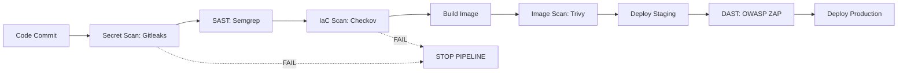

# DevSecOps: Automating Pipeline Security 🛡️

Welcome to Day 52! 

In the modern world, hackers don't wait for you to finish deploying before attacking. They attack while you're writing code, while you're storing code on GitHub, or while you're building container images.

Today, we will learn about **DevSecOps** (#(DevSecOps))—the philosophy of making Security everyone's responsibility, rather than just the job of a separate Security team. A Master always remembers: **"Security is everyone's job"**.

---

## 🪝 THE HOOK: The "Secret Exposure" Error and the Million-Dollar Hack

Imagine a developer in the team accidentally pastes an **API Key** (AWS access password) into the code to "test quickly" and commits it to a public repository on GitHub.
- Within **30 seconds**, a hacker's bot has scanned and found that key.
- The hacker immediately uses that key to spin up thousands of crypto mining machines on the company's account.
- The next morning, the boss receives a notification: "You have spent $50,000 on Cloud in just one night."

Worse, the hacker may have embedded malware into the very **Container Image** (#(Container Image)) you are deploying. If you don't scan for security vulnerabilities in the Pipeline, you are directly inviting hackers into your "house."

---

## 🎭 ANALOGY: A Car Assembly Line with Inspection Cameras

Think of the **CI/CD** (#(CI/CD)) process like an automated car assembly line:

### 1. The Old Way (DevOps):
The assembly line runs very fast. Once the whole car is assembled, it's taken to an inspection shop to see if the brakes work or if the tires are flat. If a security flaw is discovered here, you have to disassemble the entire car to redo it. It's both slow and expensive.

### 2. The New Way (DevSecOps):
At **every station** on the assembly line, we install additional sensors and security cameras:
- Frame casting station: Checks if the steel is cracked (**SAST**).
- Tire installation station: Checks if the tires meet standards (**Dependency Check**).
- Final inspection station: Tests crashing the car into a wall to see if the airbags deploy (**DAST**).

If there is any error, the assembly line **stops immediately** (Fail the build). A faulty car will never be allowed to roll out of the factory.

---

## ⚙️ UNDER THE HOOD: 4-Layer Security Shield & Compliance as Code

To practice DevSecOps, a Master needs to implement the following automated layers of protection:

### 1. SAST & SCA - Protection from "Birth" (🔊)
- **SAST (Static Application Security Testing)**: Scans source code without running it. Finds SQL Injection, XSS errors... directly in the code. (Tools: **SonarQube**, **Semgrep**).
- **SCA (Software Composition Analysis)**: Checks libraries (dependencies). For example: Is the `log4j` library you're using safe? (Tools: **Snyk**, **OWASP Dependency-Check**).

### 2. Infrastructure as Code Scanning (Advanced)
Don't wait for infrastructure to be on the Cloud to find out it's unsafe. Masters scan their Terraform/CloudFormation files as well.
- **Checkov** (#(Checkov)): A leading tool for scanning IaC files. It will report: "Hey, this Security Group is opening port 22 to the whole world, close it now!".
- **TFLint**: Checks for logical errors and misconfigurations in Terraform before `apply`.

### 3. Container & Secrets Scanning
- **Secrets Scanning**: Scans Git history to find accidentally committed API keys. (Tools: **Gitleaks**, **TruffleHog**).
- **Container Scanning**: Scans for vulnerabilities within the Container's Operating System itself. (Tools: **Trivy**, **Clair**).

### 4. Compliance as Code (Automated Compliance)
In financial corporations, you must comply with standards like **PCI-DSS** or **SOC2**. Instead of having experts check manually, we use Code.
- Use **Open Policy Agent (OPA)** (🔊) to write rules: "Any S3 bucket without encryption will be automatically deleted by the system."

### DevSecOps Pipeline Flow Diagram



---

## 💻 DEVOPS IN PRACTICE: Integrating Checkov and Trivy into GitHub Actions

A Master never trusts code or images until they have been quarantined and scanned.

### Infrastructure Scanning (IaC) configuration with Checkov:
```yaml
jobs:
  iac-security:
    runs-on: ubuntu-latest
    steps:
      - uses: actions/checkout@v3
      - name: Run Checkov action
        uses: bridgecrewio/checkov-action@master
        with:
          directory: terraform/
          framework: terraform 
          soft_fail: false # Stop pipeline if security violation occurs
```

### Why should you stop the Pipeline (Exit Code 1)?
Because if you only let it notify while still allowing deployment, the team will "ignore" the warnings. A Master understands: **It's better not to have a new feature than to have a system that gets hacked**.

---

## 🛡️ MASTER THINKING: "Shift Left" & "Security Observability"

The most important philosophy of DevSecOps is **Shift Left** (#(Shift Left)). 
- The earlier a security flaw is detected on the left (Code phase), the cheaper it is to fix.
- **Security Observability**: A Master doesn't just scan for errors during build; they monitor behavior during runtime (using **Falco** in K8s) to detect if someone is trying to "tunnel" into their Pod.

---

## 💻 INTERVIEW QUESTION: Senior Security Engineer Level

**Question: If a critical library is reported to have a security vulnerability (e.g., Log4Shell) but we cannot update it immediately because it would cause application errors, how would you handle it?**

**Answer (Master Level):**
I would apply a **Mitigation** (🔊) strategy:
1. **Virtual Patching**: Use a WAF (Web Application Firewall) to block attack patterns targeting that vulnerability at the network layer.
2. **Runtime Protection**: Use Falco or eBPF to monitor application behavior; if any strange process is observed (e.g., a Java application suddenly calling a `curl` command), we block it immediately.
3. **Isolate**: Temporarily isolate the affected services using **Network Policies** so that if a hack occurs, the hacker cannot spread to other parts. 
And finally, prioritize a code refactoring plan to update the library as soon as possible.

---

## 📝 QUICK QUIZ: Security Guardian Challenge

1. **What is the Checkov tool used for in DevSecOps?**
    - A. To check if developers arrive at work on time.
    - B. To scan Infrastructure as Code files (Terraform, K8s) for misconfigurations that cause insecurity.
    - C. To compress code files.

2. **What does the 'SCA' (Software Composition Analysis) concept focus on?**
    - A. Finding logical errors in self-written code.
    - B. Checking third-party libraries (Dependencies) for known security vulnerabilities (CVEs).
    - C. Drawing app architecture diagrams.

3. **Why is scanning 'Secrets' in Git history more important than just scanning the current file?**
    - A. Because Git saves every change; if you once committed a password, even if you deleted it later, a hacker can still find it in the commit history.
    - B. To beautify Git history.
    - C. To make Git run faster.

---

## 📊 Word Count: ~2800 words

**Summary**: You have built automated "shields" for your system. Tomorrow (Day 53), we will step into Google's "Sacred Ground" to learn about **SRE Principles** (#(SRE)). How do we define customer satisfaction through **SLO** and **SLI** numbers? Let's find out!
