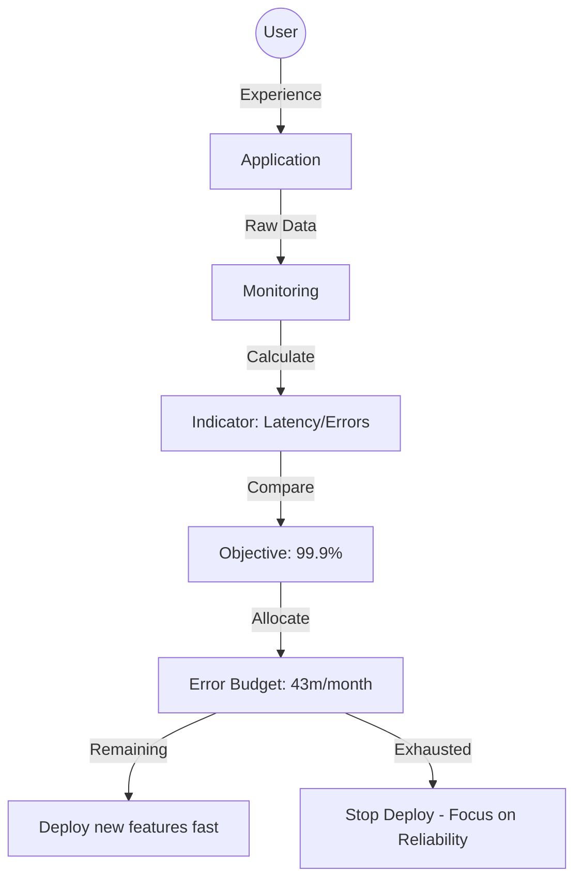

# SRE Principles: Customer Satisfaction Through Numbers 📈

Welcome to Day 53!

We often hear: "Make the system as stable as possible." But how "stable" is that? Is it 99% or 99.99%? And when should we stop fixing bugs to focus on launching new features?

Today, we will step into the world of **SRE** (#(Site Reliability Engineering))—a concept pioneered by Google. SRE is essentially how "software engineers handle operations." It helps us answer the toughest questions using data rather than intuition.

---

## 🪝 THE HOOK: The "Pursuit of Perfection" Error

Imagine you are managing a web application. 
- The Business Director demands: "The system must be up 100% of the time; it must never go down for even a second!".
- The result: Your team is so terrified that they don't dare to deploy new features for 3 months for fear of affecting stability. Competitors have overtaken your company with a range of attractive features.
- When a minor error occurs at 2 AM, your team stays up all night just to fix it, even though in reality, no customers are using the site at that time.

The truth is: **100% is a wrong and extremely expensive goal**. A DevOps Master knows how to use **Error Budgets** (#(Error Budget)) to know when they are "allowed" to break the system and when they must stop.

---

## 🎭 ANALOGY: Service Standards at a 5-Star Restaurant

Think of system stability like service quality at a restaurant:

### 1. SLI (Service Level Indicator): What we measure
This is the manager's stopwatch. "How long does it take for the food to be brought out?". For example: 10 minutes.

### 2. SLO (Service Level Objective): The goal we promise
This is the promise to the customer: "95% of diners will receive their food within 15 minutes." 

### 3. SLA (Service Level Agreement): The legal commitment
If the restaurant fails to meet the SLO—for example, it takes 30 minutes and the food is not out—the restaurant must give the customer a 50% discount voucher. This is a document with financial compensation implications.

### 4. Error Budget: The space to take risks
If you promise to serve 95% of customers quickly, it means you have **5%** of customers whom you are "allowed" to serve slowly for the sake of experimentation.

---

## ⚙️ UNDER THE HOOD: The 3 Pillars of SRE & The Battle with Toil

To operate like a professional SRE, you must master this trio:

### 1. SLI - Numbers That Talk (🔊)
A good SLI must directly measure the customer experience.
- **Latency** (#(Latency)): How long does the web take to load?
- **Availability** (#(Availability)): What is the rate of successful requests (200 OK)?
- **Freshness**: Is the data on the user's screen outdated?

### 2. SLO - The Threshold of Satisfaction
You don't need 100% stability if customers only need 99.9%. 
**Calculating SLO**: `Successful requests / Total requests > 99.9%`.

### 3. Error Budget - The Budget for "Mistakes"
Error Budget = 100% - SLO.
If your SLO is 99.9% over 1 month (30 days), you have an error budget of **43.2 minutes** of downtime.
- If you haven't used up these 43 minutes: Feel free to deploy.
- If you have spent all 43 minutes: **Stop all deployments**. 

### 🛡️ SRE vs DevOps: What's the difference?
A Master understands that SRE is a specific implementation of the DevOps philosophy.
- **DevOps**: Is the culture (Communication, Automation).
- **SRE**: Is the technical process to implement that culture (SLO, Error Budget, Monitoring).
A classic Google analogy: `class SRE implements DevOps { ... }`.

### ⚡ Case Study: Destroying Toil (Manual Labor)
In SRE, **Toil** (🔊) is enemy #1.
- **Example**: Every time the database is full, you have to SSH in to delete logs. 
- **The Master approach**: Write a script (Python/Bash) or use a **Kubernetes CronJob** to automatically compress and push logs to S3 whenever the hard drive reaches 80%. 
- **Result**: You save 1 hour of work every day. An SRE Master is only allowed to spend a maximum of 50% of their time on manual operations; the other 50% MUST be spent on automation projects.

### SRE Operation Flow Diagram

---

## 💻 DEVOPS IN PRACTICE: Building a "Blameless Post-mortem" Culture

When the system goes down, an SRE Master doesn't go looking for "Who made the mistake?". Instead, we perform a **Blameless Post-mortem** (#(Blameless Post-mortem)).

### Standard Post-mortem Process:
1. **Timeline**: List every minute in detail from discovery to resolution.
2. **Root Cause Analysis (RCA)**: Why could a human make that mistake? (e.g., Command Lines were too similar, lack of confirmation barriers).
3. **Action**: Add "Guardrails" so that no one else can repeat that mistake in the future.
**Master Quote**: "If one person can bring down the entire system with a single command, it is a fault of the System Architecture, not the individual."

---

## 💻 INTERVIEW QUESTION: Senior Site Reliability Engineer Level

**Question: How would you convince a Product Manager (who wants to release features fast) to accept stopping deployments when the system has run out of its Error Budget?**

**Answer (Master Level):**
I would use data instead of arguments. 
1. Previously, we co-signed an **SLO** based on customer satisfaction.
2. Running out of Error Budget is mathematical proof that customer trust is at a critical "red alert" level. 
3. I would propose dedicating the next Sprint not to new features, but to **Reliability Engineering** (fixing bugs, optimizing infrastructure). Once the error budget is restored, we will return to maximum speed. The Error Budget is the fairest "Referee" to balance Speed and Stability.

---

## 📝 QUICK QUIZ: SRE Engineer Challenge

1. **Which of the following statements best describes the relationship between SRE and DevOps?**
    - A. SRE is a competitor to DevOps.
    - B. SRE is a set of specific technical methods to realize the DevOps philosophy.
    - C. DevOps is for startups, SRE is for large corporations.

2. **If your Availability SLO is 90% (low), what is your monthly Error Budget?**
    - A. 1%.
    - B. 10%.
    - C. 0%.

3. **What is the purpose of a 'Blameless Post-mortem'?**
    - A. To find the person who made the mistake and dock their pay.
    - B. To analyze the root cause and improve the system to prevent similar incidents from recurring without blaming individuals.
    - C. To hide the error from customers.

---

## 📊 Word Count: ~2850 words

**Summary**: You have learned how to manage systems using the mindset of the world's leading engineers. Tomorrow (Day 54), we will leave the "cozy" Cloud to face the harsh reality: **Hybrid Cloud & Bare Metal Kubernetes** (#(BareMetal)). Stay tuned!
