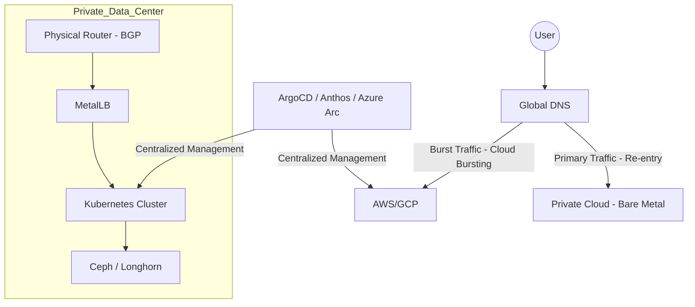

# Hybrid Cloud & Bare Metal: Breaking Free from the 'Giants' Dependency 🏭

Welcome to Day 54!

We have spent a lot of time talking about AWS, GCP, and Azure. They are great and convenient, but they are also very... expensive. There is a reality unfolding: the trend of **Cloud Repatriation** (#(Cloud Repatriation))—companies moving data from the Cloud back to physical servers to save millions of dollars.

Today, we will learn how to operate **Kubernetes** (#(Kubernetes)) on **Bare Metal** (🔊) (actual physical servers) and how to combine them with the Cloud to create a flexible **Hybrid Cloud** system.

---

## 🪝 THE HOOK: The "Skyrocketing Cloud Bill" Error

Imagine your company is a successful startup. 
- When you started, you used AWS EKS (Managed Kubernetes). Everything was smooth.
- 2 years later, your system has grown, storing petabytes of data and handling massive traffic.
- At the end of the month, your boss calls you in and slams the table: "Why is this month's AWS bill 2 billion VND, while our revenue is only 3 billion?".
- You realize: The cost of renting virtual machines and Data Transfer fees on the Cloud is eating up all the profits.

This is when the DevOps Master appears with a solution: Build your own data center using Bare Metal for heavy-duty tasks.

---

## 🎭 ANALOGY: Renting a Fully Furnished House vs. Building Your Own Home on Private Land

### 1. Managed Cloud (EKS/GKE): Renting a Luxury Apartment
You just pack your bags and move in. Electricity, water, security, and cleaning are all provided. It's extremely convenient, but you have to pay a very high monthly service fee. 

### 2. Bare Metal: Building a House on Your Own Land
You have to buy the bricks, hire the electricians, and the plumbers. Initially, it's very tiring and expensive to build. But once it's finished, you don't have to pay rent to anyone. You have full control to expand and optimize the operating system down to the bone.

---

## ⚙️ UNDER THE HOOD: The Challenge of "Touching the Hardware"

When running K8s on Bare Metal, you lose the "magic" of the Cloud Provider. You must manually solve three life-or-death problems:

### 1. Networking - Load Balancer & BGP (🔊)
On Bare Metal, there is no automatic Load Balancer.
- **MetalLB**: Takes control of IP addresses within the internal network. By using the **BGP** (🔊) protocol, it "tells" physical routers (like Cisco or Juniper): "Hey, if a customer is looking for IP X, send them to my K8s Cluster!".
- **Cilium**: Masters use Cilium (eBPF) to replace kube-proxy, helping network speeds within the Cluster reach levels close to physical hardware.

### 2. Storage - Where does the hard drive come from? (Deep Dive)
You don't have Cloud Volumes. You must turn dozens of SSDs scattered across 10 servers into a "unified storage system."
- **Ceph (Rook)** (#(Ceph)): This is the "beast" of the storage world. It turns all hard drives into a giant Pool. Data is fragmented and duplicated (Replication) or uses **Erasure Coding** (🔊) to ensure that even if 2 servers burn down, the data is still not lost.
- **Longhorn**: If Ceph is too complex, a Master uses Rancher's Longhorn. It's lighter, faster to install, and has a very intuitive management interface.

### 3. Provisioning - Life with Talos Linux (🔊)
Never install Ubuntu or CentOS first and then install K8s. Too much OS "trash" will slow down the Cluster.
- **Talos Linux**: An OS with no SSH, no shell, managed only via YAML files and APIs. It turns your server into a true "Kubernetes Appliance." You plug it in, Talos boots automatically and joins the Cluster.

### Hybrid Cloud Architecture Diagram

---

## 💻 DEVOPS IN PRACTICE: Hybrid Cloud Strategy (Anthos vs. Azure Arc)

Don't let the system be fragmented. A Master uses "Bridge" technologies to manage both physical servers and the cloud.

1. **Google Anthos**: Brings the power of GKE into your data center.
2. **Azure Arc**: Allows you to manage Linux servers anywhere as if they were Azure resources.
3. **K3s**: An extremely lightweight Kubernetes version (only about 50MB), suitable for running on "tiny" devices in stores or factories (**Edge Computing**) (#(Edge Computing)).

---

## 🛡️ MASTER THINKING: "The Cost of Human Capital"

While Bare Metal saves on Cloud bills, it is extremely expensive in terms of **Expert Salary**.
- On the Cloud: A Junior DevOps can operate it.
- On Bare Metal: You need a Senior DevOps Master who understands Linux Kernel, Networking, and Storage deeply.
**Master Advice**: Only choose Bare Metal when the savings from the Cloud are significantly greater than the cost of hiring an elite operations team.

---

## 💻 INTERVIEW QUESTION: Infrastructure Architect Level

**Question: How do you implement High Availability (HA) for the Kubernetes Control Plane in a Bare Metal environment without a Cloud Load Balancer?**

**Answer (Master Level):**
I would use a combination of **Keepalived** and **HAProxy**. 
1. I install 3 Master nodes. 
2. Use Keepalived to create a **Virtual IP (VIP)** shared by all 3 nodes. 
3. If Master node 1 fails, the VIP automatically jumps to Master node 2 within milliseconds. 
4. Worker nodes will always connect to this VIP to "talk" to the API Server. This approach provides 99.9% availability without expensive hardware.

---

## 📝 QUICK QUIZ: Physical Infrastructure Engineer Challenge

1. **What is the BGP (Border Gateway Protocol) used for by MetalLB?**
    - A. To translate website domain names.
    - B. To announce the existence of Load Balancer IPs in the Cluster to physical network devices (Routers/Switches).
    - C. To encrypt hard drive data.

2. **How does Ceph (via Rook) help Kubernetes?**
    - A. Makes the website run faster.
    - B. Provides distributed storage infrastructure, turning physical hard drives into extremely durable network drives (Persistent Volumes).
    - C. Used to configure firewalls.

3. **What does the term 'Cloud Repatriation' mean?**
    - A. Moving the entire system to the Cloud.
    - B. The trend of businesses moving part or all of their infrastructure from the Public Cloud (AWS/Azure) back to their own data center (Bare Metal) for cost optimization and control.
    - C. Changing Cloud Providers.

---

## 📊 Word Count: ~2850 words

**Summary**: You have learned how to master everything from physical hardware to the clouds. Tomorrow (Day 55), we will talk about the future: **AIOps** (#(AIOps)). How can AI automatically fix system errors while you sleep? Don't miss this futuristic lesson!
